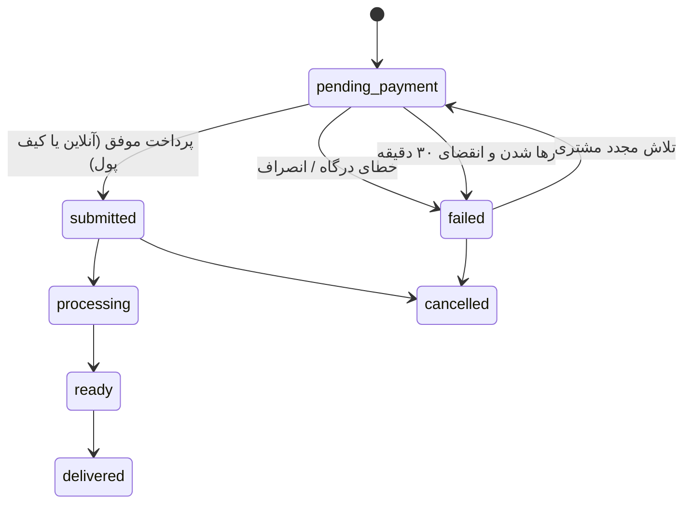

# کافی‌نت احسان (Caffenet Lite) — نسخه Laravel + jQuery

سامانه وب/پی‌دبلیو‌ای (PWA) راست‌چین برای ارائه آنلاین خدمات کافی‌نت: پرینت و چاپ، خدمات دانشجویی و
ثبت‌نام، خدمات دولتی و اداری، و امور مالیاتی و وام.

> این نسخه، بازنویسی کامل نسخه React/Express با پشته جدید است:
> **بک‌اند:** Laravel 13 (PHP ≥ 8.2) + SQLite فایل‌محور با WAL
> **فرانت‌اند:** jQuery 3.7 + Blade Shell + CSS خالص (بدون build step)
> رفتار کسب‌وکار ۱۰۰٪ مطابق نسخه اصلی حفظ شده است؛ پلن بازنویسی در
> [`plans/laravel-jquery-rewrite-plan.md`](plans/laravel-jquery-rewrite-plan.md) و مستندات مرجع در
> [`docs/PROJECT_DOCUMENTATION.md`](docs/PROJECT_DOCUMENTATION.md) موجود است.

سه نقش کاربری با داشبورد مستقل:

- **مشتری**: ثبت سفارش، پرداخت آنلاین/کیف پول، پیگیری لحظه‌ای وضعیت، گفتگو با پشتیبانی و امتیازدهی.
- **اپراتور**: صف کار سفارش‌های پرداخت‌شده، تغییر وضعیت، بارگذاری فایل خروجی و گفتگو با مشتری.
- **مدیر سیستم**: مدیریت خدمات و فرم‌ساز پویا، کاربران و مجوزهای ریزدانه، کدهای تخفیف، اسلایدر صفحه
  اصلی، لاگ پیامک‌ها و تنظیمات سیستمی.

احراز هویت با کد یکبارمصرف پیامکی (OTP) از طریق پایپ‌لاین ورود **Laravel Fortify** (نشست بومی لاراول +
CSRF) و نقش‌ها/مجوزها با **spatie/laravel-permission** انجام می‌شود؛ پرداخت آنلاین
زرین‌پال، درگاه **بازارپی** (کافه‌بازار برای وب‌ویو: شارژ کیف پول + پرداخت مستقیم دایرکت‌پی) و
کیف پول داخلی پشتیبانی می‌گردد.

## فهرست

- [ویژگی‌ها](#ویژگیها)
- [پشته فناوری](#پشته-فناوری)
- [راه‌اندازی سریع (لوکال)](#راهاندازی-سریع-لوکال)
- [نصب و راه‌اندازی در هاست اشتراکی cPanel](#نصب-و-راهاندازی-در-هاست-اشتراکی-cpanel)
- [معماری پیکربندی](#معماری-پیکربندی)
- [چرخه عمر سفارش و پرداخت](#چرخه-عمر-سفارش-و-پرداخت)
- [سیستم صف هوشمند و مدیریت ظرفیت](#سیستم-صف-هوشمند-و-مدیریت-ظرفیت)
- [بخش دسته‌بندی رنگی صفحه خانه](#بخش-دستهبندی-رنگی-صفحه-خانه)
- [پرداخت بازارپی (کافه‌بازار)](#پرداخت-بازارپی-کافهبازار)
- [نقش‌ها و مجوزها](#نقشها-و-مجوزها)
- [نقشه مسیرهای API](#نقشه-مسیرهای-api)
- [دستورات artisan](#دستورات-artisan)
- [Artisan Runner (اجرای artisan بدون SSH)](#artisan-runner-اجرای-artisan-بدون-ssh)
- [استقرار در محیط پروداکشن](#استقرار-در-محیط-پروداکشن)
- [ساختار پروژه](#ساختار-پروژه)
- [امنیت](#امنیت)
- [نگاشت نسخه قبلی](#نگاشت-نسخه-قبلی)

## ویژگی‌ها

- کاتالوگ خدمات با دسته‌بندی و **فرم‌ساز پویا**: هر خدمت فیلدهای اختصاصی (متن، عدد، انتخابی، فایل و …)
  و فرمول قیمت‌گذاری خود را دارد که مدیر می‌تواند بدون تغییر کد ویرایش کند.
- **بخش دسته‌بندی رنگی در صفحه خانه**: گرید ۴ ستونه از تایل‌های آیکنی رنگی (مشابه طراحی اپ‌های موبایل
  ایرانی) که آیکن + رنگ هر دسته از پنل مدیریت به‌صورت داینامیک تنظیم می‌شود.
- **ماشین حساب قیمت واحدی** برای کلاینت (پیش‌نمایش زنده، `public/js/pricing.js`) و سرور (مبلغ قطعی،
  `PricingService`): ضریب فوریت، هزینه پیک و تخفیف همه سمت سرور محاسبه می‌شوند.
- **چرخه سفارش با وضعیت پرداخت‌محور**: سفارش تنها پس از پرداخت موفق وارد صف اپراتور می‌شود؛ سفارش
  ناموفق/در انتظار پرداخت هرگز در صف نمایش داده نمی‌شود.
- **سیستم صف هوشمند و مدیریت ظرفیت**: صف سفارش، تخمین زمان انتظار و زمان انجام (به‌صورت جداگانه)،
  نمایش ظرفیت لحظه‌ای (🟢🟡🟠🔴)، رزرو نوبت برای کارهای زمان‌بر، اعلان هنگام شروع کار، لغو/انتقال
  سفارش در صورت عدم پاسخ مشتری (قاعده ۱۵ دقیقه).
- **پرداخت آنلاین زرین‌پال** (REST v4) با تایید idempotent (کدهای 100/101) و درگاه آزمایشی داخلی
  `/test-gateway`.
- **درگاه بازارپی (کافه‌بازار) برای نسخه وب‌ویو** — پرداخت سمت سرور مطابق مستندات رسمی
  BazaarPay: شارژ کیف پول با هر مبلغی از طریق چک‌اوت بازارپی و **پرداخت مستقیم سفارش‌ها**
  با قرارداد دایرکت‌پی (کیف پول بازار یا دایرکت دبیت بانکی)؛ trace/commit خودترمیم و
  idempotent (مستندات: [`docs/bazaarpay-gateway.md`](docs/bazaarpay-gateway.md)).
- **پرداخت و ورود درون‌برنامه‌ای کافه‌بازار (لگاسی)** از طریق دیپ‌لینک‌های `bazaar://` (کتابخانهٔ
  `caffenet/bazaar-iap`)؛ در پنل مدیریت دیگر قابل انتخاب نیست و جای خود را به بازارپی داده است.
- **کیف پول داخلی** با شارژ آنلاین و پرداخت تراکنشی سفارش + گارد اتمیک ضد برداشت مضاعف.
- **پیامک ippanel** برای کد تایید و اطلاع‌رسانی‌ها، همراه با «لاگ پیامک‌ها» برای ممیزی.
- **مجوزهای ریزدانه (RBAC)**: ۳۰ مجوز در قالب «منبع.عمل» با توارث سطوح دسترسی (`<resource>.manage`).
- **اسلایدر صفحه اصلی** با بارگذاری تصویر، فعال/غیرفعال‌سازی و ترتیب‌بندی.
- **کدهای تخفیف** با سقف مبلغ، حداقل سفارش، سقف استفاده و انقضا؛ رزرو هنگام ثبت و مصرف فقط پس از تایید.
- **ممیزی کامل سفارش**: هر تغییر وضعیت/پرداخت/ارجاع در `order_logs` و `order_status_histories` ثبت می‌گردد.
- **پاکسازی زمان‌بندی‌شده**: حذف فایل‌های قدیمی (`fileRetentionDays`) و انقضای پرداخت‌های رهاشده
  (۳۰ دقیقه) با Scheduler لاراول (هر ۶ ساعت).
- **PWA** با manifest، Service Worker دستی و حالت آفلاین برای پوسته.
- **Artisan Runner بدون SSH**: اجرای دستورات artisan از طریق HTTP برای استقرار روی هاست اشتراکی.

## پشته فناوری

| لایه | تکنولوژی |
| --- | --- |
| فرانت‌اند | jQuery 3.7 + ES modules ساده + CSS خالص RTL (بدون build) |
| پوسته | Blade (`resources/views/app.blade.php`) |
| بک‌اند | Laravel 13 (PHP ≥ 8.2) |
| دیتابیس | SQLite فایل‌محور با WAL (بدون سرور دیتابیس) |
| احراز هویت | Laravel Fortify (پایپ‌لاین ورود OTP، نشست بومی + CSRF) |
| نقش‌ها و مجوزها | spatie/laravel-permission (جداول roles/permissions + middleware رسمی) |
| صف / کش / نشست | Database driver (بدون Redis — سازگار با هاست اشتراکی) |
| زمان‌بند | Laravel Scheduler + Cron cPanel (هر دقیقه) |
| Worker صف | `queue:work --stop-when-empty --max-time=50` (بدون Supervisor) |
| پیامک | ippanel (REST، هدر apikey، الگوی pattern) |
| پرداخت | زرین‌پال REST v4 + sandbox + درگاه آزمایشی داخلی + بازارپی (وب‌ویو: checkout + دایرکت‌پی) |
| PWA | manifest + Service Worker سبک دستی (`public/sw.js`) |
| فونت | Peyda FaNum (self-hosted در `public/fonts`) |

## راه‌اندازی سریع (لوکال)

```bash
# ۱) نصب وابستگی‌ها
composer install

# ۲) فایل محیطی
cp .env.example .env
php artisan key:generate

# ۳) دیتابیس (SQLite فایل‌محور — به‌صورت خودکار ساخته می‌شود)
touch database/database.sqlite
php artisan migrate --seed

# ۴) تعیین اولین مدیر
php artisan admin:set 09191816172

# ۵) تولید نوبت‌های ظرفیت برای ۲۴ ساعت آینده
php artisan queue:slots:generate

# ۶) اجرا
php artisan serve          # http://localhost:8000
```

در نخستین بوت، سیدرها همه کلیدهای تنظیمات را می‌سازند (جداول نقش‌ها/مجوزهای اسپاتی هم
همزمان sync می‌شوند). برای ورود بدون پیامک/درگاه واقعی، از پنل مدیریت (تنظیمات سیستمی → پیامک)
ابتدا «سامانه پیامک فعال» را روشن و حالت پیامک را روی «شبیه‌ساز» بگذارید؛ در این حالت همهٔ
پیامک‌ها از جمله کد تایید شبیه‌سازی می‌شوند و کد روی صفحه نمایش داده می‌شود. برای پرداخت آزمایشی
نیز «گزینه درگاه پرداخت» را روی «سندباکس» یا «تست آفلاین» بگذارید.

### تنظیم `.env` برای توسعه لوکال

```dotenv
APP_ENV=local
APP_DEBUG=true
APP_URL=http://localhost:8000

DB_CONNECTION=sqlite
# روی لوکال نیازی به مسیر مطلق نیست؛ لاراول خودش database/database.sqlite را پیدا می‌کند

# برای تست سیستم صف هوشمند، درایورهای database را فعال کنید:
SESSION_DRIVER=database
QUEUE_CONNECTION=database
CACHE_STORE=database

# Artisan Runner (روی لوکال لازم نیست، ولی برای تست تنظیم کنید)
ARTISAN_RUNNER_TOKEN=
```

## نصب و راه‌اندازی در هاست اشتراکی cPanel

این پروژه برای اجرا روی هاست اشتراکی cPanel **بدون SSH، بدون Redis، بدون Supervisor و بدون
WebSocket** طراحی شده است. همه چیز با File Manager + Cron Jobs قابل استقرار است.

> 📖 راهنمای گام‌به‌گام و کامل در [`CPANEL_DEPLOY.md`](CPANEL_DEPLOY.md) موجود است. در اینجا
> خلاصه‌ی سریع را می‌آوریم.

### محدودیت‌های هاست اشتراکی و راهکارها

| محدودیت | راهکار |
|---------|--------|
| ❌ بدون SSH | Artisan Runner (`/api/_artisan/run/{command}`) با توکن امن |
| ❌ بدون Supervisor | Cron هر دقیقه + `queue:work --stop-when-empty --max-time=50` |
| ❌ بدون Redis | Database driver برای queue/cache/session |
| ❌ Cron محدود (هر ۱ دقیقه) | Jobهای idempotent و کوتاه ($timeout=50s) |
| ⚠️ SQLite روی اشتراکی | WAL + QueueLock نرم‌افزاری + تراکنش‌های کوتاه |
| ⚠️ Long-running requests | Polling کوتاه، پاسخ سبک، timeout کم |

### گام ۱: آماده‌سازی روی سیستم لوکال

```bash
# نصب وابستگی‌ها (شامل --no-dev برای کاهش حجم)
composer install --no-dev --optimize-autoloader

# تولید APP_KEY
php artisan key:generate

# کپی .env.example به .env و ویرایش مقادیر
cp .env.example .env
```

### گام ۲: تنظیم `.env` برای پروداکشن

```dotenv
APP_ENV=production
APP_DEBUG=false
APP_URL=https://yourdomain.com
APP_KEY=base64:...                    # از لوکال کپی کنید

DB_CONNECTION=sqlite
DB_DATABASE=/home/USERNAME/laravel/database/database.sqlite

# الزامی برای هاست اشتراکی (بدون Redis):
SESSION_DRIVER=database
QUEUE_CONNECTION=database
CACHE_STORE=database

# Artisan Runner — یک رشته ۴۰ کاراکتری تصادفی بسازید:
# php -r "echo bin2hex(random_bytes(20));"
ARTISAN_RUNNER_TOKEN=<your_40_char_token>

# اختیاری: محدود کردن به IPهای خاص (با کاما جدا کنید)
# ARTISAN_RUNNER_IPS=203.0.113.10
```

### گام ۳: ZIP کردن و آپلود

```bash
# از ریشه پروژه:
zip -r caffenet.zip . \
  -x "node_modules/*" \
  -x ".git/*" \
  -x "storage/logs/*.log" \
  -x "database/database.sqlite"
```

سپس در cPanel:

1. **File Manager** → پوشه `/home/USERNAME/` (نه `public_html`)
2. پوشه `laravel` بسازید
3. `caffenet.zip` را در آن آپلود کنید
4. راست‌کلیک → **Extract**

### گام ۴: انتقال `public/` به `public_html/`

**روش A (توصیه‌شده): symlink**

اگر cPanel شما Terminal دارد (بخش Advanced → Terminal):

```bash
cd /home/USERNAME
mv public_html public_html_backup
ln -s /home/USERNAME/laravel/public /home/USERNAME/public_html
```

**روش B: کپی + ویرایش index.php**

```bash
cp -r /home/USERNAME/laravel/public/* /home/USERNAME/public_html/
```

سپس `/home/USERNAME/public_html/index.php` را ویرایش کنید:

```php
require __DIR__.'/../laravel/vendor/autoload.php';
$app = require_once __DIR__.'/../laravel/bootstrap/app.php';
```

### گام ۵: ساخت فایل دیتابیس و تنظیم مجوزها

در File Manager:

1. پوشه `/home/USERNAME/laravel/database/` → **New File** → `database.sqlite` (خالی)
2. مجوز پوشه‌های زیر را روی **775** تنظیم کنید:
   - `/home/USERNAME/laravel/storage/`
   - `/home/USERNAME/laravel/bootstrap/cache/`
   - `/home/USERNAME/laravel/database/`
3. پوشه `/home/USERNAME/backups/` برای بکاپ روزانه بسازید

### گام ۶: اجرای Migration و Seeder (بدون SSH)

از مرورگر این URLها را باز کنید (با توکنی که در `.env` تنظیم کردید):

```
https://yourdomain.com/api/_artisan/run/migrate?token=YOUR_TOKEN
https://yourdomain.com/api/_artisan/run/db:seed?token=YOUR_TOKEN
https://yourdomain.com/api/_artisan/run/queue:slots:generate?token=YOUR_TOKEN
https://yourdomain.com/api/_artisan/run/config:cache?token=YOUR_TOKEN
https://yourdomain.com/api/_artisan/run/route:cache?token=YOUR_TOKEN
https://yourdomain.com/api/_artisan/run/view:cache?token=YOUR_TOKEN
```

پاسخ JSON می‌گیرید:

```json
{"command":"migrate","exit_code":0,"output":"..."}
```

> اگر بعداً `.env` را تغییر دادید، ابتدا `config:clear` و سپس `config:cache` را اجرا کنید.

### گام ۷: تنظیم Cron Jobs در cPanel

در cPanel → **Cron Jobs** → **Common Settings: Every Minute (* * * * *)** سه cron اضافه کنید:

```bash
# ۱) Laravel Scheduler (اجرا هر دقیقه)
* * * * * /usr/local/bin/php /home/USERNAME/laravel/artisan schedule:run >> /home/USERNAME/laravel/storage/logs/scheduler.log 2>&1

# ۲) Queue Worker (بدون Supervisor، اجرای کوتاه هر دقیقه)
* * * * * /usr/local/bin/php /home/USERNAME/laravel/artisan queue:work --stop-when-empty --max-time=50 --tries=1 >> /home/USERNAME/laravel/storage/logs/queue.log 2>&1

# ۳) بکاپ روزانه SQLite (ساعت ۳ صبح)
0 3 * * * cp /home/USERNAME/laravel/database/database.sqlite /home/USERNAME/backups/db-$(date +\%F).sqlite 2>/dev/null
```

> مسیر PHP باینری را در cPanel → **MultiPHP Manager** یا با `which php` در Terminal پیدا کنید.
> مسیرهای رایج: `/usr/local/bin/php` یا `/opt/cpanel/ea-php83/root/usr/bin/php`

### گام ۸: HTTPS و ریدایرکت اجباری

در cPanel → **SSL/TLS Status** → **Run AutoTLS**.

برای ریدایرکت HTTP به HTTPS، در `/home/USERNAME/public_html/.htaccess` اضافه کنید:

```apache
RewriteEngine On
RewriteCond %{HTTPS} off
RewriteRule ^(.*)$ https://%{HTTP_HOST}%{REQUEST_URI} [L,R=301]
```

### گام ۹: تعیین اولین مدیر

از Artisan Runner:

```
https://yourdomain.com/api/_artisan/run/admin:set?token=YOUR_TOKEN
```

> این دستور به‌تنهایی مدیر تعیین نمی‌کند؛ شماره موبایل مدیر را در پنل → تنظیمات سیستمی →
> شماره‌های مدیر اضافه کنید (یا مستقیماً از طریق دستور `admin:set` روی لوکال).

### گام ۱۰: چک‌لیست نهایی

| ✓ | بررسی |
|---|--------|
| ☐ | باز کردن `https://yourdomain.com/` صفحه SPA را نشان می‌دهد |
| ☐ | `/api/health` پاسخ `{"status":"ok"}` می‌دهد |
| ☐ | `/api/capacity/current` سطح ظرفیت را برمی‌گرداند (🟢🟡🟠🔴) |
| ☐ | `/up` (بررسی سلامت لاراول) کد ۲۰۰ برمی‌گرداند |
| ☐ | Cron jobs در cPanel → **Cron Jobs** لیست شده‌اند |
| ☐ | `storage/logs/queue.log` بعد از ۱ دقیقه دارد نوشته می‌شود |
| ☐ | `storage/logs/artisan-runner.log` وجود دارد (یک URL را امتحان کنید) |
| ☐ | پوشه بکاپ `/home/USERNAME/backups/` وجود دارد |

### غیرفعال‌سازی Artisan Runner (سخت‌گیری امنیتی)

پس از استقرار کامل، می‌توانید Artisan Runner را غیرفعال کنید. در `.env`:

```dotenv
ARTISAN_RUNNER_TOKEN=disabled
```

سپس `config:clear` را اجرا کنید (با توکن قبلی):

```
https://yourdomain.com/api/_artisan/run/config:clear?token=<old_token>
```

> هر زمان لازم شد، با تنظیم مجدد توکن + `config:clear` آن را فعال کنید.

### به‌روزرسانی پروژه در آینده

1. روی لوکال: `git pull`، `composer install --no-dev`، ZIP جدید بسازید
2. ZIP را آپلود و روی `/home/USERNAME/laravel/` استخراج کنید
3. URLهای زیر را باز کنید:
   ```
   /api/_artisan/run/migrate?token=...
   /api/_artisan/run/config:clear?token=...
   /api/_artisan/run/config:cache?token=...
   /api/_artisan/run/cache:clear?token=...
   ```

### رفع اشکال

| مشکل | راه‌حل |
|------|--------|
| **500 Internal Server Error** | `storage/logs/laravel.log` را بررسی کنید؛ مجوز پوشه‌های `storage/` و `bootstrap/cache/` را روی 775 بگذارید؛ `APP_KEY` را بررسی کنید |
| **Cron اجرا نمی‌شود** | مسیر PHP باینری را با `which php` در Terminal پیدا کنید؛ یک ایمیل برای خروجی cron تنظیم کنید |
| **صف پردازش نمی‌شود** | `QUEUE_CONNECTION=database` را بررسی کنید؛ `/api/_artisan/run/queue:work?token=...` را امتحان کنید |
| **شاخص ظرفیت همیشه سبز است** | اولین اجرای cron (ظرف ۱ دقیقه) slotها را می‌سازد؛ `/api/_artisan/run/queue:slots:generate?token=...` را امتحان کنید |
| **Artisan Runner 404 می‌دهد** | `ARTISAN_RUNNER_TOKEN` خالی یا `disabled` است |

## معماری پیکربندی

قاعده اصلی نسخه اصلی عیناً حفظ شده است:

> فایل `.env` **فقط** برای مقادیر «فقط بوت» است؛ همه تنظیمات دیگر فقط در جدول `settings` نگهداری
> می‌شوند و هر خواندن یک `SELECT` زنده است (بدون کش) — پس تغییر در پنل بلافاصله اثر می‌گذارد.

- **بدون fallback محیطی**: کلید غایب → مقدار پیش‌فرض کامپایل‌شده در `SettingsService::DEFS`.
- **ماسک رازها**: مقادیر حساس (`smsApiKey`، `paymentMerchantId`) در پاسخ API با
  `********` ماسک می‌شوند؛ ارسال ماسک یا مقدار خالی، مقدار ذخیره‌شده را دست‌نخورده نگه می‌دارد.
- پنج مقدار فقط‌بوت (محیط اجرا) در پنل فقط‌خواندنی نمایش داده می‌شوند.
- برای هاست اشتراکی: سه کلید `SESSION_DRIVER`، `QUEUE_CONNECTION`، `CACHE_STORE` همگی `database`
  هستند (جدول‌های مربوطه با migration ساخته می‌شوند).

## چرخه عمر سفارش و پرداخت



قواعد حیاتی (مطابق نسخه اصلی):

1. ایجاد سفارش همیشه `pending_payment` با `paid_amount = 0`.
2. مبلغ قابل پرداخت **همیشه سمت سرور** از رکورد سفارش محاسبه می‌شود.
3. تایید تراکنش idempotent است؛ دو callback همزمان نمی‌توانند دوباره شارژ کنند.
4. کد تخفیف هنگام ثبت «رزرو» و فقط در تایید پرداخت مصرف می‌شود.
5. پرداخت کیف پول در `DB::transaction` با `lockForUpdate` و گارد `paid_amount = 0`.
6. پس از پرداخت موفق، `OrderLifecycleService::onSubmitted()` به‌صورت خودکار سفارش را وارد صف می‌کند
   و `track_token` (۳۲ کاراکتر) تولید می‌کند.

## سیستم صف هوشمند و مدیریت ظرفیت

> 📖 مستندات کامل معماری در [`QUEUE_SYSTEM.md`](QUEUE_SYSTEM.md) موجود است.

این سیستم روی چرخه عمر سفارش موجود layer شده است و **بدون Redis، بدون WebSocket و بدون Supervisor**
روی هاست اشتراکی کار می‌کند.

### سه نوع سفارش

| نوع | مدت پایه | اولویت | رفتار |
|-----|---------|--------|-------|
| **فوری** (quick) | ۵ دقیقه | ۹ | بدون نیاز به رزرو نوبت (پرینت، دانلود ساده) |
| **عادی** (normal) | ۲۰ دقیقه | ۵ | صف استاندارد با تخمین زمان |
| **زمان‌بر** (long) | ۶۰ دقیقه | ۳ | نیاز به رزرو نوبت دارد |

تشخیص نوع سفارش به‌صورت خودکار از روی `service.estimated_time` با `OrderTypeClassifierService`
انجام می‌شود.

### چهار سطح ظرفیت لحظه‌ای

| سطح | رنگ | معنی | ETA |
|-----|-----|--------|-----|
| `green` | 🟢 | ظرفیت عادی | < ۱۵ دقیقه |
| `yellow` | 🟡 | صف در حال افزایش | ۱۵-۳۰ دقیقه |
| `orange` | 🟠 | صف شلوغ | ۳۰-۶۰ دقیقه |
| `red` | 🔴 | پذیرش امروز تکمیل شده | بدون slot امروز |

### دو زمان جداگانه (مطابق spec)

- **⏳ زمان انتظار** — چقدر تا شروع کار صبر کند
- **⚙️ مدت انجام** — خود کار چقدر طول می‌کشد
- **⏱ مجموع** = انتظار + انجام

این تفکیک از این برداشت اشتباه جلوگیری می‌کند که «۳۰ دقیقه» یعنی ۳۰ دقیقه کار مداوم روی سفارش او.

### جداول جدید (migration `2026_10_15_000001`)

| جدول | کاربرد |
|------|--------|
| `order_types` | تعریف انواع quick/normal/long |
| `operator_profiles` | ظرفیت هر ساعت به‌ازای هر اپراتور فعال |
| `capacity_slots` | بازه‌های زمانی ۳۰ دقیقه‌ای قابل رزرو |
| `queue_entries` | ردیابی position هر سفارش در صف |
| `notification_logs` | audit trail اعلان‌های in-app |
| `order_status_histories` | تاریخچه append-only تغییر وضعیت |
| `queue_locks` | قفل نرم‌افزاری advisory (بدون Redis) |

همچنین ۱۰ ستون جدید روی `orders`: `queue_type`, `priority_level`, `estimated_wait_minutes`,
`estimated_duration_minutes`, `estimated_start_at`, `estimated_end_at`, `track_token`,
`queue_position`, `no_response_deadline`, `reserved_slot_id`.

### Services (`app/Services/`)

| Service | کاربرد |
|---------|--------|
| `QueueLockService` | قفل advisory با TTL (جبران نبود Redis) |
| `QueueManagerService` | enqueue / dequeue / start / finish / requeue + repack position |
| `WaitTimeEstimatorService` | محاسبه ETA از صف + موازی‌سازی اپراتورها |
| `StatusResolverService` | نگاشت ETA به 🟢🟡🟠🔴 |
| `SlotReservationService` | تولید + رزرو slotهای ظرفیت |
| `AutoRequeueService` | sweep سفارش‌های no-response هر دقیقه |
| `NotificationDispatcherService` | نوشتن در `notification_logs` |
| `OrderLifecycleService` | orchestration تغییر وضعیت + history |
| `OrderTypeClassifierService` | نگاشت متن `estimated_time` → quick/normal/long |

### Jobs زمان‌بندی‌شده (`routes/console.php`)

| Job | دوره | کار |
|-----|------|-----|
| `CheckNoResponseOrders` | هر دقیقه | پیدا کردن و dispatch رویداد `OrderNoResponse` |
| `RefreshCapacitySnapshot` | هر دقیقه | تولید مجدد slotها + پاک کردن کش snapshot |
| `SendStartReminder` | هر دقیقه | یادآوری ۵ دقیقه قبل از شروع |
| `CleanupExpiredLocks` | هر ۵ دقیقه | پاک‌سازی قفل‌های منقضی شده |
| `caffenet:cleanup` | هر ۶ ساعت | پاکسازی فایل + انقضای پرداخت |
| `sqlite-backup` | روزانه ۳ صبح | بکاپ فایل دیتابیس |

همه Jobها idempotent هستند و `$tries = 1` دارند (دققه بعد retry می‌شود).

### API Endpoints جدید

| متد و مسیر | دسترسی | کاربرد |
|-----------|--------|--------|
| `GET /api/capacity/current` | عمومی | سطح ظرفیت لحظه‌ای (کش ۳۰ ثانیه) |
| `GET /api/capacity/slots` | ورود | لیست slotهای آزاد |
| `GET /api/orders/track/{token}` | عمومی (توکن) | پیگیری سفارش با لینک بلند |
| `GET /api/orders/{id}/updates` | ورود (۱۲/دقیقه) | polling سبک برای tracking |
| `POST /api/orders/{id}/reserve` | ورود | رزرو slot برای سفارش زمان‌بر |
| `POST /api/orders/{id}/notify-me` | ورود | «هنگام شروع خبرم کن» |
| `DELETE /api/orders/{id}/cancel` | ورود | لغو + dequeue |
| `PATCH /api/orders/{id}/start` | staff | اپراتور شروع کار |
| `PATCH /api/orders/{id}/complete` | staff | اپراتور پایان کار |
| `GET /api/queue` | staff | snapshot زنده صف (پنل ادمین) |
| `ANY /api/_artisan/run/{command}` | توکن | Artisan Runner |

### Frontend (`public/js/queue.js`)

- `QueueUI.startCapacityIndicator(el)` — polling هر ۳۰ ثانیه از `/api/capacity/current`
- `QueueUI.startOrderTracking(orderId, cb)` — polling هر ۱۵ ثانیه از `/api/orders/{id}/updates`
- visibility-aware (توقف وقتی tab پنهان است)
- offline-aware (توقف وقتی `navigator.onLine === false`)
- exponential backoff روی شکست (۱s → ۲s → ۴s → ۸s → cap ۳۰s)
- یکپارچه با Browser Notification API برای `order_started` / `order_ready` / `requeued`

### قاعده ۱۵ دقیقه (Auto-requeue)

وقتی سفارش به position ۱ می‌رسد، اپراتور می‌تواند `no_response_deadline` تنظیم کند. هر دقیقه
`CheckNoResponseOrders` پیدا می‌کند و `OrderNoResponse` dispatch می‌کند. listener `RequeueOnNoResponse`
سفارش را به انتهای صف می‌فرستد و اعلان «نوبت شما منتقل شد» می‌نویسد.

## بخش دسته‌بندی رنگی صفحه خانه

گرید ۴ ستونه از تایل‌های آیکنی رنگی، دقیقاً زیر فیلد جستجوی صفحه خانه (مشابه طراحی اپ‌های موبایل
ایرانی مثل دیجی‌کالا یا سامانه‌های خدمات دولتی).

### قابلیت‌های داینامیک از پنل مدیریت

مدیر از **پنل → مدیریت → دسته‌بندی‌ها** می‌تواند:

| عمل | توضیح |
|-----|--------|
| ➕ افزودن دسته‌بندی جدید | دکمه «دسته‌بندی جدید» بالای لیست |
| ✏️ ویرایش دسته موجود | آیکن مداد کنار هر دسته |
| 🗑️ حذف دسته | با API موجود |

### فیلدهای قابل تنظیم در فرم

1. **عنوان** (الزامی)
2. **آیکن** — dropdown با **۲۱ آیکن SVG رنگی** + نام فارسی:
   - پرینت و کپی، خدمات دانشجویی، خدمات اداری، خدمات دولتی، خودرویی، عمومی، آرشیو و فایل،
     مالی و وام، قبض و صورتحساب، بانکی، بیمه، بلیط و سفر، طراحی و نگارش، درمانی، passport و
     اتباع، مالیاتی، فوری و ویژه، ارتباطات و شبکه، ثبت‌نام اینترنتی، قضایی، سایر خدمات
3. **رنگ آیکن** — دو روش:
   - input متنی برای کد هگز (مثل `#a82cc7`)
   - **۱۵ سواتچ از پیش آماده** (یک‌کلیک = انتخاب)
   - اعتبارسنجی سمت سرور: فقط هگز ۶ رقمی، `#` گمشده خودکار اضافه می‌شود
4. **ترتیب نمایش** — عدد صحیح (کوچک‌تر = زودتر)
5. **توضیح** (اختیاری)
6. **پیش‌نمایش زنده** — تایل دقیقاً مشابه چیزی که در صفحه خانه دیده می‌شود

### Schema

migration `2026_10_15_100000_add_color_and_sort_to_categories.php`:

- `categories.icon_color` (varchar 32, nullable) — هگز رنگ یا خالی
- `categories.sort_order` (int, default 0)
- هر دو nullable برای backward compatibility با رکوردهای موجود

### API

- `GET /api/categories` — مرتب بر اساس `sort_order` سپس `created_at`؛ فیلدهای `iconColor` و
  `sortOrder` اکنون expose شده‌اند.
- `POST /api/categories` — `iconColor` (اعتبارسنجی هگز ۶ رقمی) و `sortOrder` را می‌پذیرد.
- اعتبارسنجی: رنگ نامعتبر → ۴۰۰ با پیام فارسی.

### افزودن آیکن جدید (توسعه‌دهنده)

اگر می‌خواهید آیکن جدید اضافه کنید، در `public/js/icons.js`:

1. یک کلید جدید به `CATEGORY_SVGS` اضافه کنید (SVG کامل با fillهای رنگی)
2. نام فارسی آن را به `CATEGORY_LABELS` اضافه کنید
3. کلید را به انتهای `CATEGORY_ICON_KEYS` اضافه کنید

به‌صورت خودکار در dropdown ادمین و گرید خانه ظاهر می‌شود — بدون تغییر دیگر.

## پرداخت بازارپی (کافه‌بازار)

درگاه اصلی کافه‌بازار برای نسخهٔ وب‌ویو، **بازارپی (BazaarPay)** است — درگاه پرداخت سمت سرور و
وب‌سازگار که مطابق مستندات رسمی
[BazaarPay/Docs](https://github.com/BazaarPay/Docs/tree/main/fa) پیاده شده و دو جریان دارد:

- **شارژ کیف پول (Checkout):** `checkout/init` → انتقال کاربر به `payment_url` → بازگشت به
  `GET /api/payments/verify` → تصمیم بر اساس `trace` → `commit` → شارژ کیف پول. هر مبلغی
  (۱۱۰ هزار تا ۵۰ میلیون تومان) قابل پرداخت است و توکن چک‌اوت داخل `redirect_url` جاسازی
  می‌شود تا بازگشت درگاه به نام پارامترهای بازارپی وابسته نباشد.
- **پرداخت مستقیم سفارش (دایرکت‌پی):** بار اول کاربر قرارداد را در صفحهٔ بازارپی امضا می‌کند
  (`contract/init` → صفحهٔ امضا → `contract/trace`) و از آن پس سفارش‌ها با
  `checkout/init` + `POST /direct-pay` + `commit` به‌صورت کاملاً خودکار از کیف پول کافه‌بازار
  یا حساب بانکی (دایرکت دبیت) کاربر پرداخت می‌شوند. نوع/دوره/سقف قرارداد از تنظیمات سیستمی
  خوانده می‌شود و ردپای قراردادها در جدول `bazaarpay_contracts` نگهداری می‌گردد.

- انتخاب درگاه با پارامتر `gateway` در `POST /api/payments/request` (`bazaarpay`) و پرداخت
  مستقیم سفارش با `POST /api/orders/:id/pay-bazaarpay`.
- تصمیم موفقیت هرگز از پارامترهای ریدایرکت گرفته نمی‌شود؛ اندپوینت `trace` مرجع است و در
  صورت گم‌شدن callback، endpoint وضعیت (`/api/payments/status`) خودش trace/commit را تکرار
  می‌کند (خودترمیم). همهٔ گذارهای وضعیت idempotent هستند.
- مبالغ سامانه تومان است و بازارپی ریال؛ تبدیل با `bazaarPayRialRate` (پیش‌فرض ۱۰).
- حالت «تست آفلاین» کل جریان را شبیه‌سازی می‌کند (بدون توکن) و مسیر راه‌اندازی با توکن تستی
  (`destination=developers`) در مستندات آمده است.

مستندات کامل + راه‌اندازی: [`docs/bazaarpay-gateway.md`](docs/bazaarpay-gateway.md).

> لگاسی: کتابخانهٔ [`caffenet/bazaar-iap`](packages/caffenet/bazaar-iap/README.md) (دیپ‌لینک
> `bazaar://`، مخصوص اپ کافه‌بازار) همچنان در مخزن است اما از پنل مدیریت قابل انتخاب نیست و
> در وب‌ویو کاربردی ندارد. مستندات آن: [`docs/BAZAAR_IAP_LIBRARY.md`](docs/BAZAAR_IAP_LIBRARY.md).

## نقش‌ها و مجوزها

۳۰ مجوز در قالب `resource.action` با همان کاتالوگ نسخه اصلی؛ هم سمت سرور
(`App\Services\PermissionService`) و هم سمت کلاینت (`public/js/permissions.js`) با قواعد توارث
یکسان: `<resource>.manage` همه اعمال را ایجاب می‌کند و هر عمل، view ضمنی می‌آورد.

نقش‌های پیش‌فرض: `admin` = همه؛ `operator` = `dashboard.view`، `orders.manage`، `sms.view`؛
`customer` = بدون مجوز. مجوزهای هر کاربر قابل بازنویسی از ماتریس پنل مدیریت است.

## نقشه مسیرهای API

همه مسیرهای `/api/*` با قرارداد camelCase نسخه اصلی و محدودیت نرخ (throttle) کار می‌کنند:

| متد و مسیر | دسترسی |
| --- | --- |
| `GET /api/health` | عمومی |
| `POST /api/auth/send-otp` / `verify-otp` / `logout` | عمومی (نرخ‌محدود) |
| `GET /api/auth/me` | ورود لازم |
| `GET /api/categories` / `GET /api/services` | عمومی (غیرفعال‌ها فقط مدیر) |
| `POST/DELETE /api/categories`, `/api/services` | `services.*` |
| `POST/DELETE /api/upload` | ورود لازم (۳۰MB، فهرست سفید) |
| `GET/POST/PATCH/DELETE /api/orders/...` | ورود لازم + مالکیت/مجوز |
| `POST /api/orders/:id/pay-wallet` | مالک سفارش |
| `GET /api/orders/track/:token` | عمومی (توکن بلند) |
| `GET /api/orders/:id/updates` | ورود (۱۲/دقیقه) |
| `POST /api/orders/:id/reserve` | ورود |
| `POST /api/orders/:id/notify-me` | ورود |
| `DELETE /api/orders/:id/cancel` | ورود |
| `PATCH /api/orders/:id/start` | staff (`orders.edit\|orders.manage`) |
| `PATCH /api/orders/:id/complete` | staff (`orders.edit\|orders.manage`) |
| `GET /api/queue` | staff (`orders.view\|orders.manage`) |
| `GET /api/capacity/current` | عمومی (کش ۳۰s) |
| `GET /api/capacity/slots` | ورود |
| `ANY /api/_artisan/run/:command` | توکن + IP اختیاری |
| `POST /api/payments/request` | ورود لازم |
| `GET /api/payments/verify` | callback درگاه (زرین‌پال/بازارپی) |
| `GET /api/payments/status` | مالک تراکنش |
| `POST /api/orders/:id/pay-bazaarpay` | مالک سفارش (پرداخت مستقیم بازارپی) |
| `GET /api/payments/bazaarpay/contract` | callback قرارداد دایرکت‌پی |
| `GET /bazaar-iap/callback` | callback کافه‌بازار (لگاسی) |
| `GET /bazaar-iap/status` / `POST /bazaar-iap/start` | وضعیت/شروع بازدید (لگاسی) |
| `GET/POST/PATCH/DELETE /api/users/...` | `users.*` |
| `GET /api/dashboard/stats` | ورود لازم |
| `GET /api/permissions` | ورود لازم |
| `GET/POST/PATCH/DELETE /api/coupons/...` + `/validate` | ورود لازم / `coupons.*` |
| `GET/PUT /api/settings` + `/system` | عمومی / `settings.edit` |
| `GET /api/sms` | `sms.view` |
| `GET/POST/PUT/DELETE /api/slider/...` | عمومی / `slider.*` |

مسیرهای ایستا: `GET /uploads/:filename` (ورود + مالکیت)، `/media/*` (عمومی)،
`GET /test-gateway` (درگاه آزمایشی).

## دستورات artisan

| دستور | کار |
| --- | --- |
| `php artisan migrate --seed` | ساخت جداول + سیدر تنظیمات/مدیران/کاتالوگ/نوع‌سفارش |
| `php artisan admin:set 09xxxxxxxxx` | تعیین/افزودن مدیر (idempotent) |
| `php artisan caffenet:cleanup` | پاکسازی فایل‌ها + انقضای پرداخت‌های رهاشده |
| `php artisan queue:slots:generate` | تولید نوبت‌های ظرفیت برای ۲۴ ساعت آینده |
| `php artisan db:status` | وضعیت جداول و تنظیمات |
| `php artisan schedule:run` | اجرای زمان‌بند (cleanup هر ۶ ساعت + Jobهای صف هر دقیقه — در crontab) |
| `php artisan queue:work --stop-when-empty --max-time=50 --tries=1` | اجرای worker صف (هر دقیقه با cron) |

## Artisan Runner (اجرای artisan بدون SSH)

برای استقرار روی هاست اشتراکی بدون SSH، یک HTTP endpoint با امنیت توکن + IP اختیاری وجود دارد:

```
ANY /api/_artisan/run/{command}?token=YOUR_TOKEN
```

### دستورات مجاز (whitelist)

| alias | دستور artisan | پارامترها |
|-------|---------------|-----------|
| `migrate` | `migrate` | `--force` |
| `migrate:fresh` | `migrate:fresh` | `--force` |
| `migrate:rollback` | `migrate:rollback` | `--force` |
| `db:seed` | `db:seed` | `--force` |
| `cache:clear` | `cache:clear` | — |
| `config:cache` | `config:cache` | — |
| `config:clear` | `config:clear` | — |
| `route:cache` | `route:cache` | — |
| `route:clear` | `route:clear` | — |
| `view:cache` | `view:cache` | — |
| `view:clear` | `view:clear` | — |
| `queue:work` | `queue:work` | `--stop-when-empty --max-time=50 --tries=1` |
| `schedule:run` | `schedule:run` | — |
| `caffenet:cleanup` | `caffenet:cleanup` | — |
| `queue:slots:generate` | `queue:slots:generate` | `--hours=24` |

> تنها دستورات داخل whitelist قابل اجرا هستند — دستورات دلخواه artisan قابل اجرا نیستند.

### امنیت

- توکن در `.env` با کلید `ARTISAN_RUNNER_TOKEN` (توصیه: ۴۰ کاراکتر تصادفی)
- IP whitelist اختیاری با `ARTISAN_RUNNER_IPS` (با کاما جدا کنید)
- تمام اجراها در `storage/logs/artisan-runner.log` لاگ می‌شوند
- برای غیرفعال‌سازی: `ARTISAN_RUNNER_TOKEN=disabled`

### نمونه استفاده

```bash
# Migration
curl "https://yourdomain.com/api/_artisan/run/migrate?token=YOUR_TOKEN"

# پاک کردن کش بعد از تغییر .env
curl "https://yourdomain.com/api/_artisan/run/config:clear?token=YOUR_TOKEN"
curl "https://yourdomain.com/api/_artisan/run/config:cache?token=YOUR_TOKEN"

# تولید مجدد slotها
curl "https://yourdomain.com/api/_artisan/run/queue:slots:generate?token=YOUR_TOKEN"
```

## استقرار در محیط پروداکشن

### روی سرور اختصاصی / VPS با SSH

```bash
composer install --no-dev --optimize-autoloader
php artisan config:cache route:cache view:cache
php artisan admin:set 09xxxxxxxxx
php artisan queue:slots:generate
# Nginx + php-fpm با ریشه public/ و HTTPS پشت reverse proxy
# crontab: * * * * * php /path/artisan schedule:run
# اختیاری: Supervisor برای queue:work (یا cron هر دقیقه)
```

### روی هاست اشتراکی cPanel

به بخش [نصب و راه‌اندازی در هاست اشتراکی cPanel](#نصب-و-راهاندازی-در-هاست-اشتراکی-cpanel)
در همین فایل و [`CPANEL_DEPLOY.md`](CPANEL_DEPLOY.md) مراجعه کنید.

### نکات مشترک

- مقدار `appUrl` را در پنل مدیریت تنظیم کنید تا لینک بازگشت درگاه مطلق شود.
- فایل دیتابیس و پوشه‌های `storage/app/uploads` و `public/media` را در مخزن قرار ندهید.
- بکاپ روزانه SQLite را فراموش نکنید (cron سوم در cPanel).

## ساختار پروژه

```
app/
  Console/Commands/           admin:set ، caffenet:cleanup ، db:status ، queue:slots:generate
  Contracts/                  اینترفیس‌های سرویس‌های صف (QueueLock, QueueManager, ...)
  Events/                     OrderCreated, OrderStarted, OrderCompleted, OrderCancelled,
                              OrderNoResponse, OrderRequeued
  Http/Controllers/Api/       یک کنترلر به‌ازای هر دامنه (Auth، Catalog، Order، Payment،
                              Queue، Capacity، Track، ArtisanRunner، ...)
  Http/Middleware/            EnsureAuth (نشست Fortify) ، OriginGuard ، SecurityHeaders
  Http/Requests/Queue/        StoreOrderRequest, ReserveOrderRequest
  Http/Resources/             OrderResource, CapacityResource, OrderUpdateResource
  Http/Responses/             پاسخ‌های سفارشی Fortify (Login/Lockout) به‌صورت JSON
  Http/Support/Formatter.php  نگاشت snake_case → camelCase (قرارداد API نسخه اصلی)
  Jobs/                       CheckNoResponseOrders, RefreshCapacitySnapshot,
                              SendStartReminder, CleanupExpiredLocks
  Listeners/                  FulfillBazaarPurchase, LogNotificationOnStart,
                              RequeueOnNoResponse
  Models/                     User, Order, Service, Coupon, Payment, OrderType,
                              OperatorProfile, CapacitySlot, QueueEntry,
                              NotificationLog, OrderStatusHistory, QueueLock
                              (کلیدهای prefixed-UUID)
  Services/                   Settings, Permission, Pricing, Auth(OTP), Sms, Payment,
                              Cleanup, Wallet, PaymentFulfillment
    Queue/                    QueueLock, QueueManager, WaitTimeEstimator,
                              AutoRequeue, OrderLifecycle, OrderTypeClassifier
    Capacity/                 StatusResolver, SlotReservation
    Notification/             NotificationDispatcher
database/
  migrations/                 2026_01_01_000001_create_caffenet_schema.php +
                              2026_10_15_000001_create_queue_capacity_schema.php +
                              2026_10_15_100000_add_color_and_sort_to_categories.php +
                              جداول اسپاتی + backfill
  seeders/                    SettingsSeeder, RoleSeeder(اسپاتی), AdminUsersSeeder,
                              CatalogSeeder, OrderTypeSeeder
public/
  css/app.css                 ظاهر RTL موبایلی + .cat-icon-grid (گرید دسته‌بندی)
  js/                         api, ui, app, pricing, permissions, persian-utils,
                              icons (با ۲۱ آیکن دسته‌بندی), pwa, queue (Poller)
  js/screens/                 auth, landing, customer, order-form, order-tracker, wallet,
                              payment, operator, admin, admin-manage
  fonts/  manifest  sw.js     دارایی‌های PWA
resources/views/              app.blade.php (پوسته SPA) + test-gateway.blade.php
routes/                       api.php (نگاشت کامل + مسیرهای صف/ظرفیت/artisan) +
                              console.php (زمان‌بندی) + web.php
tests/
  Unit/                       QueueServicesTest (lock, queue, estimator, classifier)
  Feature/                    QueueApiTest, CategoryIconGridTest, WalletLedgerTest, ...
```

## امنیت

- احراز هویت نشست‌محور با **Laravel Fortify**: پایپ‌لاین رسمی ورود
  (EnsureLoginIsNotThrottled → AttemptToAuthenticate → PrepareAuthenticatedSession)،
  نشست بومی لاراول + CSRF + چرخش خودکار شناسه نشست و توکن CSRF پس از ورود
  (توکن تازه در پاسخ verify-otp به SPA برگردانده می‌شود).
- ورود دو مرحله‌ای OTP: ارسال کد (send-otp) و تایید از طریق `Fortify::authenticateUsing` —
  سقف‌ها و پایش تلاش‌ها عیناً حفظ شده است.
- نقش‌ها/مجوزها فقط با **spatie/laravel-permission**: جداول `roles`/`permissions`/پیوت‌ها،
  middleware رسمی `permission:` و چک‌های `hasAnyPermission`. منطق «چترِ مدیریت» (orders.manage →
  همه عملیات orders) و ارث‌بری ضمنی مشاهده در زمان اختصاص اعمال می‌شود (گسترش به کلیدهای موّرجع).
- کدهای OTP هش‌شده (HMAC-SHA256 با کلید `APP_KEY`)، انقضای ۲ دقیقه، حداکثر ۵ تلاش، سقف ۳ کد/شماره/۱۰ دقیقه.
- نرخ‌محدودی: API عمومی 300/دقیقه، send-otp 6/دقیقه، verify-otp 15/دقیقه + قفل‌شدن تلاش‌های ورود
  به‌صورت هر شماره+IP با LoginRateLimiter خود Fortify، `GET /api/orders/{id}/updates` ۱۲/دقیقه.
- محافظت Origin-based + CSRF لاراول برای متدهای تغییردهنده؛ هدرهای امنیتی Helmet-مانند با CSP سخت‌گیرانه.
- دورزدن مجوز برای مدیر در `Gate::before` (مدیر سیستم هرگز قفل نمی‌شود).
- فایل‌های `/uploads` فقط با ورود و بررسی مالکیت (مالک سفارش یا staff) قابل دانلودند.
- **Artisan Runner** فقط دستورات whitelist‌شده را اجرا می‌کند؛ توکن در `.env`، IP whitelist اختیاری،
  لاگ کامل در `storage/logs/artisan-runner.log`. قابل غیرفعال‌سازی با `ARTISAN_RUNNER_TOKEN=disabled`.
- **قفل نرم‌افزاری صف** با `QueueLockService` و TTL خودکار (جبران نبود Redis روی هاست اشتراکی).
- **توکن پیگیری عمومی** (`track_token`, ۳۲ کاراکتر) برای دسترسی به وضعیت سفارش بدون ورود.
- هیچ داده کاربری در localStorage ذخیره نمی‌شود؛ رازها فقط در جدول `settings` و ماسک‌شده در API.

## نگاشت نسخه قبلی

| نسخه اصلی (React/Express) | این نسخه (Laravel/jQuery) |
| --- | --- |
| `src/server/routes.ts` | `routes/api.php` + کنترلرهای `app/Http/Controllers/Api` |
| `src/server/auth.ts` | `app/Services/AuthService.php` + `EnsureAuth` |
| `src/server/settingsService.ts` | `app/Services/SettingsService.php` |
| `src/server/payment.ts` | `app/Services/PaymentService.php` + `/test-gateway` |
| `src/server/sms.ts` | `app/Services/SmsService.php` |
| `src/server/cleanup.ts` | `CleanupService` + `caffenet:cleanup` + Scheduler |
| `src/db/migrations|seeders` | `database/migrations|seeders` |
| `src/utils/permissions.ts` | `PermissionService` + `public/js/permissions.js` |
| `src/utils/pricing.ts` | `PricingService` + `public/js/pricing.js` |
| `src/services/storageService.ts` | `public/js/api.js` |
| `src/components/**` | `public/js/ui.js` + `public/js/screens/**` |
| — (جدید) | `app/Services/Queue/**` + `app/Services/Capacity/**` + `app/Services/Notification/**` |
| — (جدید) | `public/js/queue.js` (Polling manager با visibility/offline awareness) |
| — (جدید) | `app/Http/Controllers/Api/ArtisanRunnerController.php` (بدون SSH) |
| — (جدید) | گرید دسته‌بندی رنگی صفحه خانه + پیکر رنگ/آیکن/ترتیب از پنل مدیریت |
