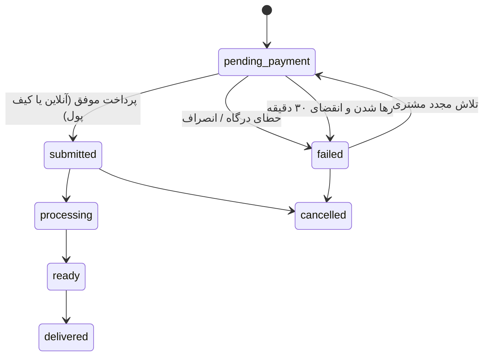

# کافی‌نت آنلاین (Caffenet Lite) — نسخه Laravel + jQuery

سامانه وب/پی‌دبلیو‌ای (PWA) راست‌چین برای ارائه آنلاین خدمات کافی‌نت: پرینت و چاپ، خدمات دانشجویی و
ثبت‌نام، خدمات دولتی و اداری، و امور مالیاتی و وام.

> این نسخه، بازنویسی کامل نسخه React/Express با پشته جدید است:
> **بک‌اند:** Laravel 13 (PHP ≥ 8.2) + SQLite فایل‌محور با WAL
> **فرانت‌اند:** jQuery 3.7 + Blade Shell + CSS خالص (بدون build step)
> رفتار کسب‌وکار ۱۰۰٪ مطابق نسخه اصلی حفظ شده است؛ پلن بازنویسی در
> [`plans/laravel-jquery-rewrite-plan.md`](plans/laravel-jquery-rewrite-plan.md) و مستندات مرجع در
> [`docs/PROJECT_DOCUMENTATION.md`](docs/PROJECT_DOCUMENTATION.md) موجود است.

سه نقش کاربری با داشبورد مستقل:

- **مشتری**: ثبت سفارش، پرداخت آنلاین/کیف پول، پیگیری لحظه‌ای وضعیت، گفتگو با پشتیبانی و امتیازدهی.
- **اپراتور**: صف کار سفارش‌های پرداخت‌شده، تغییر وضعیت، بارگذاری فایل خروجی و گفتگو با مشتری.
- **مدیر سیستم**: مدیریت خدمات و فرم‌ساز پویا، کاربران و مجوزهای ریزدانه، کدهای تخفیف، اسلایدر صفحه
  اصلی، لاگ پیامک‌ها و تنظیمات سیستمی.

احراز هویت با کد یکبارمصرف پیامکی (OTP) از طریق پایپ‌لاین ورود **Laravel Fortify** (نشست بومی لاراول +
CSRF) و نقش‌ها/مجوزها با **spatie/laravel-permission** انجام می‌شود؛ پرداخت آنلاین
زرین‌پال و کیف پول داخلی پشتیبانی می‌گردد.

## فهرست

- [ویژگی‌ها](#ویژگیها)
- [پشته فناوری](#پشته-فناوری)
- [راه‌اندازی سریع](#راهاندازی-سریع)
- [معماری پیکربندی](#معماری-پیکربندی)
- [چرخه عمر سفارش و پرداخت](#چرخه-عمر-سفارش-و-پرداخت)
- [نقش‌ها و مجوزها](#نقشها-و-مجوزها)
- [نقشه مسیرهای API](#نقشه-مسیرهای-api)
- [دستورات artisan](#دستورات-artisan)
- [استقرار در محیط پروداکشن](#استقرار-در-محیط-پروداکشن)
- [ساختار پروژه](#ساختار-پروژه)
- [امنیت](#امنیت)
- [نگاشت نسخه قبلی](#نگاشت-نسخه-قبلی)

## ویژگی‌ها

- کاتالوگ خدمات با دسته‌بندی و **فرم‌ساز پویا**: هر خدمت فیلدهای اختصاصی (متن، عدد، انتخابی، فایل و …)
  و فرمول قیمت‌گذاری خود را دارد که مدیر می‌تواند بدون تغییر کد ویرایش کند.
- **ماشین حساب قیمت واحدی** برای کلاینت (پیش‌نمایش زنده، `public/js/pricing.js`) و سرور (مبلغ قطعی،
  `PricingService`): ضریب فوریت، هزینه پیک و تخفیف همه سمت سرور محاسبه می‌شوند.
- **چرخه سفارش با وضعیت پرداخت‌محور**: سفارش تنها پس از پرداخت موفق وارد صف اپراتور می‌شود؛ سفارش
  ناموفق/در انتظار پرداخت هرگز در صف نمایش داده نمی‌شود.
- **پرداخت آنلاین زرین‌پال** (REST v4) با تایید idempotent (کدهای 100/101) و درگاه آزمایشی داخلی
  `/test-gateway`.
- **کیف پول داخلی** با شارژ آنلاین و پرداخت تراکنشی سفارش + گارد اتمیک ضد برداشت مضاعف.
- **پیامک ippanel** برای کد تایید و اطلاع‌رسانی‌ها، همراه با «لاگ پیامک‌ها» برای ممیزی.
- **مجوزهای ریزدانه (RBAC)**: ۳۰ مجوز در قالب «منبع.عمل» با توارث سطوح دسترسی (`<resource>.manage`).
- **اسلایدر صفحه اصلی** با بارگذاری تصویر، فعال/غیرفعال‌سازی و ترتیب‌بندی.
- **کدهای تخفیف** با سقف مبلغ، حداقل سفارش، سقف استفاده و انقضا؛ رزرو هنگام ثبت و مصرف فقط پس از تایید.
- **ممیزی کامل سفارش**: هر تغییر وضعیت/پرداخت/ارجاع در `order_logs` ثبت می‌گردد.
- **پاکسازی زمان‌بندی‌شده**: حذف فایل‌های قدیمی (`fileRetentionDays`) و انقضای پرداخت‌های رهاشده
  (۳۰ دقیقه) با Scheduler لاراول (هر ۶ ساعت).
- **PWA** با manifest، Service Worker دستی و حالت آفلاین برای پوسته.

## پشته فناوری

| لایه | تکنولوژی |
| --- | --- |
| فرانت‌اند | jQuery 3.7 + ES modules ساده + CSS خالص RTL (بدون build) |
| پوسته | Blade (`resources/views/app.blade.php`) |
| بک‌اند | Laravel 13 (PHP ≥ 8.2) |
| دیتابیس | SQLite فایل‌محور با WAL (بدون سرور دیتابیس) |
| احراز هویت | Laravel Fortify (پایپ‌لاین ورود OTP، نشست بومی + CSRF) |
| نقش‌ها و مجوزها | spatie/laravel-permission (جداول roles/permissions + middleware رسمی) |
| پیامک | ippanel (REST، هدر apikey، الگوی pattern) |
| پرداخت | زرین‌پال REST v4 + sandbox + درگاه آزمایشی داخلی |
| PWA | manifest + Service Worker سبک دستی (`public/sw.js`) |
| فونت | Peyda FaNum (self-hosted در `public/fonts`) |

## راه‌اندازی سریع

```bash
# ۱) نصب وابستگی‌ها
composer install

# ۲) فایل محیطی
cp .env.example .env
php artisan key:generate

# ۳) دیتابیس (SQLite فایل‌محور — به‌صورت خودکار ساخته می‌شود)
touch database/database.sqlite
php artisan migrate --seed

# ۴) تعیین اولین مدیر
php artisan admin:set 09191816172

# ۵) اجرا
php artisan serve          # http://localhost:8000
```

در نخستین بوت، سیدرها همه کلیدهای تنظیمات را می‌سازند (جداول نقش‌ها/مجوزهای اسپاتی هم
همزمان sync می‌شوند). برای ورود بدون پیامک/درگاه واقعی، از پنل مدیریت (تنظیمات سیستمی → حالت‌های آزمایشی)
کلیدهای `otpTestMode`، `smsTestMode` و `paymentTestMode` را فعال کنید؛ در حالت آزمایشی، کد تایید
روی صفحه نمایش داده می‌شود و درگاه داخلی `/test-gateway` با دکمه‌های «پرداخت موفق/انصراف» کار می‌کند.

## معماری پیکربندی

قاعده اصلی نسخه اصلی عیناً حفظ شده است:

> فایل `.env` **فقط** برای مقادیر «فقط بوت» است؛ همه تنظیمات دیگر فقط در جدول `settings` نگهداری
> می‌شوند و هر خواندن یک `SELECT` زنده است (بدون کش) — پس تغییر در پنل بلافاصله اثر می‌گذارد.

- **بدون fallback محیطی**: کلید غایب → مقدار پیش‌فرض کامپایل‌شده در `SettingsService::DEFS`.
- **ماسک رازها**: مقادیر حساس (`smsApiKey`، `paymentMerchantId`) در پاسخ API با
  `********` ماسک می‌شوند؛ ارسال ماسک یا مقدار خالی، مقدار ذخیره‌شده را دست‌نخورده نگه می‌دارد.
- پنج مقدار فقط‌بوت (محیط اجرا) در پنل فقط‌خواندنی نمایش داده می‌شوند.

## چرخه عمر سفارش و پرداخت



قواعد حیاتی (مطابق نسخه اصلی):

1. ایجاد سفارش همیشه `pending_payment` با `paid_amount = 0`.
2. مبلغ قابل پرداخت **همیشه سمت سرور** از رکورد سفارش محاسبه می‌شود.
3. تایید تراکنش idempotent است؛ دو callback همزمان نمی‌توانند دوباره شارژ کنند.
4. کد تخفیف هنگام ثبت «رزرو» و فقط در تایید پرداخت مصرف می‌شود.
5. پرداخت کیف پول در `DB::transaction` با `lockForUpdate` و گارد `paid_amount = 0`.

## نقش‌ها و مجوزها

۳۰ مجوز در قالب `resource.action` با همان کاتالوگ نسخه اصلی؛ هم سمت سرور
(`App\Services\PermissionService`) و هم سمت کلاینت (`public/js/permissions.js`) با قواعد توارث
یکسان: `<resource>.manage` همه اعمال را ایجاب می‌کند و هر عمل، view ضمنی می‌آورد.

نقش‌های پیش‌فرض: `admin` = همه؛ `operator` = `dashboard.view`، `orders.manage`، `sms.view`؛
`customer` = بدون مجوز. مجوزهای هر کاربر قابل بازنویسی از ماتریس پنل مدیریت است.

## نقشه مسیرهای API

همه مسیرهای `/api/*` با قرارداد camelCase نسخه اصلی و محدودیت نرخ (throttle) کار می‌کنند:

| متد و مسیر | دسترسی |
| --- | --- |
| `GET /api/health` | عمومی |
| `POST /api/auth/send-otp` / `verify-otp` / `logout` | عمومی (نرخ‌محدود) |
| `GET /api/auth/me` | ورود لازم |
| `GET /api/categories` / `GET /api/services` | عمومی (غیرفعال‌ها فقط مدیر) |
| `POST/DELETE /api/categories`, `/api/services` | `services.*` |
| `POST/DELETE /api/upload` | ورود لازم (۳۰MB، فهرست سفید) |
| `GET/POST/PATCH/DELETE /api/orders/...` | ورود لازم + مالکیت/مجوز |
| `POST /api/orders/:id/pay-wallet` | مالک سفارش |
| `POST /api/payments/request` | ورود لازم |
| `GET /api/payments/verify` | callback درگاه |
| `GET /api/payments/status` | مالک تراکنش |
| `GET/POST/PATCH/DELETE /api/users/...` | `users.*` |
| `GET /api/dashboard/stats` | ورود لازم |
| `GET /api/permissions` | ورود لازم |
| `GET/POST/PATCH/DELETE /api/coupons/...` + `/validate` | ورود لازم / `coupons.*` |
| `GET/PUT /api/settings` + `/system` | عمومی / `settings.edit` |
| `GET /api/sms` | `sms.view` |
| `GET/POST/PUT/DELETE /api/slider/...` | عمومی / `slider.*` |

مسیرهای ایستا: `GET /uploads/:filename` (ورود + مالکیت)، `/media/*` (عمومی)،
`GET /test-gateway` (درگاه آزمایشی).

## دستورات artisan

| دستور | کار |
| --- | --- |
| `php artisan migrate --seed` | ساخت جداول + سیدر تنظیمات/مدیران/کاتالوگ |
| `php artisan admin:set 09xxxxxxxxx` | تعیین/افزودن مدیر (idempotent) |
| `php artisan caffenet:cleanup` | پاکسازی فایل‌ها + انقضای پرداخت‌های رهاشده |
| `php artisan db:status` | وضعیت جداول و تنظیمات |
| `php artisan schedule:run` | اجرای زمان‌بند (cleanup هر ۶ ساعت — در crontab) |

## استقرار در محیط پروداکشن

```bash
composer install --no-dev --optimize-autoloader
php artisan config:cache route:cache view:cache
php artisan admin:set 09xxxxxxxxx
# Nginx + php-fpm با ریشه public/ و HTTPS پشت reverse proxy
# crontab: * * * * * php /path/artisan schedule:run
```

- مقدار `appUrl` را در پنل مدیریت تنظیم کنید تا لینک بازگشت درگاه مطلق شود.
- فایل دیتابیس و پوشه‌های `storage/app/uploads` و `public/media` را در مخزن قرار ندهید.

## ساختار پروژه

```
app/
  Console/Commands/           admin:set ، caffenet:cleanup ، db:status
  Http/Controllers/Api/       یک کنترلر به‌ازای هر دامنه (Auth، Catalog، Order، Payment، …)
  Http/Middleware/            EnsureAuth (نشست Fortify) ، OriginGuard ، SecurityHeaders
  Http/Responses/             پاسخ‌های سفارشی Fortify (Login/Lockout) به‌صورت JSON
  Http/Support/Formatter.php  نگاشت snake_case → camelCase (قرارداد API نسخه اصلی)
  Models/                     User, Order, Service, Coupon, Payment, … (کلیدهای prefixed-UUID)
  Services/                   Settings, Permission(کاتالوگ/گسترش), Pricing, Auth(OTP), Sms, Payment, Cleanup
database/
  migrations/                 2026_01_01_000001_create_caffenet_schema.php + جداول اسپاتی + backfill
  seeders/                    SettingsSeeder, RoleSeeder(اسپاتی), AdminUsersSeeder, CatalogSeeder
public/
  css/app.css                 ظاهر RTL موبایلی (قاب گوشی، Sheet، Toast، …)
  js/                         api, ui, app, pricing, permissions, persian-utils, icons, pwa
  js/screens/                 auth, landing, customer, order-form, order-tracker, wallet,
                              payment, operator, admin, admin-manage
  fonts/  manifest  sw.js     دارایی‌های PWA
resources/views/              app.blade.php (پوسته SPA) + test-gateway.blade.php
routes/                       api.php (نگاشت کامل §13 مستندات) + web.php
```

## امنیت

- احراز هویت نشست‌محور با **Laravel Fortify**: پایپ‌لاین رسمی ورود
  (EnsureLoginIsNotThrottled → AttemptToAuthenticate → PrepareAuthenticatedSession)،
  نشست بومی لاراول + CSRF + چرخش خودکار شناسه نشست و توکن CSRF پس از ورود
  (توکن تازه در پاسخ verify-otp به SPA برگردانده می‌شود).
- ورود دو مرحله‌ای OTP: ارسال کد (send-otp) و تایید از طریق `Fortify::authenticateUsing` —
  سقف‌ها و پایش تلاش‌ها عیناً حفظ شده است.
- نقش‌ها/مجوزها فقط با **spatie/laravel-permission**: جداول `roles`/`permissions`/پیوت‌ها،
  middleware رسمی `permission:` و چک‌های `hasAnyPermission`. منطق «چترِ مدیریت» (orders.manage →
  همه عملیات orders) و ارث‌بری ضمنی مشاهده در زمان اختصاص اعمال می‌شود (گسترش به کلیدهای موّرجع).
- کدهای OTP هش‌شده (HMAC-SHA256 با کلید `APP_KEY`)، انقضای ۲ دقیقه، حداکثر ۵ تلاش، سقف ۳ کد/شماره/۱۰ دقیقه.
- نرخ‌محدودی: API عمومی 300/دقیقه، send-otp 6/دقیقه، verify-otp 15/دقیقه + قفل‌شدن تلاش‌های ورود
  به‌صورت هر شماره+IP با LoginRateLimiter خود Fortify.
- محافظت Origin-based + CSRF لاراول برای متدهای تغییردهنده؛ هدرهای امنیتی Helmet-مانند با CSP سخت‌گیرانه.
- دورزدن مجوز برای مدیر در `Gate::before` (مدیر سیستم هرگز قفل نمی‌شود).
- فایل‌های `/uploads` فقط با ورود و بررسی مالکیت (مالک سفارش یا staff) قابل دانلودند.
- هیچ داده کاربری در localStorage ذخیره نمی‌شود؛ رازها فقط در جدول `settings` و ماسک‌شده در API.

## نگاشت نسخه قبلی

| نسخه اصلی (React/Express) | این نسخه (Laravel/jQuery) |
| --- | --- |
| `src/server/routes.ts` | `routes/api.php` + کنترلرهای `app/Http/Controllers/Api` |
| `src/server/auth.ts` | `app/Services/AuthService.php` + `EnsureAuth` |
| `src/server/settingsService.ts` | `app/Services/SettingsService.php` |
| `src/server/payment.ts` | `app/Services/PaymentService.php` + `/test-gateway` |
| `src/server/sms.ts` | `app/Services/SmsService.php` |
| `src/server/cleanup.ts` | `CleanupService` + `caffenet:cleanup` + Scheduler |
| `src/db/migrations|seeders` | `database/migrations|seeders` |
| `src/utils/permissions.ts` | `PermissionService` + `public/js/permissions.js` |
| `src/utils/pricing.ts` | `PricingService` + `public/js/pricing.js` |
| `src/services/storageService.ts` | `public/js/api.js` |
| `src/components/**` | `public/js/ui.js` + `public/js/screens/**` |
