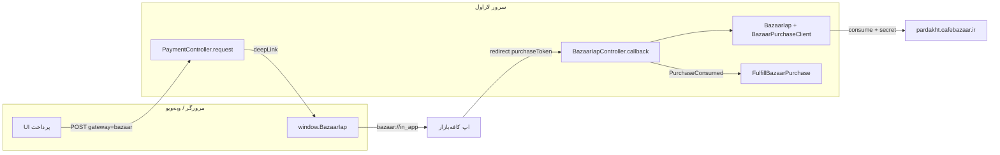
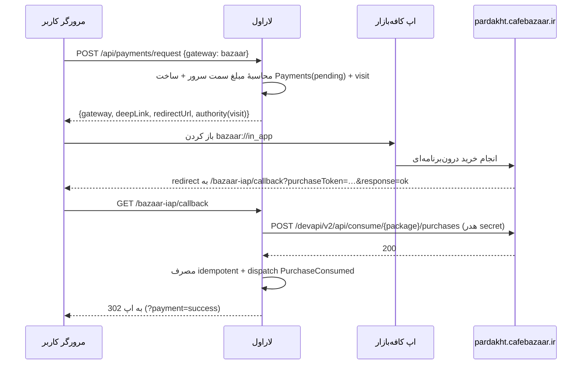
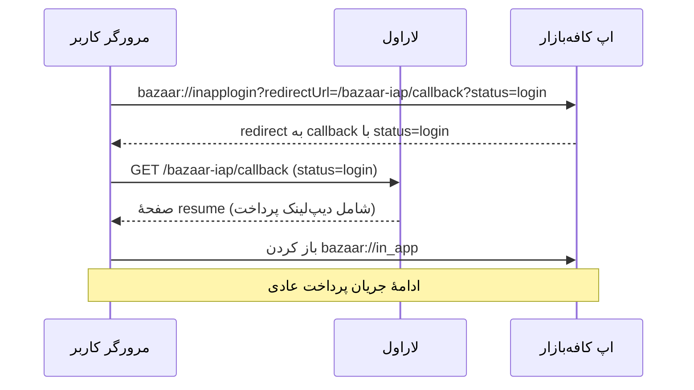
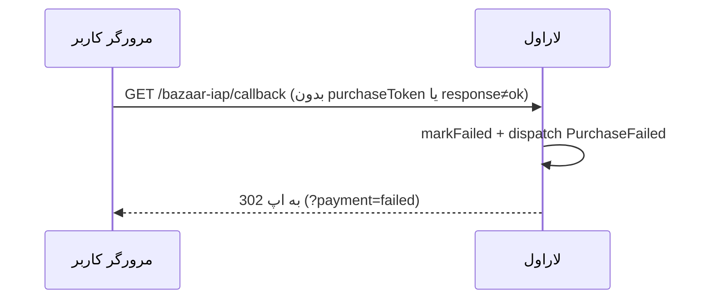

# مستندات کتابخانهٔ پرداخت درون‌برنامه‌ای کافه‌بازار (`caffenet/bazaar-iap`)

این سند مرجع کامل کتابخانهٔ **پرداخت و ورود درون‌برنامه‌ای کافه‌بازار** و نحوهٔ به‌کارگیری
آن در این پروژهٔ لاراولی است. کتابخانه از نمونهٔ PWA مرجع
([`embedded-pwa-main/src/App.tsx`](../embedded-pwa-main/src/App.tsx:1)) الهام گرفته، اما یک
نقص امنیتی مهم آن را برطرف می‌کند: فراخوانی مصرف خرید (consume) و کلید `API_SECRET`
صرفاً سمت سرور انجام می‌شود.

---

## فهرست

1. [نمای کلی](#1-نمای-کلی)
2. [مفاهیم کلیدی](#2-مفاهیم-کلیدی)
3. [جریان‌ها (Sequence)](#3-جریانها-sequence)
4. [ساختار بسته و پروژه](#4-ساختار-بسته-و-پروژه)
5. [نصب و ثبت](#5-نصب-و-ثبت)
6. [پیکربندی](#6-پیکربندی)
7. [یکپارچه‌سازی در این برنامه](#7-یکپارچهسازی-در-این-برنامه)
8. [مرجع API](#8-مرجع-api)
9. [کاربرد سمت مرورگر](#9-کاربرد-سمت-مرورگر)
10. [تنظیمات پنل توسعه‌دهندگان کافه‌بازار](#10-تنظیمات-پنل-توسعهدهندگان-کافهبازار)
11. [امنیت](#11-امنیت)
12. [رفع اشکال](#12-رفع-اشکال)
13. [تست](#13-تست)
14. [پرسش‌های متداول: SKU و قیمت‌گذاری متغیر](#14-پرسشهای-متداول-sku-و-قیمتگذاری-متغیر)

---

## 1. نمای کلی

کافه‌بازار برای پرداخت درون‌برنامه‌ای در اپ‌های وب (PWA/وبه‌ویو) دو دیپ‌لینک در اختیار
قرار می‌دهد:

| جریان | دیپ‌لینک |
| --- | --- |
| ورود درون‌برنامه‌ای | `bazaar://inapplogin?redirectUrl=…&packageName=…&permissionScope=1` |
| پرداخت درون‌برنامه‌ای | `bazaar://in_app?redirectUrl=…&sku=…&dealerPackageName=…` |

پس از پایان کار، کافه‌بازار کاربر را به `redirectUrl` بازمی‌گرداند و پارامترهای
`response=ok` و (در خرید موفق) `purchaseToken` را ضمیمه می‌کند.

> **تفاوت کلیدی با نمونهٔ مرجع:** در [`App.tsx`](../embedded-pwa-main/src/App.tsx:64) نمونه،
> تابع `paymentConsuming` و کلید [`API_SECRET`](../embedded-pwa-main/src/App.tsx:4) داخل
> مرورگر اجرا/افشا می‌شوند. در این کتابخانه، `redirectUrl` مستقیماً به یک **مسیر callback
> لاراول** اشاره می‌کند که مصرف را سمت سرور انجام می‌دهد و سپس کاربر را به اپ برمی‌گرداند.



---

## 2. مفاهیم کلیدی

- **بازدید (Visit):** هر شروع پرداخت یک `visit_id` می‌سازد و در `redirectUrl` جای می‌گیرد.
  callback با همین شناسه تراکنش را پیدا می‌کند.
- **دیپ‌لینک (Deep link):** URI از نوع `bazaar://…` که اپ کافه‌بازار را باز می‌کند.
- **مصرف (Consume):** پس از خرید موفق، توکن خرید باید در سرور کافه‌بازار «مصرف» شود تا
  خرید نهایی و اجازهٔ خرید مجدد همان محصول صادر شود. این فراخوانی **سرور‌محور** است.
- **اعتبارسنجی (Validate):** بررسی وضعیت یک خرید بدون مصرف آن (اختیاری).
- **ورود‑سپس‑پرداخت (Login-first):** اگر خریدار `accountId` نداشته باشد، ابتدا ورود
  درون‌برنامه‌ای انجام می‌شود و پس از بازگشت، پرداخت به‌صورت خودکار ادامه می‌یابد.

---

## 3. جریان‌ها (Sequence)

### ۳.۱ پرداخت مستقیم



### ۳.۲ ورود‑سپس‑پرداخت



### ۳.۳ شکست / انصراف



---

## 4. ساختار بسته و پروژه

```
packages/caffenet/bazaar-iap/
  composer.json                      ← PSR-4 + package discovery
  config/bazaar-iap.php              ← پیکربندی پیش‌فرض (env)
  routes/bazaar-iap.php              ← callback / status / login / start
  database/migrations/…              ← جدول bazaar_iap_transactions
  resources/views/resume.blade.php   ← صفحهٔ ادامهٔ پرداخت پس از ورود
  resources/assets/js/bazaar-iap.js  ← کمک‌کنندهٔ سمت مرورگر
  src/
    BazaarIapServiceProvider.php
    BazaarIap.php                    ← سرویس اصلی (Facade)
    Contracts/BazaarIapSettings.php  ← نقطهٔ توسعهٔ پیکربندی
    Support/ConfigBazaarIapSettings.php
    Support/BazaarDeepLink.php       ← سازندهٔ دیپ‌لینک
    Support/BazaarPurchaseClient.php ← کلاینت REST (consume/validate)
    Http/Controllers/BazaarIapController.php
    Models/BazaarIapTransaction.php
    Events/{PurchaseConsumed,PurchaseFailed}.php
    Dto/{ConsumeResult,PurchaseResult}.php
    Exceptions/{BazaarIapException,ConsumeFailedException}.php
```

فایل‌های یکپارچه‌سازی در همین برنامه:

| فایل | نقش |
| --- | --- |
| [`app/Services/BazaarIapSettingsResolver.php`](../app/Services/BazaarIapSettingsResolver.php:1) | خواندن اعتبارنامه از `SettingsService` |
| [`app/Services/PaymentFulfillmentService.php`](../app/Services/PaymentFulfillmentService.php:1) | اعمال idempotent اثر پرداخت (سفارش/کیف پول) |
| [`app/Listeners/FulfillBazaarPurchase.php`](../app/Listeners/FulfillBazaarPurchase.php:1) | ترجمهٔ رویداد بسته به پرداخت برنامه |
| [`app/Http/Controllers/Api/PaymentController.php`](../app/Http/Controllers/Api/PaymentController.php:1) | انتخاب درگاه + ساخت دیپ‌لینک |

---

## 5. نصب و ثبت

بسته از طریق **path repository** در [`composer.json`](../composer.json:1) ثبت شده است:

```json
"repositories": [
    { "type": "path", "url": "packages/caffenet/bazaar-iap", "options": { "symlink": true } }
],
"require": { "caffenet/bazaar-iap": "@dev" }
```

```bash
composer update caffenet/bazaar-iap
php artisan migrate                         # جدول bazaar_iap_transactions
php artisan vendor:publish --tag=bazaar-iap-assets   # کپی public/js/bazaar-iap.js
```

سرویس‌پروایدر [`BazaarIapServiceProvider`](../packages/caffenet/bazaar-iap/src/BazaarIapServiceProvider.php:1)
به‌صورت خودکار کشف می‌شود و این‌ها را ثبت می‌کند: ادغام config، bind کردن
`BazaarIapSettings`، `BazaarPurchaseClient` و `BazaarIap`، بارگذاری route/view/migration و
منابع قابل انتشار.

---

## 6. پیکربندی

این برنامه اعتبارنامه را از **پنل تنظیمات سیستمی** (دیتابیس) می‌خواند، نه از `.env`. کلیدهای
افزوده‌شده به [`SettingsService::DEFS`](../app/Services/SettingsService.php:41) در دستهٔ
`payment` و `test` قرار دارند:

| کلید | نوع | توضیح |
| --- | --- | --- |
| `bazaarEnabled` | boolean | فعال بودن درگاه کافه‌بازار |
| `bazaarPackageName` | string | نام پکیج اپ در کافه‌بازار (`ir.example.app`) |
| `bazaarApiSecret` | secret | کلید API (ماسک‌شده در پاسخ‌ها) |
| `bazaarSku` | string | شناسهٔ محصول پیش‌فرض (فالبک) — اصلی: کنار هر مبلغ آماده شارژ در «تنظیمات کسب‌وکار» تعریف می‌شود |
| `bazaarDealerPackageName` | string | پکیج فروشنده (خالی = همان پکیج اپ) |
| `bazaarPermissionScope` | number | سطح دسترسی ورود (پیش‌فرض ۱) |
| `bazaarRedirectUrl` | string | بازگشت کافه‌بازار (خالی = مسیر پیش‌فرض بسته) |
| `bazaarConsumeUrl` | string | آدرس پایهٔ consume |
| `bazaarValidateUrl` | string | آدرس پایهٔ validate |
| `bazaarTimeout` | number | مهلت HTTP (ثانیه) |
| `bazaarTestMode` | boolean | حالت آزمایشی (بدون فراخوانی واقعی) |

برای میزبان‌های مستقل، فایل [`config/bazaar-iap.php`](../packages/caffenet/bazaar-iap/config/bazaar-iap.php:1)
همین مقادیر را از متغیرهای `BAZAAR_IAP_*` می‌خواند. نقطهٔ اتصال، اینترفیس
[`BazaarIapSettings`](../packages/caffenet/bazaar-iap/src/Contracts/BazaarIapSettings.php:1)
است؛ bind برنامه (در [`AppServiceProvider::register`](../app/Providers/AppServiceProvider.php:26))
بر پیش‌فرض بسته اولویت دارد.

---

## 7. یکپارچه‌سازی در این برنامه

### ۷.۱ انتخاب درگاه (فقط برای شارژ کیف پول)

> **معماری این برنامه:** پرداخت خدمات **فقط از کیف پول** انجام می‌شود. درگاه
> (زرین‌پال/کافه‌بازار) تنها برای **شارژ کیف پول** به کار می‌رود؛ بنابراین
> `POST /api/payments/request` فقط `purpose: "wallet"` را می‌پذیرد و هر `purpose` دیگر با کد
> `WALLET_ONLY` (۴۰۰) رد می‌شود. اگر موجودی کیف پول کافی نباشد، سفارش **ثبت نمی‌شود** و پاسخ
> `INSUFFICIENT_WALLET` (شامل `required/balance/shortfall`) بازمی‌گردد.

[`PaymentController::request`](../app/Http/Controllers/Api/PaymentController.php:30) پارامتر
`gateway` را می‌پذیرد (`online` پیش‌فرض = زرین‌پال، `bazaar` = کافه‌بازار). در حالت
`bazaar`، متد خصوصی `requestBazaar` یک ردیف `payments` با وضعیت `pending`، `purpose='wallet'` و
`gateway='bazaar'` می‌سازد که `authority` آن همان `visit_id` است؛ سپس دیپ‌لینک پرداخت و
دیپ‌لینک ورود را برمی‌گرداند:

```json
{
  "gateway": "bazaar",
  "paymentId": "pay-…",
  "authority": "<visit-id>",
  "deepLink": "bazaar://in_app?…",
  "loginDeepLink": "bazaar://inapplogin?…",
  "redirectUrl": "https://app.test/bazaar-iap/callback?visit=…&status=payment&sku=…"
}
```

### ۷.۲ اعمال اثر پرداخت

`callback` بسته پس از مصرف موفق، رویداد `PurchaseConsumed` را منتشر می‌کند. شنوندهٔ
[`FulfillBazaarPurchase`](../app/Listeners/FulfillBazaarPurchase.php:1) پرداخت متناظر را با
`authority = visit_id` می‌یابد و از
[`PaymentFulfillmentService::apply`](../app/Services/PaymentFulfillmentService.php:20)
استفاده می‌کند — همان اکشن idempotent که جریان زرین‌پال هم از آن بهره می‌برد (سفارش →
`submitted`، مصرف کد تخفیف، یا شارژ کیف پول).

### ۷.۳ رابط کاربری

- [`order-form.js`](../public/js/screens/order-form.js:1): **فقط کیف پول** — گزینهٔ درگاه حذف
  شده است. اگر موجودی کمتر از مبلغ قابل پرداخت باشد، سفارش ثبت نمی‌شود و پیام «موجودی کافی
  نیست» با مبلغ کمبود و دکمهٔ «شارژ کیف پول» نمایش داده می‌شود (`Screens.openWalletShortage`).
- [`order-tracker.js`](../public/js/screens/order-tracker.js:233): پرداخت مجدد فقط از کیف پول
  انجام می‌شود (بدون fallback درگاه) و در کمبود موجودی همان پیام شارژ نمایش داده می‌شود.
- [`wallet.js`](../public/js/screens/wallet.js:1): شارژ کیف پول از درگاه — کافه‌بازار
  درون‌برنامه‌ای یا زرین‌پال. **وقتی کافه‌بازار به‌عنوان درگاه فعال تنظیم شده باشد**
  (`settings.bazaar.enabled`)، فیلد «مبلغ دلخواه» **نمایش داده نمی‌شود** و فقط **مبالغ آماده
  شارژ** (`walletTopUpPresets`) با **SKU متناظر هر بسته** قابل پرداخت‌اند؛ در غیر آن (زرین‌پال)،
  مبلغ دلخواه آزاد است.
- [`payment.js`](../public/js/screens/payment.js:9): اگر `payResult.gateway === 'bazaar'`
  باشد، `window.BazaarIap.pay()` فراخوانی می‌شود؛ بیرون از اپ کافه‌بازار پیام هشدار داده می‌شود.
- پرچم `bazaar` در پاسخ [`GET /api/settings`](../app/Http/Controllers/Api/SettingsController.php:16)
  قرار می‌گیرد (بدون هیچ راز) تا کلاینت تصمیم بگیرد.

---

## 8. مرجع API

### فاساد `BazaarIap`

| متد | خروجی | توضیح |
| --- | --- | --- |
| `isEnabled()` | `bool` | فعال بودن درگاه |
| `isTestMode()` | `bool` | حالت آزمایشی |
| `resolveSku(?string)` | `string` | SKU ورودی یا پیش‌فرض |
| `redirectUrl(array)` | `string` | افزودن پارامتر به آدرس بازگشت |
| `callbackUrl()` | `string` | آدرس بازگشت (با fallback) |
| `loginDeepLink(string, ?string)` | `string` | دیپ‌لینک ورود |
| `paymentDeepLink(string, ?string)` | `string` | دیپ‌لینک پرداخت |
| `consume(string)` | `ConsumeResult` | مصرف خرید |
| `consumeOrFail(string)` | `ConsumeResult` | مصرف، با استثنا در خطا |
| `validate(string, string)` | `PurchaseResult` | اعتبارسنجی خرید |

### مسیرهای بسته

| متد | مسیر | توضیح |
| --- | --- | --- |
| `GET` | `/bazaar-iap/callback` | بازگشت Bazaar؛ ورود/مصرف/شکست |
| `GET` | `/bazaar-iap/status?visit=` | وضعیت تراکنش |
| `GET` | `/bazaar-iap/login?sku=&return=` | دیپ‌لینک ورود |
| `POST` | `/bazaar-iap/start` | ایجاد بازدید + دیپ‌لینک |

### رویدادها

| رویداد | زمان | داده‌ها |
| --- | --- | --- |
| `PurchaseConsumed` | مصرف موفق | `transaction`، `result`، `purchaseToken` |
| `PurchaseFailed` | انصراف/شکست | `transaction` (nullable)، `reason` |

### DTOها

- `ConsumeResult`: `ok`, `statusCode`, `message`, `body` و `isAlreadyConsumed()`.
- `PurchaseResult`: `ok`, `statusCode`, `productId`, `purchaseToken`,
  `purchaseState`, `consumptionState`, `purchaseTime` و `isPurchased()/isConsumed()`.

---

## 9. کاربرد سمت مرورگر

فایل [`public/js/bazaar-iap.js`](../public/js/bazaar-iap.js:1) (نسخهٔ بسته:
[`resources/assets/js/bazaar-iap.js`](../packages/caffenet/bazaar-iap/resources/assets/js/bazaar-iap.js:1))
شیء `window.BazaarIap` را می‌سازد:

| متد | توضیح |
| --- | --- |
| `isInBazaar()` | آیا داخل وبه‌ویو کافه‌بازار هستیم؟ |
| `getAccountId(packageName)` | خواندن `accountId` از پل بومی `Bazaar` |
| `open(deepLink)` | باز کردن دیپ‌لینک |
| `pay(payResult)` | باز کردن `deepLink` پاسخ سرور |
| `login(loginResult)` | شروع ورود درون‌برنامه‌ای |
| `returnParams()` | خواندن `response/purchaseToken/status/sku` از URL |
| `installBackHandler()` | هدایت دکمهٔ بازگشت به `Bazaar.back()` |

این فایل هیچ کلید یا فراخوانی REST ندارد؛ فقط دیپ‌لینک باز می‌کند.

---

## 10. تنظیمات پنل توسعه‌دهندگان کافه‌بازار

1. در پنل توسعه‌دهندگان، محصول **درون‌برنامه‌ای (IAP)** با شناسهٔ موردنظر (SKU) بسازید و
   **قیمت ثابت** آن را تعیین کنید؛ کافه‌بازار هنگام خرید همیشه **همین قیمت ثبت‌شده** را از
   کاربر می‌گیرد (دیپ‌لینک پرداخت پارامتر مبلغ ندارد).
2. `package name` اپ را در پنل ثبت کنید (همان `bazaarPackageName`).
3. `API secret` را از پنل بردارید و در تنظیمات سیستمی (`bazaarApiSecret`) ذخیره کنید.
4. برای هر **قیمت ثابت** یک محصول (SKU) بسازید و قیمتش را در پنل کافه‌بازار تعیین کنید. SKU هر
   مبلغ شارژ، **همراه با همان مبلغ** در «تنظیمات کسب‌وکار» برنامه (بخش «مبالغ آماده شارژ کیف
   پول») تعریف می‌شود؛ هنگام ساخت دیپ‌لینک از همان SKU استفاده می‌گردد. کلید `bazaarSku` فقط
   به‌عنوان فالبک باقی می‌ماند.
5. اگر فروشنده متفاوت است، `bazaarDealerPackageName` را تنظیم کنید.
6. کلید `bazaarEnabled` را فعال و در صورت نیاز `bazaarTestMode` را روشن کنید.
7. `appUrl` را در تنظیمات سیستمی تنظیم کنید تا آدرس بازگشت مطلق ساخته شود.

> برای قیمت‌های **متغیر** (محاسبهٔ پویای سفارش)، یک SKU به‌ازای هر مبلغ عملی نیست؛ پیش از
> راه‌اندازی، بخش [۱۴](#14-پرسشهای-متداول-sku-و-قیمتگذاری-متغیر) را بخوانید.

> دیپ‌لینک‌ها فقط داخل اپ کافه‌بازار کار می‌کنند؛ برای آزمون محلی، `bazaarTestMode` را فعال
> کنید و جریان UI را با شبیه‌سازی مقصد بررسی نمایید.

---

## 11. امنیت

- **کلید API فقط روی سرور:** در [`BazaarPurchaseClient`](../packages/caffenet/bazaar-iap/src/Support/BazaarPurchaseClient.php:1)
  به هدر درخواست اضافه می‌شود و هرگز در پاسخ/فایل سمت مرورگر نیست.
- **مصرف سرور‌محور:** `redirectUrl` به callback لاراول اشاره می‌کند، نه به صفحهٔ مرورگر.
- **محافظت از Open Redirect:** پارامتر `return` فقط به مسیر نسبی یا هم‌دامنه محدود می‌شود
  (`BazaarIapController::safeReturn`).
- **Idempotency:** تکرار callback خرید را دوباره مصرف نمی‌کند و ردیف پرداخت را دوباره
  «پرداخت‌شده» نمی‌کند.
- **ماسک راز:** `bazaarApiSecret` در پاسخ‌های سیستمی با `********` ماسک می‌شود
  (سازوکار موجود `SettingsService`).

---

## 12. رفع اشکال

| نشانه | علت احتمالی | راه‌حل |
| --- | --- | --- |
| دکمهٔ کافه‌بازار دیده نمی‌شود | `bazaar.available=false` | `bazaarEnabled` و `bazaarPackageName` و (در حالت غیرآزمایشی) `bazaarApiSecret` را تنظیم کنید |
| `503` در `/bazaar-iap/start` | درگاه غیرفعال | `bazaarEnabled=1` |
| پیام «فقط داخل اپ کافه‌بازار» | اجرا در مرورگر معمولی | اپ را داخل کافه‌بازار باز کنید |
| خطای consume | SKU نامطابق یا کلید اشتباه | SKU و `bazaarApiSecret` را بررسی کنید |
| بدون بازگشت به اپ | `bazaarRedirectUrl` نامعتبر | مقدار را خالی بگذارید یا آدرس callback صحیح دهید |
| `bazaar_iap_transactions` وجود ندارد | مایگریشن اجرا نشده | `php artisan migrate` |
| مبلغ پرداختی با مبلغ سفارش نمی‌خواند | کافه‌بازار **قیمت ثابت SKU** را می‌گیرد، نه مبلغ داینامیک سفارش | SKU متناظر مبلغ را بدهید یا الگوی کیف‌پول‌محور / تطبیق SKU↔مبلغ را اعمال کنید ([بخش ۱۴](#14-پرسشهای-متداول-sku-و-قیمتگذاری-متغیر)) |

---

## 13. تست

```bash
php artisan test --filter=BazaarIapGatewayTest
```

پوشش تست‌ها در [`tests/Feature/BazaarIapGatewayTest.php`](../tests/Feature/BazaarIapGatewayTest.php:1):

- ساخت دیپ‌لینک پرداخت (sku/dealer/redirect) و دیپ‌لینک ورود (package/scope).
- فراخوانی consume با هدر راز (با `Http::fake`).
- idempotency callback + انتشار رویداد `PurchaseConsumed`.
- `503` در حالت غیرفعال و ساخت بازدید در `/bazaar-iap/start`.

---

## 14. پرسش‌های متداول: SKU و قیمت‌گذاری متغیر

این بخش به یک پرسش پرتکرار پاسخ می‌دهد: «من چند پنل خدمات با قیمت‌های متنوع و متغیر دارم؛
آیا باید برای هر محصول در پنل کافه‌بازار SKU تعریف کنم؟»

### ۱۴.۱ مدل قیمت‌گذاری کافه‌بازار

کافه‌بازار در **پرداخت درون‌برنامه‌ای (PISHKHAN)** بر پایهٔ «محصول» کار می‌کند، نه بر پایهٔ
«مبلغ آزاد»:

- در پنل توسعه‌دهندگان، برای هر محصول یک **شناسه (SKU)** می‌سازید.
- **قیمت هر SKU در همان پنل و به‌صورت ثابت** تعیین می‌شود. دیپ‌لینک
  `bazaar://in_app?…&sku=…` **هیچ پارامتر مبلغی ندارد**؛ کاربر دقیقاً همان
  **قیمت ثبت‌شدهٔ آن SKU** را پرداخت می‌کند.
- بنابراین کافه‌بازار یک **درگاه مبلغ‌آزاد** (مانند زرین‌پال که هر مبلغی را می‌پذیرد) نیست،
  بلکه یک **فروشگاه محصول با قیمت ثابت** است.
- هر خرید برای هر SKU مستقل شمارش و «مصرف» (consume) می‌شود و پس از مصرف، خرید مجدد همان SKU
  ممکن است.

### ۱۴.۲ آیا برای هر محصول باید SKU تعریف کنم؟

پاسخ به **ثابت یا متغیر** بودن قیمت بستگی دارد:

| حالت قیمت | راهکار پیشنهادی |
| --- | --- |
| محصول با قیمت **ثابت** (مثلاً «اشتراک ماهانه ۱۰۰٬۰۰۰ تومان») | **یک SKU به‌ازای هر محصول/قیمت**؛ همان SKU را در `bazaarSku` یا پارامتر `sku` بدهید. |
| چند **سطح قیمت ثابت** (مثلاً بسته‌های ۵۰k / ۱۰۰k / ۲۰۰k) | **یک SKU برای هر سطح** (نردبان SKU). |
| قیمت **متغیر و محاسبه‌شده per سفارش** (فرم‌ساز پویا، ضریب فوریت، پیک، تخفیف) | **SKU جدا برای هر مبلغ عملی نیست**؛ از الگوی «کیف‌پول‌محور» یا درگاه زرین‌پال استفاده کنید. |

### ۱۴.۳ راهکار انتخاب‌شده در این برنامه

در این برنامه مبلغ سفارش **داینامیک** است و سمت سرور با
[`PricingService::calculate`](../app/Services/PricingService.php:35) محاسبه می‌شود (قاعدهٔ ویژهٔ
پرینت، ضریب فوریت/آنی، هزینهٔ پیک، تخفیف). برای رفع ناهم‌ترازی مبلغ در کافه‌بازار، معماری به
صورت **کیف‌پول‌محور** پیاده‌سازی شده است:

- **پرداخت خدمات فقط از کیف پول** انجام می‌شود؛ مسیر پرداخت مستقیم سفارش از درگاه حذف شده است
  ([`OrderController::payWithWallet`](../app/Http/Controllers/Api/OrderController.php:169)). اگر
  موجودی کافی نباشد، سفارش **ثبت نمی‌شود** و پاسخ ساختاریافتهٔ `INSUFFICIENT_WALLET`
  (`required` / `balance` / `shortfall`) برگردانده می‌شود.
- **شارژ کیف پول** از درگاه انجام می‌شود
  ([`PaymentController::request`](../app/Http/Controllers/Api/PaymentController.php:30) فقط
  `purpose='wallet'`). وقتی کافه‌بازار درگاه فعال باشد، فیلد مبلغ دلخواه نمایش داده نمی‌شود و
  مبلغ شارژ باید یکی از **مبالغ آماده** (`walletTopUpPresets`) باشد. هر مبلغ آماده، **SKU
  متناظر خود** را در همان فهرست نگه می‌دارد (تعریف‌شده در «تنظیمات کسب‌وکار») و هنگام ساخت
  دیپ‌لینک از همان SKU استفاده می‌شود؛ برای مبلغ دلخواه از زرین‌پال استفاده می‌شود.
- بنابراین مسئلهٔ «قیمت متغیر» دیگر گریبان‌گیر کافه‌بازار نمی‌شود: سفارش‌های متنوع از موجودی
  کیف پول کسر می‌شوند و کافه‌بازار صرفاً برای بسته‌های با قیمت ثابت به کار می‌رود. مقدار
  [`bazaarSku`](../app/Services/SettingsService.php:115) فقط به‌عنوان SKU پیش‌فرض/فالبک باقی می‌ماند.

> **نکتهٔ پیکربندی:** در «تنظیمات کسب‌وکار» برای هر مبلغ آماده شارژ، SKU متناظر همان قیمت را
> وارد کنید. مقدار در دیتابیس به‌صورت `[{"amount":50000,"sku":"topup_50k"}, …]` ذخیره می‌شود؛
> ساختار قدیمی (فهرست سادهٔ اعداد) نیز پشتیبانی می‌گردد.

### ۱۴.۴ الزام پیاده‌سازی برای اطمینان اقتصادی

این موارد پیاده‌سازی شده‌اند:

- هنگام ساخت دیپ‌لینک، SKU **متناظر با مبلغ** انتخاب می‌شود (نه یک SKU ثابت جهانی) — با
  [`SettingsService::walletTopUpSkuFor`](../app/Services/SettingsService.php:1).
- در شنوندهٔ [`FulfillBazaarPurchase`](../app/Listeners/FulfillBazaarPurchase.php:1)، مبلغ منتسب
  به SKU با `payment.amount` مقایسه می‌شود و در صورت نابرابری با
  [`PaymentFulfillmentService::markFailed`](../app/Services/PaymentFulfillmentService.php:1)
  پرداخت ناموفق ثبت می‌گردد.
- از [`BazaarIap::validate`](../packages/caffenet/bazaar-iap/src/BazaarIap.php:113) می‌توان برای
  بررسی وضعیت محصول (`productId`) پیش از مصرف استفاده کرد (توجه: پاسخ validate شامل **قیمت**
  نیست؛ نگاشت SKU→قیمت همان `walletTopUpPresets` است).

> **خلاصه:** کافه‌بازار **مبلغ آزاد نمی‌پذیرد**؛ برای هر **قیمت ثابت** یک SKU لازم است. برای
> قیمت‌های متغیر، الگوی کیف‌پول‌محور یا تطبیق SKU↔مبلغ را انتخاب کنید و هرگز بدون بررسی، مبلغ
> خریداری‌شدهٔ واقعی را با مبلغ سفارش برابر نگیرید.
