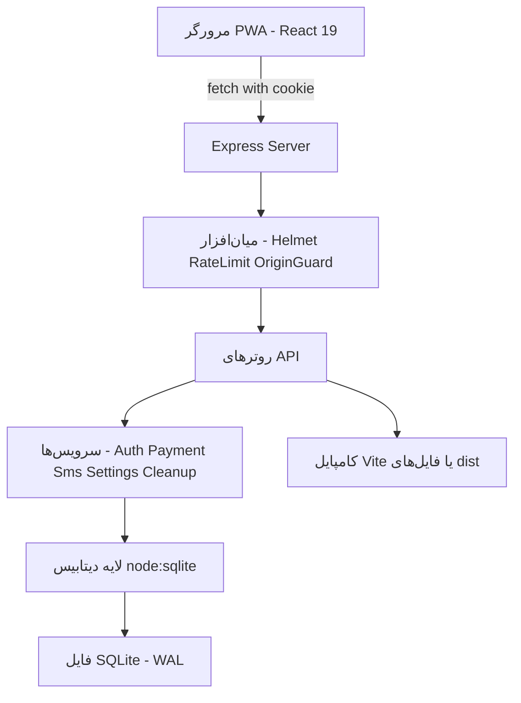
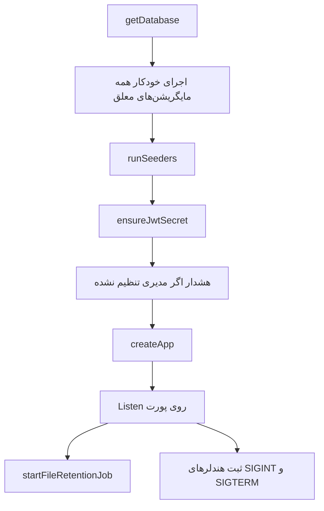
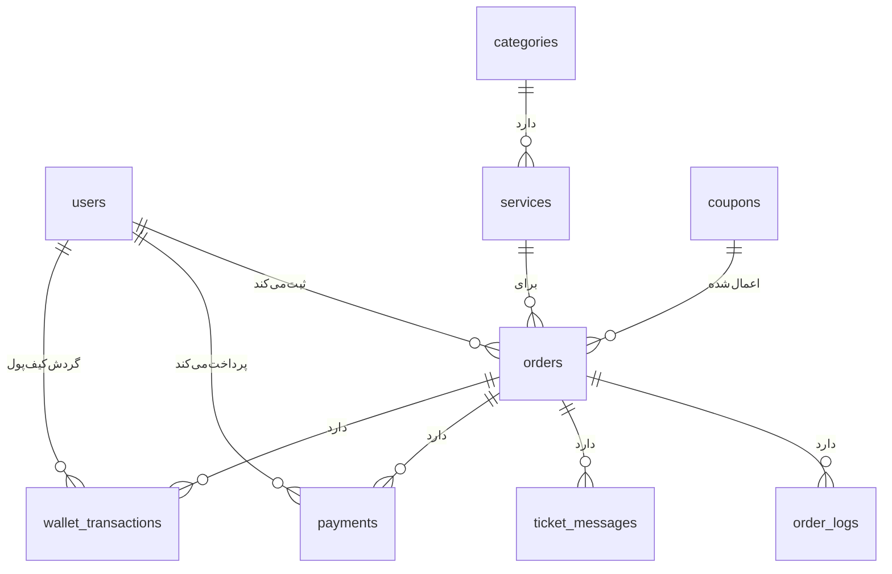
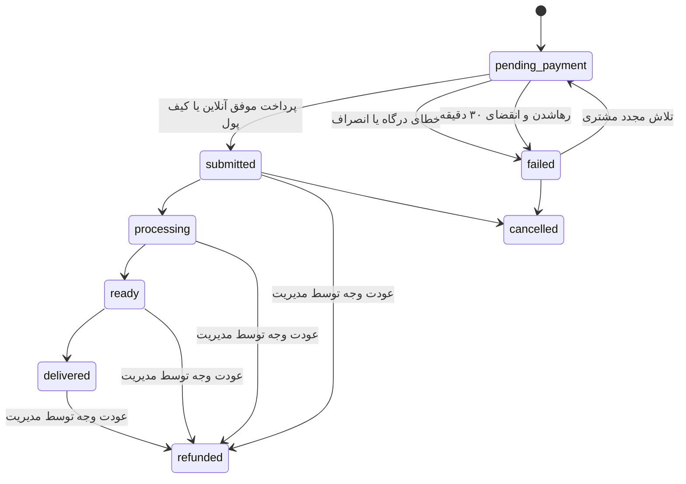

> **یادداشت نسخه Laravel + jQuery:** این سند رفتار مرجع نسخه اصلی (React/Express) را توصیف
> می‌کند که در بازنویسی Laravel/jQuery عیناً حفظ شده است. نگاشت موئلفه‌ها به ساختار جدید در
> [`plans/laravel-jquery-rewrite-plan.md`](../plans/laravel-jquery-rewrite-plan.md) و README آمده است.
>
> **به‌روزرسانی لایه احراز هویت/مجوزها:** در پیاده‌سازی فعلی، احراز هویت با **Laravel Fortify**
> (نشست بومی لاراول + CSRF به‌جای JWT/کوکی `cn_auth`) و نقش‌ها/مجوزها با
> **spatie/laravel-permission** (به‌جای `permissions_json`) انجام می‌شود. قرارداد API و همه
> سقف‌ها/پیام‌ها عیناً حفظ شده؛ جزئیات در [`plans/fortify-spatie-auth-plan.md`](../plans/fortify-spatie-auth-plan.md)
> و بخش «امنیت» README. بخش‌های این سند که JWT و `permissions_json` را توصیف می‌کنند، صرفاً
> رفتار مرجع نسخه اصلی را مستند می‌کنند.

# مستندات جامع معماری برنامه «کافی‌نت احسان»

این سند مرجع کامل ساختار برنامه است و برای «برنامه‌نویس جدید» و «هوش مصنوعی» نوشته شده تا بدون خواندن کل کد، تمام سیستم‌ها، تکنولوژی‌ها، متدها، جداول، مایگریشن‌ها، سیـدرها، مسیرهای API و کامپوننت‌های رابط کاربری را به‌صورت دقیق بشناسد.

> سامانه یک وب/پی‌دبلیو‌ای (PWA) راست‌چین برای ارائه آنلاین خدمات کافی‌نت است: پرینت و چاپ، خدمات دانشجویی و ثبت‌نام، خدمات دولتی و اداری، و امور مالیاتی و وام.

---

## فهرست

1. [نمای کلی و پشته فناوری](#1-نمای-کلی-و-پشته-فناوری)
2. [نقشه معماری لایه‌ای](#2-نقشه-معماری-لایهای)
3. [ساختار پوشه‌ها و فایل‌ها](#3-ساختار-پوشهها-و-فایلها)
4. [چرخه بوت سرور](#4-چرخه-بوت-سرور)
5. [معماری پیکربندی](#5-معماری-پیکربندی)
6. [لایه دیتابیس](#6-لایه-دیتابیس)
7. [سیستم مایگریشن (Migration)](#7-سیستم-مایگریشن-migration)
8. [سیستم سیـدر (Seeder)](#8-سیستم-سیدر-seeder)
9. [طرح جداول و ایندکس‌ها](#9-طرح-جداول-و-ایندکسها)
10. [سیستم احراز هویت](#10-سیستم-احراز-هویت)
11. [سیستم مجوزها (RBAC)](#11-سیستم-مجوزها-rbac)
12. [میان‌افزارها و امنیت](#12-میانافزارها-و-امنیت)
13. [مسیرهای API](#13-مسیرهای-api)
14. [سیستم پرداخت و کیف پول](#14-سیستم-پرداخت-و-کیف-پول)
15. [سیستم پیامک](#15-سیستم-پیامک)
16. [موتور قیمت‌گذاری](#16-موتور-قیمتگذاری)
17. [کارهای زمان‌بندی‌شده و پاکسازی](#17-کارهای-زمانبندیشده-و-پاکسازی)
18. [لایه داده کلاینت](#18-لایه-داده-کلاینت)
19. [معماری رابط کاربری و مسیریابی صفحه‌ها](#19-معماری-رابط-کاربری-و-مسیریابی-صفحهها)
20. [کاتالوگ کامپوننت‌ها](#20-کاتالوگ-کامپوننتها)
21. [ابزارها و توابع کمکی](#21-ابزارها-و-توابع-کمکی)
22. [تایپ‌ها و مدل داده](#22-تایپها-و-مدل-داده)
23. [سیستم PWA](#23-سیستم-pwa)
24. [استایل، فونت و انیمیشن](#24-استایل-فونت-و-انیمیشن)
25. [اسکریپت‌ها و دستورات](#25-اسکریپتها-و-دستورات)
26. [راهنمای توسعه: چگونه چیزی اضافه کنیم](#26-راهنمای-توسعه-چگونه-چیزی-اضافه-کنیم)
27. [جدول تکنولوژی‌ها و کتابخانه‌ها](#27-جدول-تکنولوژیها-و-کتابخانهها)

---

## 1. نمای کلی و پشته فناوری

### ماهیت برنامه
- یک اپلیکیشن **تک‌صفحه‌ای React** که به‌شکل اپلیکیشن موبایل (PWA) طراحی شده است.
- سه نقش کاربری با داشبورد مستقل:
  - **مشتری**: ثبت سفارش، پرداخت آنلاین/کیف پول، پیگیری لحظه‌ای، گفتگو و امتیازدهی.
  - **اپراتور**: صف سفارش‌های پرداخت‌شده، تغییر وضعیت، بارگذاری فایل خروجی و گفتگو.
  - **مدیر سیستم**: مدیریت خدمات و فرم‌ساز پویا، کاربران و مجوزها، کدهای تخفیف، اسلایدر، لاگ پیامک و تنظیمات.
- **بدون بک‌اند جداگانه**: یک سرور Node/Express در همان پروژه هم API را سرو می‌کند و هم در حالت توسعه رابط Vite را و در پروداکشن فایل‌های `dist` را.

### پشته فناوری (مطابق [`package.json`](package.json:21))
| لایه | تکنولوژی |
| --- | --- |
| رابط کاربری | React 19.0.1 + React DOM 19.0.1 |
| زبان | TypeScript 7.0.2 |
| بیلد و ابزار | Vite 8.3.0 + `tsx` 4.21 برای اجرای TS در Node |
| استایل | Tailwind CSS 4.3.3 با پلاگین `@tailwindcss/vite` |
| PWA | `vite-plugin-pwa` 1.3.0 + Workbox |
| آیکون و انیمیشن | `lucide-react` 0.546 و `motion` 12.23.24 |
| سرور | Express 4.21.2 روی Node ≥ 22.5 |
| دیتابیس | درایور بومی `node:sqlite` (`DatabaseSync`) فایل‌محور با WAL |
| احراز هویت | `jsonwebtoken` 9.0.2 + `cookie-parser` |
| امنیت | `helmet` 8.0.0 + `express-rate-limit` 7.4.1 |
| آپلود فایل | `multer` 2.4.0 |
| پیکربندی | `dotenv` 17.2.3 |

### نمودار معماری لایه‌ای


---

## 2. نقشه معماری لایه‌ای

سه لایه اصلی وجود دارد:

1. **لایه داده کلاینت** ([`src/services/storageService.ts`](src/services/storageService.ts:63)): یک سینگلتون که حافظهٔ درون‌برنامه‌ای را با API هم‌گام می‌کند (هر ۱۵ ثانیه + هنگام focus + پس از هر تغییر). هیچ دادهٔ پایدار در `localStorage` ذخیره نمی‌شود.
2. **لایه سرور** ([`src/server/`](src/server/app.ts:1)): ساخت اپ Express، میان‌افزارها، روترها، سرویس‌های دامنه (پیامک، پرداخت، تنظیمات، احراز هویت، پاکسازی).
3. **لایه دیتابیس** ([`src/db/`](src/db/sqlite.ts:1)): بازکردن اتصال، اجرای خودکار مایگریشن‌ها، اجرای سیـدرها، توابع کمکی کوئری و تراکنش.

---

## 3. ساختار پوشه‌ها و فایل‌ها

```
server.ts                     نقطه ورود سرور: بوت، سیـدر، JWT، خاموشی نرم
index.html                    پوستهٔ HTML و ریشهٔ React
vite.config.ts                پیکربندی Vite + PWA + alias آ
metadata.json                 متادیتای پروژه
.env.example                  نمونهٔ متغیرهای فقط‌بوت

scripts/
  db-migrate.ts               اجرای مایگریشن‌ها و نمایش وضعیت
  db-seed.ts                  اجرای سیـدرها با پشتیبانی --force
  db-status.ts                گزارش وضعیت مایگریشن، سیـدر و شمار ردیف جداول
  set-admin.ts                تعیین مدیر اول بدون نیاز به env

src/
  App.tsx                     پوستهٔ اصلی PWA، مسیریابی صفحه‌ها، مدیریت Sheetها
  main.tsx                    نقطه ورود React + فعال‌سازی زودهنگام لیسنرهای PWA
  index.css                   Tailwind v4، فونت Peyda، RTL، Safe-Area، انیمیشن‌ها
  types/index.ts              تایپ‌ها و مدل‌های دامنه

  server/
    app.ts                    ساخت اپ Express، مسیرها، فایل‌های استاتیک، درگاه آزمایشی
    config.ts                 پیکربندی فقط‌بوت + پیش‌فرض‌های کامپایل‌شده
    middleware.ts             امنیت، نرخ‌محدودی، لاگ، محافظت CSRF، مدیریت خطا
    auth.ts                   OTP، JWT، میان‌افزار نقش و مجوز
    routes.ts                 همهٔ مسیرهای API (۲۲۷۵ خط)
    settingsService.ts        تنظیمات دیتابیسی بدون کش
    sms.ts                    سرویس ippanel
    payment.ts                سرویس زرین‌پال + درگاه آزمایشی
    cleanup.ts                کارهای زمان‌بندی‌شده

  db/
    sqlite.ts                 اتصال بومی، توابع queryAll/queryOne/withTransaction
    migrator.ts               اجراکنندهٔ مایگریشن به سبک لاراول
    seeder.ts                 اجراکنندهٔ سیـدر
    schemaHelpers.ts          کمک‌تابع‌های DDL مثل ensureColumn
    migrations/               مایگریشن‌ها + index.ts
    seeders/                  سیـدرها + index.ts

  services/storageService.ts  لایه داده کلاینت و هماهنگی با API

  components/
    common/                   Sheet, Toast, AppBar, BottomNav, Navbar, HomeScreen,
                              LandingScreen, ProfileScreen, ImageSlider,
                              OrderStatusBadge, SmsInboxModal
    auth/                     AuthModal
    customer/                 CustomerDashboard, ServiceCatalog, OrderFormModal,
                              OrderTrackerModal, WalletModal
    operator/                 OperatorDashboard
    admin/                    AdminDashboard, SliderManager
    payment/                  PaymentModal
    pwa/                      OfflineIndicator, PWAInstallButton

  utils/
    permissions.ts            مدل مجوز مشترک سرور و کلاینت
    pricing.ts                موتور قیمت‌گذاری مشترک
    persianUtils.ts           تاریخ شمسی، اعداد فارسی، نرمال‌سازی موبایل
    pwa.ts                    هوک‌های نصب و وضعیت آنلاین
```

---

## 4. چرخه بوت سرور

نقطهٔ ورود [`server.ts`](server.ts:13) دقیقاً به این ترتیب اجرا می‌شود:



نکات کلیدی:
- **بازکردن دیتابیس = مهاجرت خودکار**: به‌محض `getDatabase()` همهٔ مایگریشن‌های معلق اجرا می‌شوند ([`src/db/sqlite.ts`](src/db/sqlite.ts:47)).
- **سیـدرها در بوت** اجرا می‌شوند ([`runSeeders`](src/db/seeder.ts:38)).
- **تولید خودکار راز JWT** با `ensureJwtSecret` در صورت نبودِ مقدار.
- **خاموشی نرم**: روی `SIGINT`/`SIGTERM` ابتدا `flushDatabase` و سپس `server.close`؛ اگر تا ۵ ثانیه بسته نشد، `process.exit(0)`.
- **مدیریت خطای سراسری**: `unhandledRejection` فقط لاگ می‌شود و `uncaughtException` پس از flush باعث خروج با کد ۱ می‌شود.

---

## 5. معماری پیکربندی

این مهم‌ترین قاعدهٔ معماری پروژه است:

> فایل `.env` **فقط** برای مقادیر «فقط‌بوت» است. همهٔ تنظیمات دیگر صرفاً در جدول `settings` دیتابیس نگهداری می‌شوند.

- **پنج مقدار فقط‌بوت** در [`config.ts`](src/server/config.ts:39): `NODE_ENV`, `PORT`, `DATABASE_PATH`, `UPLOADS_DIR`, `MEDIA_DIR`.
- **بدون fallback محیطی**: اگر کلیدی در جدول `settings` نباشد، مقدار پیش‌فرض کامپایل‌شدهٔ `SETTING_DEFAULTS` ([`src/server/config.ts`](src/server/config.ts:57)) استفاده می‌شود، نه env.
- **بدون کش حافظه‌ای**: هر فراخوانی تنظیمات یک `SELECT` هم‌زمان روی SQLite است؛ پس تغییر از پنل مدیریت بلافاصله در کل برنامه اثر می‌گذارد.
- **ماسک‌کردن رازها**: مقادیر حساس در پاسخ API با `SECRET_MASK = '********'` ([`src/server/settingsService.ts`](src/server/settingsService.ts:52)) بازگردانده می‌شوند؛ ارسال مقدار خالی یا همان ماسک، مقدار ذخیره‌شده را دست‌نخورده نگه می‌دارد.

### توابع کلیدی `settingsService.ts`
| تابع | کار |
| --- | --- |
| `getRawSetting(key)` | خواندن دیتابیس‌محور یک کلید با fallback به پیش‌فرض کامپایل‌شده |
| `getRawBool(key)` | تبدیل به بولین (`true`/`1`/`yes`) |
| `getAppUrl()` | آدرس پایهٔ سایت بدون اسلش انتهایی |
| `getAdminPhones()` | شماره‌های مدیر نرمال‌شده |
| `getJwtSettings()` | `{ secret, expiresIn }` (در نبود راز، خطا می‌دهد) |
| `getSmsSettings()` | تنظیمات ippanel + فلگ `canSend` |
| `getPaymentSettings()` | تنظیمات زرین‌پال + `callbackUrl` محاسبه‌شده |
| `getFileRetentionDays()` | تعداد روز نگهداری فایل |
| `isOtpTestModeEnabled()` | آیا حالت آزمایشی OTP فعال است |
| `ensureJwtSecret()` | تولید و ذخیرهٔ راز JWT در صورت نبود |
| `listSystemSettings()` / `updateSystemSettings()` | خواندن/نوشتن تنظیمات سیستمی از پنل |

### چیدمان شیت «تنظیمات سیستمی»
دسته‌بندی سطح داده همان `SystemSettingCategory = general | auth | sms | payment | test | runtime` است، اما شیت یک چیدمان دامنه‌محور دارد و تنها دو انتخاب کاربری برای پرداخت نشان می‌دهد:
- **عمومی**: `appUrl`, `adminPhones`.
- **پیامک**: `smsEnabled` و سلکتور `شبیه‌ساز / واقعی`؛ اعتبارنامه‌ها (`smsApiKey`, `smsSender`, `smsOtpPattern` و `smsBaseUrl` در «تنظیمات پیشرفته») فقط وقتی نمایش داده می‌شوند که سامانه فعال و حالت «واقعی» باشد. اگر `smsEnabled` خاموش باشد، سلکتور حالت غیرفعال می‌شود و هیچ مودی (نه واقعی و نه شبیه‌ساز) کار نمی‌کند.
- **پرداخت**: انتخاب **تک‌گانهٔ نوع درگاه** (`paymentEnabled` = زرین‌پال یا `bazaarEnabled` = کافه‌بازار — فقط یک درگاه هم‌زمان) به‌همراه یک سلکتور سراسری **گزینه درگاه پرداخت**؛ فیلدهای اعتبارنامهٔ هر درگاه تنها وقتی نمایش داده می‌شوند که آن درگاه فعال **و** حالت «واقعی» باشد (در «سندباکس» و «تست آفلاین» پنهان می‌مانند، اما مقدارشان حفظ می‌شود) و همهٔ URLها/تایم‌اوت‌ها/پکیج فروشنده/سطح دسترسی داخل «تنظیمات پیشرفته» می‌مانند.
- پنج کلید خام (`paymentEnabled`, `paymentSandbox`, `paymentTestMode`, `bazaarEnabled`, `bazaarTestMode`) و کلید پیامک (`smsTestMode`) هرگز به‌صورت کنترل خام نمایش داده نمی‌شوند.
- هر کلید سیستمی که چیدمان سفارشی پوشش ندهد، خودکار زیر «سایر تنظیمات» رندر می‌شود تا هیچ کلیدی دست‌نیافتنی نشود.

### نگاشت انتخاب‌های UI به کلیدها
سلکتورها هنگام ذخیره این بولین‌ها را می‌سازند:
- **نوع درگاه** (تک‌گانه): `paymentEnabled` (زرین‌پال) یا `bazaarEnabled` (کافه‌بازار)؛ حداکثر یکی فعال است و با فعال‌کردن درگاه دیگر، درگاه قبلی غیرفعال می‌شود.
- **گزینه درگاه پرداخت** (سراسری):

| گزینه | paymentSandbox | paymentTestMode | bazaarTestMode |
|---|---|---|---|
| واقعی | 0 | 0 | 0 |
| سندباکس | 1 | 0 | 0 |
| تست آفلاین | 1 | 0 | 1 |

  - `paymentTestMode` همیشه `0` است؛ «تست آفلاین» برای زرین‌پال خودکار به سندباکس زرین‌پال تبدیل می‌شود. `paymentSandbox` تنها وقتی `1` می‌شود که زرین‌پال فعال و حالت غیرِ «واقعی» باشد؛ `bazaarTestMode` تنها وقتی `1` می‌شود که کافه‌بازار فعال و حالت «تست آفلاین» باشد. چون تنها یک درگاه فعال است، کلید مربوط به درگاه غیرفعال همیشه `0` می‌ماند.
- **حالت پیامک** (`شبیه‌ساز / واقعی`): `smsTestMode` به `1/0` تنظیم می‌شود. کلید `otpTestMode` حذف شده است، چون حالت شبیه‌ساز همهٔ پیامک‌ها از جمله OTP را پوشش می‌دهد.
- **وقتی `smsEnabled=0` باشد هیچ مودی کار نمی‌کند:** `POST /api/auth/send-otp` با خطای «سامانه پیامک غیرفعال است» (کد ۵۰۳) پاسخ می‌دهد و کدی ساخته یا نمایش داده نمی‌شود (نه واقعی، نه شبیه‌ساز). صفحهٔ ورود کلاینت این وضعیت را از پرچم عمومی `smsEnabled` در `GET /api/settings` می‌خواند، پیام هشدار نشان می‌دهد و دکمهٔ ارسال کد را غیرفعال می‌کند.

### تفکیک scope: کسب‌وکار در برابر سیستمی
هر تعریف در `DEFS` یک `scope` دارد (`business` یا `system`) و هر کلید **فقط** در یک پنل ویرایش می‌شود:
- `business`: `siteTitle, coffeenetAddress, coffeenetPhone, workingHours, fileRetentionDays, urgentPriceMultiplier, immediatePriceMultiplier, courierCost, enableWalletPayment, enableCoupons, walletTopUpPresets` — از طریق `GET/PUT /api/settings` و شیت «تنظیمات کسب‌وکار».
- `system`: بقیهٔ کلیدها (اعتبارنامه‌های پیامک/درگاه، `appUrl`, `adminPhones` و حالت‌های آزمایشی) — از طریق `GET/PUT /api/settings/system` و شیت «تنظیمات سیستمی».
- `systemSettingsView()` و `updateSystem()` کلیدهای `business` را نادیده می‌گیرند تا یک مقدار در دو پنل تکرار (و دو جا ویرایش) نشود. فهرست `businessKeys()` از روی همین `scope` ساخته می‌شود.

---

## 6. لایه دیتابیس

فایل [`src/db/sqlite.ts`](src/db/sqlite.ts:1) از درایور بومی Node (`node:sqlite` / `DatabaseSync`) استفاده می‌کند:

- **فایل‌محور و بدون سرور جداگانه**؛ هر نوشتن بلافاصله پایدار است (هیچ snapshot حافظه‌ای وجود ندارد، لذا `saveDatabase` و `flushDatabase` عملاً no-op هستند ولی برای سازگاری حفظ شده‌اند).
- **PRAGMAهای فعال‌شده**:
  - `journal_mode = WAL` برای پایداری و خوانندگان هم‌زمان
  - `foreign_keys = ON`
  - `busy_timeout = 5000`
- **رابط (Interface) نازک** `SqliteDatabase` با سه متد `run`, `exec`, `prepare` تا کدهای موجود بدون تغییر کار کنند.
- **مهاجرت خودکار در باز شدن اتصال**؛ هندلر **قبل از** مهاجرت منتشر می‌شود تا مهاجرت هرگز اتصال دوم باز نکند.

### توابع کمکی
| تابع | کار |
| --- | --- |
| `getDatabase()` | بازکردن یک‌باره و برگرداندن هندل مشترک |
| `getLastMigrationResult()` | نتیجهٔ مهاجرت‌های بوت‌شده |
| `queryAll<T>(db, sql, params)` | اجرای کوئری و برگرداندن آرایه |
| `queryOne<T>(db, sql, params)` | برگرداندن یک ردیف یا `null` |
| `withTransaction<T>(db, fn)` | اجرای تراکنشی با ROLLBACK در خطا |
| `closeDatabase()` | بستن هندل (برای اسکریپت‌های CLI) |

فایل [`src/db/schemaHelpers.ts`](src/db/schemaHelpers.ts:1) کمک‌تابع‌های DDL برای مایگریشن‌ها را دارد:
- `columnExists(db, table, column)`
- `tableExists(db, table)`
- `ensureColumn(db, table, column, definition)` → افزودن ستون در صورت نبود (برای ارتقای بدون بازنویسی جدول).

---

## 7. سیستم مایگریشن (Migration)

سیستم نسخه‌بندی دیتابیس **به سبک لاراول** پیاده شده است.

### اجزا
- **تعریف مایگریشن**: هر فایل در [`src/db/migrations/`](src/db/migrations/index.ts:1) یک `export const name` و یک `export function up(db)` دارد.
- **رجیستری**: آرایهٔ `MIGRATIONS` در [`src/db/migrations/index.ts`](src/db/migrations/index.ts:23) — ترتیب اجرا = ترتیب آرایه.
- **اجراکننده**: [`runMigrations`](src/db/migrator.ts:50)
- **جدول ثبت**: `migrations` با ستون‌های `id, migration, batch, ran_at`.

### رفتار اجراکننده
1. جدول `migrations` را در صورت نبود می‌سازد (`CREATE TABLE IF NOT EXISTS`).
2. مایگریشن‌های اجراشده را می‌خواند و مجموعهٔ `done` را می‌سازد.
3. مایگریشن‌های معلق را فیلتر می‌کند و در صورت خالی بودن، هیچ‌کاری نمی‌کند.
4. `batch` جدید = بزرگ‌ترین batch قبلی + ۱.
5. برای هر مایگریشن: `BEGIN` → `up(db)` → `INSERT` در `migrations` → `COMMIT`.
6. در خطا: `ROLLBACK` و پرتاب خطا با نام مایگریشن؛ رکورد ثبت نمی‌شود تا پس از اصلاح دوباره اجرا شود.

### وضعیت مایگریشن
`migrationStatus(db)` ([`src/db/migrator.ts`](src/db/migrator.ts:86)) برای هر مایگریشن `{ name, ran, batch, ranAt }` برمی‌گرداند.

### مایگریشن‌های فعلی
| نام | کار |
| --- | --- |
| [`001_create_initial_schema`](src/db/migrations/001_create_initial_schema.ts:12) | ساخت همهٔ جدول‌ها و ایندکس‌های پایه (همه `IF NOT EXISTS`) |
| [`002_add_users_permissions_json`](src/db/migrations/002_add_users_permissions_json.ts:11) | افزودن ستون `permissions_json` به کاربران |
| [`003_add_orders_coupon_id`](src/db/migrations/003_add_orders_coupon_id.ts:10) | افزودن ستون `coupon_id` به سفارش‌ها |
| [`004_drop_legacy_schema_migrations`](src/db/migrations/004_drop_legacy_schema_migrations.ts:10) | حذف جدول قدیمی `schema_migrations` |
| [`005_add_order_payment_status`](src/db/migrations/005_add_order_payment_status.ts:16) | بازطبقه‌بندی سفارش‌های پرداخت‌نشده به `pending_payment` + ایندکس `orders(status)` |

### افزودن مایگریشن جدید
1. فایلی با پیشوند عددی بسازید، مثلاً `006_add_refunds.ts`:
   ```ts
   import type { SqliteDatabase } from '../sqlite';
   export const name = '006_add_refunds';
   export function up(db: SqliteDatabase): void { /* DDL */ }
   ```
2. آن را به آرایهٔ `MIGRATIONS` در [`src/db/migrations/index.ts`](src/db/migrations/index.ts:23) اضافه کنید.
3. **هرگز مایگریشن منتشرشده را ویرایش نکنید**؛ دیتابیس‌های موجود آن را دوباره اجرا نمی‌کنند.

---

## 8. سیستم سیـدر (Seeder)

اجزا:
- **تعریف سیـدر**: هر فایل در [`src/db/seeders/`](src/db/seeders/index.ts:1) شامل `name`، فیلد اختیاری `repeatable` و `run(db)`.
- **رجیستری**: آرایهٔ `SEEDERS` در [`src/db/seeders/index.ts`](src/db/seeders/index.ts:21).
- **اجراکننده**: [`runSeeders(db, { force })`](src/db/seeder.ts:38).
- **جدول ثبت**: `seeders` با `id, seeder, ran_at`.

### رفتار
- سیـدر عادی فقط یک‌بار اجرا می‌شود.
- سیـدر `repeatable` در هر بوت دوباره اجرا می‌شود و **باید idempotent** باشد.
- `--force` همهٔ سیـدرها را دوباره اجرا می‌کند (مقادیر موجود را بازنویسی نمی‌کند، فقط ردیف‌های غایب را می‌افزاید).
- هر سیـدر در تراکنش اختصاصی خود اجرا می‌شود: `BEGIN` → `run` → `INSERT OR IGNORE` در `seeders` → `COMMIT`، و در خطا `ROLLBACK`.
- برای سیـدرهای repeatable، `ran_at` اصلی حفظ می‌شود.

### سیـدرهای فعلی
| نام | repeatable | کار |
| --- | --- | --- |
| [`001_settings_seeder`](src/db/seeders/001_settings_seeder.ts:35) | ✅ | با `INSERT OR IGNORE` برای همهٔ کلیدهای `SYSTEM_SETTING_DEFS` (به‌جز boot-only) و تنظیمات کسب‌وکار یک ردیف می‌سازد؛ هرگز مقدار ذخیره‌شده را بازنویسی نمی‌کند |
| [`002_admin_users_seeder`](src/db/seeders/002_admin_users_seeder.ts:15) | ✅ | مقدار `adminPhones` را به کاربران واقعی تبدیل می‌کند: هر شماره را می‌سازد یا به نقش `admin` ارتقا می‌دهد |

---

## 9. طرح جداول و ایندکس‌ها

جداول اصلی (از مایگریشن ۰۰۱):

| جدول | ستون‌های کلیدی | توضیح |
| --- | --- | --- |
| `users` | `id, phone UNIQUE, name, role, wallet_balance, is_blocked, permissions_json, created_at` | کاربران سه نقش |
| `categories` | `id, title, icon_name, description` | دسته‌بندی خدمات |
| `services` | `id, category_id, title, base_price, is_active, fields_json, pricing_formula` | خدمات با فرم‌ساز پویا |
| `orders` | `id, order_number UNIQUE, service_id, customer_id, status, urgency, delivery_method, form_data_json, total_price, discount_amount, paid_amount, refund_amount, refunded_at, payment_method, coupon_id, assigned_operator_*, rating, ...` | سفارش‌ها |
| `order_logs` | `id, order_id, action, performed_by, note, timestamp` | ممیزی هر تغییر سفارش |
| `ticket_messages` | `id, order_id, sender_role, sender_name, message, is_operator_response, timestamp` | گفتگوی سفارش |
| `coupons` | `id, code UNIQUE, percent, max_amount, min_order_amount, expire_date, usage_count, max_usage, is_active` | کد تخفیف |
| `sms_logs` | `id, phone, text, type, status, provider_message_id, error, timestamp` | لاگ ممیزی پیامک |
| `otp_codes` | `id, phone, code_hash, attempts, consumed, request_ip, expires_at, created_at` | کد یکبارمصرف هش‌شده |
| `payments` | `id, order_id, user_id, purpose, amount, authority UNIQUE, ref_id, card_pan, gateway, status, verified_at` | تراکنش‌های درگاه |
| `wallet_transactions` | `id, user_id, order_id, payment_id, type, direction, amount, balance_after, reference, note, performed_by_id, performed_by_name, metadata_json, created_at` | دفتر کل گردش کیف پول |
| `settings` | `key PRIMARY KEY, value` | همهٔ تنظیمات |
| `slider_images` | `id, image_url, title, subtitle, cta_label, cta_target, is_active, sort_order, created_at` | اسلایدر صفحه اصلی |

جداول سیستمی مایگریشن/سیـدر: `migrations`, `seeders`.

ایندکس‌ها: `idx_users_phone`, `idx_orders_customer`, `idx_orders_status`, `idx_orders_created`, `idx_order_logs_order`, `idx_ticket_order`, `idx_sms_phone`, `idx_otp_phone`, `idx_payments_order`, `idx_payments_user`.

### نمودار ER ساده


---

## 10. سیستم احراز هویت

پیاده‌سازی در [`src/server/auth.ts`](src/server/auth.ts:1).

### ثابت‌ها و مکانیزم
- نام کوکی: `AUTH_COOKIE = 'cn_auth'`.
- کد OTP: ۵ رقمی با `crypto.randomInt(10000, 100000)` ([`generateOtp`](src/server/auth.ts:38)).
- انقضا: `OTP_TTL_MS = 2 * 60 * 1000` (دو دقیقه).
- حداکثر تلاش ناموفق: `OTP_MAX_ATTEMPTS = 5`.
- هش OTP: **HMAC-SHA256** با کلید راز JWT روی ورودی `${phone}:${code}` ([`hashOtp`](src/server/auth.ts:28)) — یعنی تغییر راز JWT در پنل، همهٔ کدها/نشست‌ها را بی‌اعتبار می‌کند.
- مقایسهٔ امن: `crypto.timingSafeEqual`.

### چرخهٔ OTP
- `storeOtp(phone, code, ip)` ([`src/server/auth.ts`](src/server/auth.ts:46)): ابتدا همهٔ کدهای مصرف‌نشدهٔ همان شماره را `consumed = 1` می‌کند، سپس کد جدید را با هش ذخیره می‌کند.
- `verifyOtp(phone, code)` ([`src/server/auth.ts`](src/server/auth.ts:68)) نتیجه را با دلیل مشخص برمی‌گرداند: `no_code | expired | too_many | mismatch`. در موفقیت: `consumed = 1`.

### JWT و کوکی
- `signToken(user)` ([`src/server/auth.ts`](src/server/auth.ts:137)): payload شامل `phone` و `role`، با `subject = user.id` و `expiresIn` از تنظیمات.
- `setAuthCookie` ([`src/server/auth.ts`](src/server/auth.ts:145)): کوکی `httpOnly`, `SameSite=Lax`, `secure` فقط در پروداکشن, `maxAge = 7d`, `path = '/'`.
- `extractToken`: توکن را از کوکی یا هدر `Authorization: Bearer` می‌خواند.

### میان‌افزارها
| میان‌افزار | کار |
| --- | --- |
| `requireAuth` | توکن را تایید، کاربر را از دیتابیس می‌خواند، مسدودبودن را بررسی و `req.user` را با مجوزهای حل‌شده پر می‌کند |
| `requireRole(...roles)` | محدودسازی به نقش‌های مشخص |
| `requirePermission(...perms)` | دسترسی در صورت داشتن «حداقل یکی» از مجوزها؛ admin همیشه مجاز است |
| `optionalAuth` | نشست را در صورت وجود پر می‌کند ولی اجباری نیست |

### ساخت/یافتن کاربر
[`findOrCreateUser`](src/server/auth.ts:105): شماره را نرمال می‌کند؛ اگر کاربر وجود داشت، در صورت حضور در `getAdminPhones` به مدیر ارتقا می‌یابد؛ در غیر این صورت کاربر جدید با `id = usr-<uuid>` و نام `کاربر <۴ رقم آخر>` ساخته می‌شود و اگر شماره در فهرست مدیران باشد، نقش `admin` می‌گیرد.

---

## 11. سیستم مجوزها (RBAC)

تعریف واحد در [`src/utils/permissions.ts`](src/utils/permissions.ts:1) که **هم سرور (اجرا) و هم کلاینت (نمایش)** از آن استفاده می‌کنند.

### اعمال و منابع
- اقدامات: `view | create | edit | delete | permissions | manage`
- منابع: `dashboard, orders, services, slider, coupons, users, settings, sms`
- ساختار پایه: `PERMISSION_RESOURCES` (منبع + عنوان فارسی + دسته‌بندی + فهرست اقدامات).

### مشتقات
- `PERMISSION_CATALOG`: کاتالوگ تخت همهٔ مجوزها با متادیتا.
- `PERMISSION_GROUPS`: گروه‌بندی‌شده برای رندر ماتریس دسترسی.
- `ALL_PERMISSIONS`: فهرست همهٔ کلیدهای معتبر.
- `ROLE_LABELS`: برچسب فارسی نقش‌ها.
- `ROLE_DEFAULT_PERMISSIONS` ([`src/utils/permissions.ts`](src/utils/permissions.ts:367)):
  - `admin`: همهٔ مجوزها
  - `operator`: `dashboard.view`, `orders.manage`, `sms.view`
  - `customer`: بدون مجوز

### قواعد توارث در `permissionSatisfies` ([`src/utils/permissions.ts`](src/utils/permissions.ts:418))
1. تطابق دقیق کلید → مجاز.
2. `<resource>.manage` → همهٔ اعمال آن منبع مجاز است.
3. هر عمل روی یک منبع → `<resource>.view` هم مجاز می‌شود.

توابع کمکی: `normalizePermissions` (پارس JSON ذخیره‌شده)، `resolvePermissions` (نقش + override کاربر؛ admin همیشه همه)، `hasPermission`, `hasAnyPermission`, `expandPermissions`.

---

## 12. میان‌افزارها و امنیت

پیاده‌سازی در [`src/server/middleware.ts`](src/server/middleware.ts:1) و [`src/server/app.ts`](src/server/app.ts:32).

### ترتیب میان‌افزارها در `createApp`
1. `app.disable('x-powered-by')`
2. `app.set('trust proxy', 1)` (برای IP واقعی پشت Reverse Proxy)
3. `securityHeaders()` → Helmet با CSP سخت‌گیرانه
4. `requestLogger()`
5. `express.json({ limit: '1mb' })` و `urlencoded`
6. `cookieParser()`
7. `originGuard()` (محافظت CSRF)
8. مسیر `/api/health` (بدون نرخ‌محدودی)
9. `authRouter` با محدودکننده‌های اختصاصی
10. `apiLimiter` برای بقیهٔ `/api`
11. روترهای دامنه
12. `notFoundHandler` برای `/api`
13. مسیر فایل‌های خصوصی `/uploads/:filename` با بررسی مالکیت
14. `/media` استاتیک عمومی
15. `/test-gateway` درگاه آزمایشی داخلی
16. در توسعه: میدل‌ور Vite | در پروداکشن: `express.static(dist)` + catch-all SPA
17. `errorHandler` (همیشه آخر)

### نرخ‌محدودی (express-rate-limit)
| محدودکننده | پنجره | سقف | کاربرد |
| --- | --- | --- | --- |
| `apiLimiter` | ۶۰ ثانیه | ۳۰۰ | همهٔ `/api` |
| `authLimiter` | ۶۰ ثانیه | ۶ | `send-otp` |
| `otpVerifyLimiter` | ۶۰ ثانیه | ۱۵ | `verify-otp` |

به‌علاوه: سقف **۳ کد به‌ازای هر شماره در ۱۰ دقیقه** (مستقل از محدودیت IP).

### `originGuard` (CSRF)
برای متدهای تغییردهنده، هاست مبدأ (Origin یا Referer) باید با هاست تنظیمات `appUrl` یا هاست درخواست یکسان باشد؛ در غیر این صورت ۴۰۳. درخواست‌های بدون Origin (سرور-به-سرور) عبور داده می‌شوند.

### `errorHandler`
خطاها فقط لاگ می‌شوند و پیام داخلی هرگز به کلاینت درز نمی‌کند (پاسخ ثابت ۵۰۰ با پیام فارسی).

### آپلود فایل
- فهرست سفید MIME و پسوند ([`ALLOWED_MIME_TYPES`](src/server/routes.ts:88) و `ALLOWED_EXTENSIONS`).
- سقف حجم: **۳۰ مگابایت** برای فایل سفارش، **۵ مگابایت** برای تصویر اسلایدر.
- فایل‌های `/uploads` فقط با احراز هویت + بررسی مالکیت سفارش قابل دانلودند؛ مدیر/اپراتور همه را می‌بینند.
- تصاویر اسلایدر فقط از مسیر عمومی `/media/` ارائه می‌شوند.

---

## 13. مسیرهای API

همهٔ مسیرها زیر `/api` و نرخ‌محدود هستند (به‌جز `health` و مسیرهای auth که محدودکنندهٔ اختصاصی دارند).

| متد و مسیر | دسترسی | کار |
| --- | --- | --- |
| `GET /api/health` | عمومی | سلامت سرویس |
| `POST /api/auth/send-otp` | عمومی (نرخ‌محدود) | صدور کد تایید |
| `POST /api/auth/verify-otp` | عمومی (نرخ‌محدود) | بررسی کد و ورود (کوکی JWT) |
| `POST /api/auth/logout` | عمومی | خروج |
| `GET /api/auth/me` | ورود لازم | کاربر جاری |
| `GET /api/categories` | عمومی | فهرست دسته‌بندی‌ها |
| `POST /api/categories` | `services.create/edit` | ایجاد/ویرایش دسته |
| `DELETE /api/categories/:id` | `services.delete` | حذف دسته |
| `GET /api/services` | عمومی | فهرست خدمات |
| `POST /api/services` | `services.create/edit` | ایجاد/ویرایش خدمت |
| `DELETE /api/services/:id` | `services.delete` | حذف خدمت |
| `POST /api/upload` | ورود لازم | بارگذاری فایل سفارش |
| `DELETE /api/upload` | ورود لازم | حذف فایل بارگذاری‌شده |
| `GET /api/orders` | ورود لازم | فهرست سفارش‌ها |
| `GET /api/orders/:id` | مالک/کارکنان | جزئیات سفارش |
| `POST /api/orders` | ورود لازم | ایجاد سفارش (`pending_payment`) |
| `POST /api/orders/:id/pay-wallet` | مالک | پرداخت تراکنشی با کیف پول |
| `PATCH /api/orders/:id/status` | `orders.edit` | تغییر وضعیت |
| `PATCH /api/orders/:id` | مالک/کارکنان | امتیاز، یادداشت، ارجاع |
| `POST /api/orders/:id/result` | `orders.edit` | بارگذاری فایل خروجی |
| `POST /api/orders/:id/ticket` | مالک/کارکنان | ارسال پیام گفتگو |
| `DELETE /api/orders/:id` | `orders.delete` | حذف سفارش پرداخت‌نشده |
| `POST /api/payments/request` | مالک | ایجاد تراکنش **شارژ کیف پول** (`purpose` فقط `wallet`; پارامتر `gateway`: online/bazaar) |
| `GET /api/payments/verify` | عمومی (callback) | بازگشت از درگاه و تایید (زرین‌پال) |
| `GET /api/payments/status` | مالک | وضعیت تراکنش |
| `GET /api/wallet/transactions` | ورود لازم | گردش کیف پول (مشتری: خودش؛ کارکنان با `wallet.view`: همه/فیلتر `userId`) |
| `POST /api/wallet/refund` | `wallet.refund` | عودت وجه به کیف پول کاربر (فقط مدیر/مدیر سیستم) |
| `POST /api/wallet/adjust` | `wallet.adjust` | شارژ/کسر دستی کیف پول (فقط مدیر/مدیر سیستم) |
| `GET /bazaar-iap/callback` | عمومی (callback) | بازگشت از کافه‌بازار + مصرف سرور‌محور |
| `GET /bazaar-iap/status` | عمومی | وضعیت تراکنش کافه‌بازار |
| `POST /bazaar-iap/start` | عمومی | ایجاد بازدید و دریافت دیپ‌لینک |
| `GET /api/users` | `users.view` | فهرست کاربران |
| `POST /api/users` | `users.create` | ایجاد کاربر |
| `PATCH /api/users/:id` | `users.edit/permissions` | نقش، بلوک، کیف پول، مجوزها |
| `DELETE /api/users/:id` | `users.delete` | حذف کاربر و همهٔ داده‌های مرتبط (آبشاری) |
| `GET /api/dashboard/stats` | ورود لازم | آمار مشتری یا کارکنان |
| `GET /api/permissions` | ورود لازم | کاتالوگ مجوزها و نقش‌ها |
| `GET /api/coupons` | ورود لازم | فهرست کدهای تخفیف |
| `POST /api/coupons` | `coupons.create` | ایجاد کد |
| `POST /api/coupons/validate` | ورود لازم | اعتبارسنجی کد |
| `PATCH /api/coupons/:id` | `coupons.edit` | ویرایش کد |
| `DELETE /api/coupons/:id` | `coupons.delete` | حذف کد |
| `GET /api/settings` | عمومی | تنظیمات کسب‌وکار |
| `PUT /api/settings` | `settings.edit` | ویرایش تنظیمات کسب‌وکار |
| `GET /api/settings/system` | `settings.edit` | تنظیمات سیستمی (ماسک‌شده) |
| `PUT /api/settings/system` | `settings.edit` | به‌روزرسانی تنظیمات سیستمی |
| `GET /api/sms` | `sms.view` | لاگ پیامک‌ها |
| `GET /api/slider` | عمومی | اسلایدها |
| `POST /api/slider/upload` | `slider.create/edit` | بارگذاری تصویر |
| `POST /api/slider` | `slider.create/edit` | ایجاد/ویرایش اسلاید |
| `PUT /api/slider/reorder` | `slider.edit` | ترتیب اسلایدها |
| `DELETE /api/slider/:id` | `slider.delete` | حذف اسلاید |

مسیرهای ایستا: `GET /uploads/:filename` (ورود لازم + مالکیت)، `/media/*` (عمومی)، `GET /test-gateway` (درگاه آزمایشی).

### نقشه‌گذاری داده در `routes.ts`
توابع `mapUser`, `mapServiceRow`, `formatOrder` ([`src/server/routes.ts`](src/server/routes.ts:125)) ردیف‌های snake_case دیتابیس را به مدل‌های camelCase کلاینت تبدیل می‌کنند و برای سفارش، `logs` و `ticketMessages` را هم می‌پیوندند.

---

## 14. سیستم پرداخت و کیف پول

### سرویس زرین‌پال ([`app/Services/PaymentService.php`](../app/Services/PaymentService.php:1))
- **REST v4**: `POST /pg/v4/payment/request.json` و `POST /pg/v4/payment/verify.json`؛ انتقال خریدار با `GET /pg/StartPay/{authority}` (قطعهٔ `/pg` الزامی است).
- مبلغ **همیشه** از دادهٔ سرور محاسبه می‌شود؛ مبلغ اعلامی کلاینت هرگز پذیرفته نمی‌شود.
- **واحد پولی** (`paymentCurrency`، پیش‌فرض `IRT`): پارامتر `currency` صریحاً ارسال می‌شود تا مبالغ تومانی به‌اشتباه ریال تفسیر نشوند.
- **متادیتا**: `mobile` و `order_id` (شناسهٔ پرداخت) همیشه و در صورت فعال بودن `paymentAutoVerify` مقدار `auto_verify=true` ارسال می‌شود تا تراکنش در نبود کال‌بک نهایی شود.
- **Sandbox**: با فعال بودن `paymentSandbox` پایهٔ آدرس به `https://sandbox.zarinpal.com` تغییر می‌کند و در نبود مرچنت‌کد یک UUID پایدار (کلید `paymentSandboxMerchantId`) ساخته و در request و verify یکسان به کار می‌رود.
- **حالت آزمایشی داخلی** (`paymentTestMode`): `requestPayment` یک authority با پیشوند `TEST-` می‌سازد و به `/test-gateway` هدایت می‌کند؛ `verifyPayment` تراکنش را خودکار تایید می‌کند.
- تایید موفق کدهای `100` (موفق) و `101` (قبلاً تاییدشده) را می‌پذیرد؛ خطاها با کد زرین‌پال (مثل ‎-50‎ مبلغ ناهمسان) بازگردانده می‌شوند.
- در پنل «تنظیمات سیستمی» این دو حالت با یک سلکتور سراسری `واقعی` / `سندباکس` / `تست آفلاین` نمایش داده می‌شوند (به بخش «نگاشت انتخاب‌های UI به کلیدها» مراجعه کنید) و انتخاب واحد پولی و `auto_verify` در «تنظیمات پیشرفته زرین‌پال» قرار دارند.
- **الزام callback مطلق**: در حالت واقعی/سندباکس `callback_url` باید مطلق و هم‌دامنه با دامنهٔ ثبت‌شدهٔ پنل باشد (خطای ‎-14‎)؛ در غیر این صورت درخواست با خطای واضح رد می‌شود.
- Timeout درخواست‌ها ۲۰ ثانیه است (کلاینت HTTP لاراول).

### درگاه آزمایشی داخلی (`/test-gateway`)
در [`src/server/app.ts`](src/server/app.ts:135) یک صفحهٔ HTML فارسی با دکمه‌های «پرداخت موفق» و «انصراف» رندر می‌شود که با `Status=OK` یا `Status=NOK` به آدرس callback برمی‌گردد و همان خط لولهٔ verify را طی می‌کند.

### کیف پول
- شارژ آنلاین از `POST /api/payments/request` با `purpose: "wallet"` — این تنها `purpose` پذیرفته‌شده است.
- محدودهٔ مجاز هر تراکنش: **۱۰٬۰۰۰ تا ۵۰٬۰۰۰٬۰۰۰ تومان** (`MIN_WALLET_TOPUP` و `MAX_WALLET_TOPUP` در [`src/server/routes.ts`](src/server/routes.ts:111)).
- مبالغ پیشنهادی از کلید `walletTopUpPresets` خوانده می‌شود.
- افزایش موجودی فقط در callback تاییدشده و داخل تراکنش دیتابیس.
- پرداخت سفارش با کیف پول در `POST /api/orders/:id/pay-wallet` به‌صورت تراکنشی (کسر موجودی + تغییر وضعیت).
- **پرداخت خدمات فقط از کیف پول است:** درگاه (زرین‌پال/کافه‌بازار) فقط برای **شارژ کیف پول**
  به کار می‌رود و در `POST /api/payments/request` هر `purpose` غیر از `wallet` با کد
  `WALLET_ONLY` (۴۰۰) رد می‌شود.
- هنگام **ثبت سفارش**، اگر موجودی کیف پول کمتر از مبلغ قابل پرداخت باشد، سفارش **ثبت نمی‌شود** و
  پاسخ ساختاریافتهٔ `INSUFFICIENT_WALLET` (شامل `required`, `balance`, `shortfall`) بازمی‌گردد تا
  UI کاربر را به «شارژ کیف پول» هدایت کند. همین بررسی به‌صورت اتمیک در `pay-wallet` هم تکرار می‌شود.

### دفتر کل کیف پول (Ledger) و عودت وجه
- هر تغییر موجودی در جدول `wallet_transactions` ثبت می‌شود: `type` ∈ {`topup`, `purchase`, `refund`, `manual_credit`, `manual_debit`}، `direction` ∈ {`credit`, `debit`}، `amount` (همیشه مثبت) و `balance_after` (عکس فوری موجودی پس از عملیات) — برای رهگیری و تطبیق کامل.
- همهٔ مسیرهای تغییر موجودی از [`app/Services/WalletService.php`](../app/Services/WalletService.php:1) عبور می‌کنند تا تغییر موجودی و ثبت دفتر کل اتمیک و همیشه هماهنگ بمانند: شارژ درگاه (زرین‌پال/کافه‌بازار)، پرداخت خدمت از کیف پول، و شارژ/کسر دستی مدیریت.
- **عودت وجه فقط توسط مدیر/مدیر سیستم** (`wallet.refund|wallet.manage`) و از `POST /api/wallet/refund` انجام می‌شود؛ مبلغ به کیف پول کاربر واریز می‌شود. اگر `orderId` بیاید، سفارش به وضعیت `refunded` («عودت شده») می‌رود، `refund_amount`/`refunded_at` ثبت و یک ردیف در `order_logs` (روند سفارش) اضافه می‌شود.
- شارژ/کسر دستی توسط مدیریت (`POST /api/wallet/adjust`) و تغییر موجودی در فرم کاربر (`walletChange`) همگی در دفتر کل ثبت می‌شوند.
- **رفع اشکال «کم نشدن موجودی»:** پیش‌تر `api.syncWithBackend()` کاربر جاری را دوباره نمی‌خواند و پس از پرداخت، موجودی قدیمی در هدر/کیف پول/فرم سفارش می‌ماند. اکنون این تابع `/api/auth/me` را هم به‌روزرسانی می‌کند (به [`public/js/api.js`](../public/js/api.js:158) نگاه کنید) و موجودی بلافاصله بازتاب می‌یابد. مبلغ واقعی از ابتدا درست کسر می‌شد (کسر اتمیک در `pay-wallet`).
- **پنل مدیریت:** بخش «سفارش‌ها» (مسیر `admin/orders`) سفارش همهٔ مشتری‌ها، اپراتور انجام‌دهنده، روند کامل عملیات و گردش کیف پول همهٔ کاربران را نشان می‌دهد و امکان عودت وجه و شارژ/کسر دستی را می‌دهد. مشتری نیز در صفحهٔ کیف پول بخش «تاریخچه تراکنش‌ها» را می‌بیند.

### چرخه عمر سفارش (پرداخت‌محور)


- سفارش‌های `pending_payment`، `failed` و `refunded` **هرگز** در صف اپراتور نمایش داده نمی‌شوند (ثابت `NON_QUEUE_STATUSES` در [`Order`](../app/Models/Order.php:47)).
- استفاده از کد تخفیف فقط **رزرو** می‌شود و `usage_count` پس از تایید پرداخت یک‌بار افزایش می‌یابد.
- تایید تراکنش **idempotent** است.

### درگاه درون‌برنامه‌ای کافه‌بازار (افزودهٔ Laravel)

- کتابخانه: `packages/caffenet/bazaar-iap` (namespace: `Caffenet\BazaarIap`).
- **کاربرد در این برنامه فقط شارژ کیف پول است؛** پرداخت خدمات از کیف پول انجام می‌شود و مسیر
  پرداخت مستقیم خدمات از درگاه حذف شده است (`purpose` در `POST /api/payments/request` تنها
  `wallet` است).
- انتخاب با `gateway` در `POST /api/payments/request`؛ در حالت `bazaar` دیپ‌لینک
  `bazaar://in_app` ساخته می‌شود و یک ردیف `payments` با `gateway='bazaar'`، `purpose='wallet'`
  و `authority = visit_id` ثبت می‌گردد.
- بازگشت از کافه‌بازار به `GET /bazaar-iap/callback` می‌رسد؛ مصرف خرید (consume) در سرور با
  هدر `CAFEBAZAAR-PISHKHAN-API-SECRET` انجام و رویداد `PurchaseConsumed` منتشر می‌شود.
- اعمال اثر پرداخت (**شارژ کیف پول**) از طریق شنوندهٔ `App\Listeners\FulfillBazaarPurchase` و
  اکشن مشترک `App\Services\PaymentFulfillmentService` به‌صورت idempotent انجام می‌شود — همان
  منطقی که جریان زرین‌پال نیز از آن استفاده می‌کند.
- اعتبارنامه‌ها از پنل تنظیمات سیستمی (`bazaarEnabled`, `bazaarPackageName`, `bazaarApiSecret`,
  `bazaarSku`, …) خوانده می‌شوند و کلید API هرگز به مرورگر ارسال نمی‌شود.
- **قیمت‌گذاری کافه‌بازار ثابت است:** هر SKU یک **قیمت ثابت** در پنل دارد و دیپ‌لینک پرداخت
  پارامتر مبلغ نمی‌پذیرد؛ بنابراین داخل وبه‌ویو کافه‌بازار، مبلغ شارژ کیف پول باید یکی از
  **بسته‌های پیشنهادی** (`walletTopUpPresets`، هم‌تراز با SKUهای پنل) باشد و برای مبلغ دلخواه
  باید از زرین‌پال استفاده شود. جزئیات در [`docs/BAZAAR_IAP_LIBRARY.md`](BAZAAR_IAP_LIBRARY.md:1)
  بخش ۱۴ آمده است.
- فایل سمت مرورگر: `public/js/bazaar-iap.js` (شیء `window.BazaarIap`).
- مستندات کامل: [`docs/BAZAAR_IAP_LIBRARY.md`](BAZAAR_IAP_LIBRARY.md).

---

## 15. سیستم پیامک

پیاده‌سازی در [`src/server/sms.ts`](src/server/sms.ts:1) برای سرویس **ippanel**.

- احراز هویت با هدر سفارشی `apikey` (بدون پیشوند Bearer/AccessKey).
- **کد تایید** از طریق pattern: `POST /sms/pattern/normal/send` با متغیر `code`.
- **پیام اطلاع‌رسانی** از طریق `POST /sms/send/webservice/single` با `recipient` آرایه و `description` شیء.
- Timeout: ۱۵ ثانیه.
- نرمال‌سازی شماره به فرمت بین‌المللی (`98...`) با تابع داخلی `normalizePhone`.
- هر ارسال در جدول `sms_logs` با وضعیت `sent | failed | test` ثبت می‌شود (تابع `recordSmsLog`).
- **حالت آزمایشی** (`smsTestMode`): پیامک واقعی ارسال نمی‌شود، فقط با وضعیت `test` لاگ می‌شود و کد به کاربر نمایش داده می‌شود.
- سرویس‌دهندهٔ منطقی `canSend` = فعال && غیرآزمایشی && دارای `apiKey` و `sender`.

---

## 16. موتور قیمت‌گذاری

پیاده‌سازی واحد در [`src/utils/pricing.ts`](src/utils/pricing.ts:74) — **همان تابع برای پیش‌نمایش کلاینت و محاسبهٔ قطعی سرور**.

- خروجی `PricingBreakdown`: `subtotal, urgencyMultiplier, deliveryCost, totalBeforeDiscount, discountAmount, payable`.
- **قاعدهٔ عمومی**: `subtotal = basePrice + مجموع extraPrice گزینه‌های انتخابی فیلدهای select`.
- **قاعدهٔ ویژه سرویس پرینت** (`srv-print-doc`): `subtotal = pages × pagePrice × sizeMultiplier × copies + bindingCost`.
  - قیمت صفحه: سیاه‌وسفید `1500`، رنگی `5500`.
  - ضریب اندازه: A3 دو برابر A4.
  - هزینهٔ صحافی از `extraPrice` گزینه یا مقادیر تاریخی (`plastic_coil = 25000`، `metal_coil = 40000`).
- ضریب فوریت: `normal = 1`, `urgent = 1.3`, `immediate = 1.6` (قابل تنظیم از `settings`).
- هزینهٔ پیک فقط برای `deliveryMethod === 'courier'` و از کلید `courierCost` (پیش‌فرض `35000`).
- `payable = max(0, totalBeforeDiscount - discountAmount)`.

مقادیر پیش‌فرض: `DEFAULT_URGENCY_MULTIPLIERS` و `DEFAULT_COURIER_COST`.

---

## 17. کارهای زمان‌بندی‌شده و پاکسازی

پیاده‌سازی در [`src/server/cleanup.ts`](src/server/cleanup.ts:1). کار بلافاصله پس از راه‌اندازی (با تاخیر ۳۰ ثانیه) و سپس **هر ۶ ساعت** اجرا می‌شود (`startFileRetentionJob`).

1. **`purgeExpiredFiles`**: فایل‌های قدیمی‌تر از `fileRetentionDays` روز را از دیسک حذف و ارجاع‌هایشان را از `customer_files_json` و `result_files_json` سفارش‌ها پاک می‌کند.
2. **`expireAbandonedPayments`**: سفارش‌های `pending_payment` قدیمی‌تر از **۳۰ دقیقه** را `failed` می‌کند، لاگ «پرداخت ناموفق بود» ثبت می‌کند و تراکنش‌های `pending` متناظر را می‌بندد.

تایمرها با `.unref()` اجرا می‌شوند تا مانع خروج فرایند نشوند.

---

## 18. لایه داده کلاینت

فایل [`src/services/storageService.ts`](src/services/storageService.ts:63) یک کلاس `StorageService` سینگلتون (`export const storage`) است.

### اصول
- **بدون کش پایدار**: داده‌ها فقط در حافظهٔ صفحه نگه داشته می‌شوند.
- **همگام‌سازی دوره‌ای**: هر `SYNC_INTERVAL_MS = 15000` میلی‌ثانیه + هنگام `visibilitychange` (نمایان‌شدن تب) + پس از هر تغییر.
- **نشست با کوکی httpOnly**: پس از reload از `/api/auth/me` بازیابی می‌شود.
- **الگوی Observer**: `subscribe(listener)` و `notify()`؛ `App.tsx` مشترک می‌شود.
- **خروجی خطای ساخت‌یافته**: کلاس `ApiError` با `status`.
- **درخواست با `credentials: 'same-origin'`**: کوکی نشست خودکار ارسال می‌شود.

### متدهای اصلی
| گروه | متدها |
| --- | --- |
| نشست | `requestOtp`, `verifyOtp`, `logout`, `getCurrentUser`, `setCurrentUser` |
| همگام‌سازی | `syncWithBackend` |
| آپلود | `uploadRealFile`, `uploadOrderResult`, `deleteUploadedFile` |
| کاربران | `getUsers`, `addUser`, `updateUser`, `deleteUser` |
| مجوز | `getEffectivePermissions`, `hasPermission`, `hasAnyPermission`, `getPermissionCatalog`, `getRoleLabels` |
| خدمات/دسته | `getCategories`, `getServices`, `getServiceById`, `saveService`, `deleteService`, `saveCategory`, `deleteCategory` |
| سفارش | `getOrders`, `getOrderById`, `fetchOrderById`, `createOrder`, `payOrderWithWallet`, `updateOrderStatus`, `updateOrder`, `addTicketMessage`, `deleteOrder`, `fetchDashboardStats` |
| کد تخفیف | `getCoupons`, `validateCoupon`, `saveCoupon`, `updateCoupon`, `deleteCoupon` |
| پیامک | `getSmsInbox` |
| تنظیمات | `getSettings`, `saveSettings`, `fetchSystemSettings`, `updateSystemSettings` |
| اسلایدر | `getSlides`, `saveSlide`, `deleteSlide`, `reorderSlides`, `uploadSliderImage` |
| پرداخت | `startPayment`, `getPaymentStatus` |

---

## 19. معماری رابط کاربری و مسیریابی صفحه‌ها

پوستهٔ اصلی در [`src/App.tsx`](src/App.tsx:60) است.

### ساختار بصری (قاب اپلیکیشن موبایل)
```
بوم تاریک محیطی
  قاب موبایل (max-w-480، در موبایل تمام‌صفحه، در دسکتاپ با گوشه‌های گرد)
    OfflineIndicator (در صورت آفلاین)
    AppBar (نوار بالا)
    ناحیهٔ SheetPortal (بین AppBar و BottomNav)
      main (اسکرول‌پذیر) → renderScreen
      Sheetها: OrderFormModal, PaymentModal, OrderTrackerModal,
              WalletModal, SmsInboxModal, AuthModal
      Toast (snackbar)
      Busy Overlay
    BottomNav (نوار پایین)
```

### حالت‌ها (State) کلیدی در `App`
- `currentUser`, `categories`, `services`, `orders`, `coupons`, `settings`, `slides`, `smsInbox` (از storage).
- `screen`: صفحهٔ فعال. مقدار پیش‌فرض بر اساس نقش (`defaultScreen`).
- `selectedServiceForOrder`, `pendingService`, `trackedOrder`, `isWalletOpen`, `isSmsOpen`, `isAuthOpen`, `isBusy`, `paymentResult`, `sheetHost`, `paymentState`.

### مسیریابی صفحه‌ها
`renderScreen` بر اساس نقش و `screen` یکی از این‌ها را رندر می‌کند:
- `profile` → `ProfileScreen` (اگر وارد شده) یا `LandingScreen variant=profile`.
- `role === 'customer'` → `CustomerDashboard` (صفحه‌های خانه، دسته‌بندی، سفارش‌ها، کیف پول، پروفایل).
- `role === 'operator'` و صفحهٔ غیرمدیریتی → `OperatorDashboard` (صف سفارش‌ها).
- `role === 'admin'` یا صفحات `ADMIN_SCREENS = ['dashboard', 'services', 'users', 'more']` → `AdminDashboard`.
- مهمان → `HomeScreen` یا `LandingScreen variant=services`.

### ناوبری پایین بر اساس نقش و مجوز
`navItems` ([`src/App.tsx`](src/App.tsx:278)) پویا ساخته می‌شود:
- **مشتری**: خانه، دسته‌بندی، سفارش‌ها (با badge)، کیف پول، پروفایل.
- **اپراتور**: صف (همیشه) + داشبورد/کاربران/بیشتر بر اساس مجوز.
- **مدیر**: داشبورد، خدمات، کاربران، بیشتر.

### بازگشت از درگاه پرداخت
یک `useEffect` در [`src/App.tsx`](src/App.tsx:118) پارامترهای `payment` و `authority` را از URL می‌خواند، URL را پاک می‌کند، وضعیت تراکنش را از سرور می‌گیرد، همگام‌سازی می‌کند و پیام موفقیت/خطا (Toast) نشان می‌دهد.

---

## 20. کاتالوگ کامپوننت‌ها

> همهٔ اورلی‌ها روی کامپوننت مشترک `Sheet` ساخته شده‌اند تا تجربهٔ اپلیکیشن بومی ایجاد کنند.

### 20.1 کامپوننت‌های مشترک (`src/components/common/`)

#### `Sheet` — [`Sheet.tsx`](src/components/common/Sheet.tsx:95)
پایهٔ همهٔ مودال‌ها؛ یک «برگ پایین‌کشی موبایلی».
- Props: `isOpen, onClose, title, subtitle, icon, tone, size, children, footer, bodyClassName, hero`.
- رنگ‌ها (`SheetTone`): `sky, emerald, amber, indigo, slate, dark, rose`.
- اندازه‌ها (`size`): `auto` (max 88%)، `tall` (max 92%)، `full` (97%).
- از `createPortal` در `SheetPortalContext` استفاده می‌کند تا محتوای Sheetهای باز، پس‌زمینهٔ صفحه را اسکرول نکند.
- شامل handle کشیدن، سرتیتر، بدنهٔ اسکرول‌پذیر و فوتر چسبان.

#### `Toast` — [`Toast.tsx`](src/components/common/Toast.tsx:35)
پیام شناور (snackbar) بالای نوار پایین. انواع: `success, error, warning, info`. چرخهٔ عمر توسط فراخوان مدیریت می‌شود.

#### `AppBar` — [`AppBar.tsx`](src/components/common/AppBar.tsx:21)
نوار بالای اپ: عنوان و زیرعنوان صفحه، لوگو، و اکشن‌های سریع:
- دکمهٔ کیف پول (فقط مشتری) با نمایش موجودی
- زنگولهٔ گزارش پیامک با badge (فقط مدیر)
- دکمهٔ پروفایل/ورود

#### `BottomNav` — [`BottomNav.tsx`](src/components/common/BottomNav.tsx:21)
ناوبری پایین ثابت. Props: `items` (شامل `key, label, icon, badge`)، `activeKey`, `onSelect`. هدف لمسی ≥ ۴۴px و رعایت Safe-Area.

#### `Navbar` — [`Navbar.tsx`](src/components/common/Navbar.tsx:3)
صرفاً re-export از `AppBar` برای سازگاری مسیرهای import قدیمی.

#### `HomeScreen` — [`HomeScreen.tsx`](src/components/common/HomeScreen.tsx:92)
صفحهٔ خانهٔ مشترک مهمان و مشتری.
- اجزا: `ImageSlider` (بنر مدیریتی)، میان‌بر جستجو، پیش‌نمایش سفارش جاری (فقط کاربر وارد‌شده)، خدمات پرطرفدار، و همهٔ خدمات گروه‌بندی‌شده بر اساس دسته.
- کامپوننت داخلی `ServiceGridCard` ([`HomeScreen.tsx`](src/components/common/HomeScreen.tsx:62)).
- `renderServiceIcon` آیکون را از نام مدیریتی (Printer، GraduationCap، Building2، Landmark، Car، FileSpreadsheet) به آیکون lucide تبدیل می‌کند.

#### `LandingScreen` — [`LandingScreen.tsx`](src/components/common/LandingScreen.tsx:52)
با سه حالت (`variant`):
- `home`: هیرو اسلایدر + دسته‌بندی‌ها + Feature list.
- `services`: کاتالوگ خدمات (`ServiceCatalog`).
- `profile`: کارت دعوت به ورود + اطلاعات تماس کافی‌نت.

#### `ProfileScreen` — [`ProfileScreen.tsx`](src/components/common/ProfileScreen.tsx:48)
پروفایل کاربر: کارت هویت با badge نقش (`ROLE_META`)، کیف پول (مشتری)، میان‌برها، دکمهٔ نصب PWA، اطلاعات کافی‌نت، حریم خصوصی، و خروج.

#### `ImageSlider` — [`ImageSlider.tsx`](src/components/common/ImageSlider.tsx:25)
کاروسل تصاویر دوستدار لمس و راست‌چین با پخش خودکار (`intervalMs = 5000`)، سوایپ اشاره‌گر (آستانه `60px`)، دات‌های ناوبری و CTA. در نبود اسلاید، `fallback` را نشان می‌دهد.

#### `OrderStatusBadge` — [`OrderStatusBadge.tsx`](src/components/common/OrderStatusBadge.tsx:16)
پیل رنگی وضعیت سفارش بر اساس `STATUS_MAP` (هفت وضعیت، با `animate-pulse-soft` برای وضعیت «در حال انجام»).

#### `SmsInboxModal` — [`SmsInboxModal.tsx`](src/components/common/SmsInboxModal.tsx:21)
لاگ ممیزی ارسال پیامک (فقط مدیر) به‌صورت Sheet. وضعیت موفق/ناموفق، تاریخ شمسی و پیام خطا را نشان می‌دهد.

### 20.2 احراز هویت (`src/components/auth/`)

#### `AuthModal` — [`AuthModal.tsx`](src/components/auth/AuthModal.tsx:27)
فرم ورود دومرحله‌ای:
1. `phone`: ورودی شماره با `sanitizePhoneInput` و اعتبارسنجی.
2. `otp`: ورودی ۵ رقمی با تایمر ۱۲۰ ثانیه‌ای و دکمهٔ «ارسال مجدد».
- در حالت آزمایشی، کد تایید مستقیماً نمایش داده می‌شود و دکمهٔ «درج خودکار کد» دارد.

### 20.3 مشتری (`src/components/customer/`)

| کامپوننت | فایل | کار |
| --- | --- | --- |
| `CustomerDashboard` | [`CustomerDashboard.tsx`](src/components/customer/CustomerDashboard.tsx:37) | میزبان صفحه‌های خانه، دسته‌بندی، سفارش‌ها (با فیلتر وضعیت و شمارش) و کیف پول؛ شامل کامپوننت داخلی `WalletScreen` |
| `ServiceCatalog` | [`ServiceCatalog.tsx`](src/components/customer/ServiceCatalog.tsx:22) | کاتالوگ با جستجو و چیپ‌های دسته‌بندی |
| `OrderFormModal` | [`OrderFormModal.tsx`](src/components/customer/OrderFormModal.tsx:41) | فرم‌ساز پویا + پیش‌نمایش زندهٔ قیمت + آپلود فایل + اعمال کد تخفیف + انتخاب روش پرداخت |
| `OrderTrackerModal` | [`OrderTrackerModal.tsx`](src/components/customer/OrderTrackerModal.tsx:33) | پیگیری سفارش با سه تب `timeline` / `files` / `chat`؛ polling هر ۵ ثانیه؛ امتیازدهی و تلاش مجدد پرداخت |
| `WalletModal` | [`WalletModal.tsx`](src/components/customer/WalletModal.tsx:17) | شارژ کیف پول با مبالغ پیشنهادی و مبلغ دلخواه (حداقل ۱۰٬۰۰۰ تومان) |

نکتهٔ `OrderFormModal`:
- از `calculatePricing` برای پیش‌نمایش زنده استفاده می‌کند و ضریب‌ها/هزینهٔ پیک را از `/api/settings` می‌خواند.
- آپلود فایل تا **۲۵ مگابایت** در سمت کلاینت محدود می‌شود ([`OrderFormModal.tsx`](src/components/customer/OrderFormModal.tsx:109)).
- فایل‌های جایگزین/حذف‌شده بلافاصله از سرور آزاد می‌شوند (`deleteUploadedFile`).

### 20.4 اپراتور (`src/components/operator/`)

#### `OperatorDashboard` — [`OperatorDashboard.tsx`](src/components/operator/OperatorDashboard.tsx:56)
میز کار اپراتور:
- صف سفارش‌ها = همهٔ سفارش‌ها منهای `NON_QUEUE_STATUSES = ['pending_payment', 'failed']`.
- جستجو و فیلتر وضعیت، کارت‌های خلاصه.
- Sheet جزئیات سفارش با عملیات: تغییر وضعیت، یادداشت پرسنلی، ارجاع به اپراتور، آپلود فایل خروجی و پاسخ گفتگو.

### 20.5 مدیر (`src/components/admin/`)

#### `AdminDashboard` — [`AdminDashboard.tsx`](src/components/admin/AdminDashboard.tsx:191)
پنل مدیریت (۲۴۲۵ خط) با صفحه‌های:
- `dashboard` ([خط ۸۱۴](src/components/admin/AdminDashboard.tsx:815)) — آمار فروش، درآمد امروز/۷روز/۳۰روز، پرفروش‌ترین خدمات، روند روزانه.
- `services` ([خط ۹۰۳](src/components/admin/AdminDashboard.tsx:904)) — مدیریت خدمات، دسته‌بندی‌ها و **فرم‌ساز پویا** (FieldType: text, number, textarea, select, radio, checkbox, file).
- `users` ([خط ۱۶۲۲](src/components/admin/AdminDashboard.tsx:1623)) — کاربران، نقش، بلوک، کیف پول و ماتریس مجوزها.
- `more` ([خط ۱۸۲۸](src/components/admin/AdminDashboard.tsx:1829)) — میان‌برها به Sheetهای زیرین.

Sheetهای داخلی (با state `openSheet`): `coupons`، `settings` (کسب‌وکار)، `systemSettings` (تنظیمات دیتابیسی)، `slider`.

- مدیریت خطا: `NoAccessCard` برای نبود مجوز.
- محتوای metacategory تنظیمات: `SYSTEM_CATEGORY_META`.

#### `SliderManager` — [`SliderManager.tsx`](src/components/admin/SliderManager.tsx:61)
مدیریت بنرهای صفحه اصلی: ایجاد/ویرایش/حذف، فعال‌سازی، ترتیب‌بندی و آپلود تصویر. اگر تصویری آپلود شود ولی فرم ذخیره نشود، پیش‌نویس از سرور حذف می‌شود (`draftImageRef`).

### 20.6 پرداخت (`src/components/payment/`)

#### `PaymentModal` — [`PaymentModal.tsx`](src/components/payment/PaymentModal.tsx:15)
Sheet انتقال به درگاه: پس از ۱۲۰۰ میلی‌ثانیه به‌صورت خودکار به `redirectUrl` هدایت می‌کند + دکمهٔ انتقال دستی و انصراف.

### 20.7 PWA (`src/components/pwa/`)

| کامپوننت | فایل | کار |
| --- | --- | --- |
| `OfflineIndicator` | [`OfflineIndicator.tsx`](src/components/pwa/OfflineIndicator.tsx:9) | بنر زرد «حالت آفلاین» زیر AppBar در صورت قطع اتصال |
| `PWAInstallButton` | [`PWAInstallButton.tsx`](src/components/pwa/PWAInstallButton.tsx:15) | دکمهٔ نصب با دو حالت `icon` و `row` + راهنمای گام‌به‌گام برای iOS |

---

## 21. ابزارها و توابع کمکی

### `permissions.ts`
پوشش داده شد؛ توابع: `hasPermission`, `hasAnyPermission`, `permissionSatisfies`, `resolvePermissions`, `normalizePermissions`, `expandPermissions`, `isPermission`.

### `pricing.ts`
پوشش داده شد؛ `calculatePricing`, `DEFAULT_URGENCY_MULTIPLIERS`, `DEFAULT_COURIER_COST`.

### `persianUtils.ts` — [`src/utils/persianUtils.ts`](src/utils/persianUtils.ts:1)
| تابع | کار |
| --- | --- |
| `toPersianDigits` | تبدیل ارقام لاتین به فارسی |
| `toLatinDigits` | تبدیل ارقام فارسی/عربی به لاتین |
| `sanitizePhoneInput` | پاک‌سازی ورودی شماره (فقط ارقام لاتین + `+` ابتدایی) |
| `formatToman` | قالب‌بندی مبلغ با جداکنندهٔ «،» + «تومان» |
| `formatBytes` | قالب‌بندی حجم فایل |
| `isValidIranianMobile` | اعتبارسنجی موبایل ایران |
| `normalizeIranianMobile` | نرمال‌سازی به فرم `09xxxxxxxxx` |
| `gregorianToJalali` | تبدیل میلادی به شمسی (الگوریتم استاندارد) |
| `toJalaliDate` | تاریخ شمسی کامل + ساعت |
| `toJalaliDateShort` | تاریخ شمسی کوتاه `YYYY/MM/DD` |
| `generateTrackingCode` | کد پیگیری `TRK-XXXXXX` |
| `generateOrderNumber` | شمارهٔ سفارش `CN-YYMM-XXXX` |

### `pwa.ts` — [`src/utils/pwa.ts`](src/utils/pwa.ts:1)
- `promptPWAInstall()`: نمایش پرامپت deferred نصب (فقط با گام کاربر).
- `usePWAInstall()`: هوک `useSyncExternalStore` با `isInstallable`, `isInstalled`, `isIOS`.
- `useOnlineStatus()`: هوک وضعیت آنلاین/آفلاین.
- لیسنرهای `beforeinstallprompt` و `appinstalled` در سطح ماژول و **قبل از mount شدن React** ثبت می‌شوند (از `main.tsx` import می‌شود).

---

## 22. تایپ‌ها و مدل داده

فایل [`src/types/index.ts`](src/types/index.ts:1) مدل دامنه را تعریف می‌کند:

- `UserRole`: `customer | operator | admin`
- `User`: `id, phone, name, role, permissions?, walletBalance, createdAt, isBlocked?`
- `FieldType`: `text | number | textarea | select | radio | checkbox | file`
- `DynamicFormField` / `FormFieldOption` (فرم‌ساز پویا با `extraPrice` و `pricePerUnit`)
- `ServiceCategory`, `ServiceItem` (شامل `fields` و `pricingFormulaDescription`)
- `OrderStatus`: `pending_payment | submitted | processing | ready | delivered | failed | cancelled`
- `UploadedFile`, `OrderLog`, `TicketMessage`, `DeliveryMethod`
- `Order` (مدل کامل شامل `formData`, `customerFiles`, `resultFiles`, `logs`, `ticketMessages`, `rating`)
- `DiscountCoupon`
- `SmsMessage`: `type: otp | order_status | system`
- `SliderSlide`
- `SystemSettings` (تنظیمات کسب‌وکار، `scope=business`: `siteTitle, coffeenetAddress, coffeenetPhone, workingHours, fileRetentionDays, urgentPriceMultiplier, immediatePriceMultiplier, courierCost, enableWalletPayment, enableCoupons, walletTopUpPresets`)
- `SystemSettingCategory`, `SystemSettingType`, `SystemSettingSource`, `SystemSettingView`

---

## 23. سیستم PWA

پیکربندی در [`vite.config.ts`](vite.config.ts:12):
- `registerType: 'autoUpdate'` و `injectRegister: 'script-defer'`.
- **Manifest**: نام فارسی، `lang: fa`, `dir: rtl`, `display: standalone`, `orientation: portrait`, رنگ تم `#1559de`.
- **Workbox**:
  - `globPatterns` برای js/css/html/ico/png/svg/woff/woff2
  - `navigateFallback: '/index.html'` با `navigateFallbackDenylist` برای `/api`, `/uploads`, `/media` (این مسیرها هرگز به پوستهٔ SPA fallback نمی‌شوند)
  - `maximumFileSizeToCacheInBytes = 4MB` (برای فونت‌های سنگین Peyda)
- **devOptions**: سرویس‌ورکر توسعه فقط با `PWA_DEV=true` فعال می‌شود (پیش‌فرض خاموش تا کش کهنه نشود).
- هوک HMR با `DISABLE_HMR` قابل خاموش‌کردن است.

---

## 24. استایل، فونت و انیمیشن

فایل [`src/index.css`](src/index.css:1):
- Tailwind v4 با `@import "tailwindcss"` و بلوک `@theme`.
- **فونت خودمیزبان Peyda (FaNum)**: پنج وزن (400/500/600/700/900) از `/public/fonts` با `font-display: swap` و ثبت آن به‌عنوان `--font-sans`.
- `html` و `body` راست‌چین (`direction: rtl`) با `touch-action: manipulation`.
- **کلاس‌های Safe-Area**: `pt-safe`, `pb-safe`, `pb-nav`, `bottom-nav-offset`.
- **کلاس `tab-rail`**: نوار افقی لمسی با scroll-snap و بدون اسکرول‌بار.
- **`.persian-nums`**: فعال‌سازی ویژگی‌های فونت برای ارقام فارسی.
- **انیمیشن‌ها**: `fadeIn, sheetUp, screenIn, toastIn, popIn, floatUp, pulseSoft` با کلاس‌های `animate-*`.
- **احترام به reduced-motion**: غیرفعال‌سازی انیمیشن‌ها در `prefers-reduced-motion`.

نکتهٔ مهم: در `@keyframes screenIn` مقدار نهایی `transform: none` است (نه `translateY(0)`) تا wrapper به containing-block تبدیل نشود و Sheetهای `absolute inset-0` داخل `<main>` گیر نکنند.

---

## 25. اسکریپت‌ها و دستورات

| دستور | کار |
| --- | --- |
| `npm run dev` | محیط توسعه (سرور + Vite) |
| `npm run build` | ساخت خروجی استاتیک در `dist` |
| `npm run start` | اجرای سرور در پروداکشن |
| `npm run admin:set -- <phone>` | تعیین مدیر اول/بعدی در جدول `settings` |
| `npm run db:migrate` | اجرای مایگریشن‌های معلق + نمایش وضعیت |
| `npm run db:seed` | اجرای سیـدرها (`-- --force` برای اجرای مجدد همه) |
| `npm run db:status` | وضعیت مایگریشن‌ها، سیـدرها و شمار ردیف جداول |
| `npm run lint` | بررسی تایپ‌ها با `tsc --noEmit` |
| `npm run clean` | حذف `dist` و `dev-dist` |
| `npm run preview` | پیش‌نمایش بستهٔ Vite |

### جزئیات اسکریپت‌های دیتابیس
- [`scripts/db-migrate.ts`](scripts/db-migrate.ts:12): دیتابیس را باز می‌کند (مهاجرت خودکار)، سپس نتیجهٔ `getLastMigrationResult` و `migrationStatus` را چاپ می‌کند.
- [`scripts/db-seed.ts`](scripts/db-seed.ts:14): `--force` را از `process.argv` می‌خواند و `runSeeders` را صدا می‌زند.
- [`scripts/db-status.ts`](scripts/db-status.ts:12): وضعیت کامل + شمار ردیف هر جدول + تعداد کلیدهای `settings`.
- [`scripts/set-admin.ts`](scripts/set-admin.ts:34): شماره‌ها را پارس و اعتبارسنجی می‌کند، سیـدرها و راز JWT را تضمین می‌کند، `adminPhones` را idempotent ادغام و کاربر متناظر را می‌سازد/ارتقا می‌دهد.

---

## 26. راهنمای توسعه: چگونه چیزی اضافه کنیم

### افزودن جدول یا ستون
1. فایل مایگریشن جدید با پیشوند عددی بعدی در `src/db/migrations/` بسازید (`export const name`, `export function up`).
2. آن را به `MIGRATIONS` در [`src/db/migrations/index.ts`](src/db/migrations/index.ts:23) اضافه کنید.
3. از `ensureColumn`/`tableExists`/`columnExists` در `schemaHelpers.ts` استفاده کنید تا برای دیتابیس‌های موجود ایمن باشد.
4. هرگز مایگریشن منتشرشده را ویرایش نکنید.

### افزودن دادهٔ اولیه
1. فایل سیـدر در `src/db/seeders/` بسازید.
2. اگر باید در هر بوت اجرا شود، `repeatable = true` بگذارید و idempotent بنویسید (`INSERT OR IGNORE`).
3. آن را به `SEEDERS` در [`src/db/seeders/index.ts`](src/db/seeders/index.ts:21) اضافه کنید.

### افزودن یک مسیر API
1. مسیر را در [`src/server/routes.ts`](src/server/routes.ts:1) در روتر مربوطه اضافه کنید.
2. میان‌افزار مناسب را بگذارید: `requireAuth`، `requirePermission('resource.action')` یا `requireRole(...)`.
3. ورودی را اعتبارسنجی و خروجی را با توابع `map*`/`formatOrder` به camelCase تبدیل کنید.
4. در صورت نیاز، متد کلاینت را به [`src/services/storageService.ts`](src/services/storageService.ts:63) اضافه کنید.

### افزودن یک منبع مجوز جدید
1. یک `ResourceDefinition` جدید به `PERMISSION_RESOURCES` در [`src/utils/permissions.ts`](src/utils/permissions.ts:108) اضافه کنید.
2. در صورت نیاز، مجوز را به `ROLE_DEFAULT_PERMISSIONS` نقش‌ها بیفزایید.
3. کلید نوع `Permission` را در همان فایل اضافه کنید.
4. در `routes.ts` با `requirePermission` اعمال و در UI با `can()` کنترل کنید.

### افزودن یک کامپوننت/مودال جدید
1. اگر اورلی است، از `Sheet` استفاده کنید.
2. برای مودال‌های سطح اپ، state بازبودن را در `App.tsx` مدیریت و کامپوننت را داخل ناحیهٔ `SheetPortalContext` قرار دهید.
3. برای داده، از سینگلتون `storage` استفاده کنید؛ state محلی را با `storage.subscribe` همگام نگه دارید.
4. عبارت‌های رنگی و اندازه را با `tone`/`size` هماهنگ کنید.

### افزودن تنظیم جدید
- اگر «فقط‌بوت» است → به `config.ts` و `SYSTEM_SETTING_DEFS` با `bootOnly: true` اضافه کنید.
- اگر قابل مدیریت از پنل است → به `DEFS` در `SettingsService` اضافه کنید؛ سیـدر `001_settings_seeder` (repeatable) در بوت بعدی ردیف آن را می‌سازد.
- برای هر تنظیم جدید `scope` را مشخص کنید (`business` برای پنل کسب‌وکار، `system` برای پنل سیستمی) تا کلید در هر دو پنل تکرار نشود.

---

## 27. جدول تکنولوژی‌ها و کتابخانه‌ها

| کتابخانه | نسخه | نقش |
| --- | --- | --- |
| `react`, `react-dom` | 19.0.1 | رابط کاربری |
| `typescript` | 7.0.2 | تایپ‌سیفتی |
| `vite` | 8.3.0 | بیلد و dev server |
| `@vitejs/plugin-react` | 6.1.1 | پشتیبانی React در Vite |
| `@tailwindcss/vite`, `tailwindcss` | 4.3.3 | استایل‌دهی |
| `vite-plugin-pwa` | 1.3.0 | PWA + Workbox |
| `lucide-react` | 0.546.0 | آیکون‌ها |
| `motion` | 12.23.24 | انیمیشن (وابستگی موجود) |
| `express` | 4.21.2 | سرور HTTP |
| `tsx` | 4.21.0 | اجرای TypeScript در Node |
| `jsonwebtoken` | 9.0.2 | JWT |
| `cookie-parser` | 1.4.7 | پارس کوکی |
| `helmet` | 8.0.0 | هدرهای امنیتی |
| `express-rate-limit` | 7.4.1 | نرخ‌محدودی |
| `multer` | 2.4.0 | آپلود فایل |
| `dotenv` | 17.2.3 | متغیرهای فقط‌بوت |
| `sql.js` | 1.14.2 | وابستگی موجود (دیتابیس اصلی روی `node:sqlite` است) |
| `cross-env`, `rimraf` | — | ابزار اسکریپت‌ها |

---

## پیوست: جریان یک درخواست تغییردهنده


---

> این سند با بررسی مستقیم کد منبع تولید شده است. برای جزئیات هر بخش، به فایل‌های ارجاع‌شده در همان بخش مراجعه شود.
