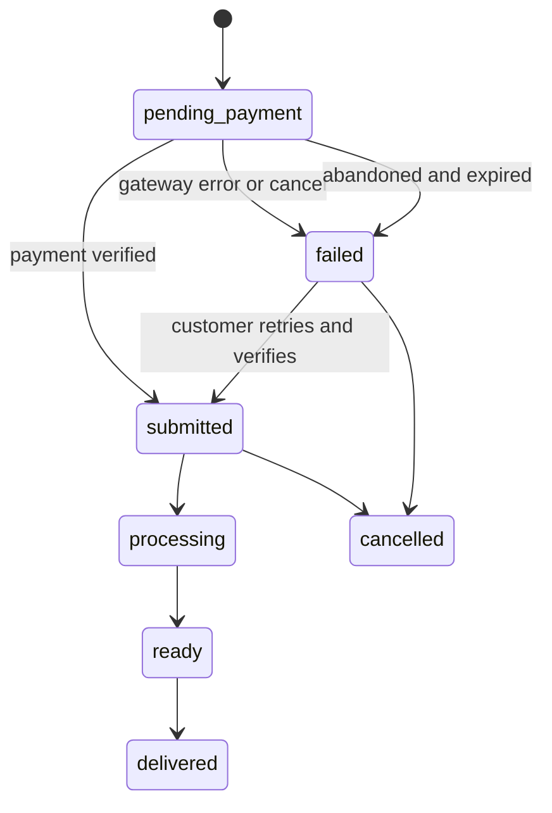

# Payment Failure & Order Status — Implemented Design

Status: **Implemented** (see migration `005_add_order_payment_status`).

Goal: any order whose payment does not complete successfully — in test mode or live
mode, whether the gateway is disabled/unconfigured or any error interrupts the
checkout — must end up in `failed` and must never enter the operator queue. Only
orders that are successfully paid enter the queue.

> This document originally described a plan. It has been rewritten to match the
> behaviour actually shipped in `src/server/routes.ts`, `src/server/cleanup.ts`,
> `src/types/index.ts` and `src/db/migrations/005_add_order_payment_status.ts`.

## Root Cause (historical)

- `POST /api/orders` used to insert the order with `status = 'submitted'` before any
  payment happened, so it was already in the queue when the gateway was called.
- On payment failure only the `payments` row was set to `failed`; the order row was
  never touched, so it stayed `submitted` in the operator queue.
- `OrderStatus` had no pre-payment or failed state.

## Status Model

- `pending_payment` (در انتظار پرداخت): initial status at order creation. Hidden
  from the operator queue. Retryable.
- `submitted` (ثبت‌شده در صف): reached only after a successful payment (online
  verify or wallet). Shown in the operator queue.
- `failed` (ناموفق): a payment attempt that did not complete. Hidden from the
  operator queue. Retryable from the customer order list.
- `processing`, `ready`, `delivered`, `cancelled`: unchanged.

> Note: the shipped retry path does **not** move a `failed` order back to
> `pending_payment`. `POST /api/payments/request` opens a new gateway transaction
> for an order whose status is one of `pending_payment`, `failed` or `submitted`
> (the last covers legacy unpaid rows), and the successful verify moves the order
> straight to `submitted`. A failed order therefore stays `failed` while the
> customer retries, which keeps it out of the queue until payment actually lands.

## Transition Rules (as implemented)

1. Order creation (`POST /api/orders`): `status = 'pending_payment'`,
   `paid_amount = 0`. A coupon, if any, is only *reserved* on the order row.
2. Online payment request fails (gateway disabled, not configured, network error,
   timeout): `markOrderFailed` sets the order to `failed` and writes an
   `order_logs` entry. The UPDATE is narrowed to
   `status IN ('pending_payment', 'failed')` so a concurrent successful payment can
   never be overwritten by a late failure callback.
3. Gateway callback returns a non-OK status: payment row `failed` and order
   `failed` (same guarded `markOrderFailed`).
4. Gateway verify fails: payment row `failed` and order `failed`.
5. Gateway verify succeeds: payment row `paid`, order becomes `submitted`
   (`paid_amount` set, coupon consumed once, idempotent vs. duplicate callbacks).
6. Wallet payment succeeds (`POST /api/orders/:id/pay-wallet`): order becomes
   `submitted`; wallet debited inside the same transaction.
7. Wallet pre-check / insufficient balance: order stays `pending_payment` so the
   customer can top up and retry.
8. Abandoned payment (no callback): the cleanup job runs every 6 hours and marks
   `pending_payment` orders older than **30 minutes** as `failed`, adds a log entry
   and closes their `pending` gateway transactions.
9. Retry: `POST /api/payments/request` accepts orders in `pending_payment`, `failed`
   or `submitted` (legacy unpaid); a successful verify moves the order to
   `submitted`.

## Affected Surfaces (as implemented)

Server:

- `src/types/index.ts` — `OrderStatus` union with `pending_payment` / `failed` and
  explanatory docs.
- `src/server/routes.ts` — order creation, `pay-wallet`, `payments/request`,
  `payments/verify`, status-patch titles, `markOrderFailed`, dashboard stats.
- `src/server/cleanup.ts` — `expireAbandonedPayments` (30-minute TTL) wired into
  `startFileRetentionJob`.

Client:

- `src/components/operator/OperatorDashboard.tsx` — excludes `pending_payment` and
  `failed` from the queue and maps the new statuses.
- `src/components/common/OrderStatusBadge.tsx`, `OrderTrackerModal.tsx` — labels.
- `src/components/customer/CustomerDashboard.tsx` — status filters including
  «در انتظار پرداخت» and «پرداخت ناموفق», plus the retry action.
- `src/App.tsx` — `handleRetryPayment` and post-error `syncWithBackend()` so the UI
  reflects the authoritative server state.
- `src/components/admin/AdminDashboard.tsx` — status breakdown including the new
  statuses.

Data:

- Migration `005_add_order_payment_status` reclassifies legacy unpaid `submitted`
  orders (`paid_amount = 0`) to `pending_payment` and adds the
  `idx_orders_status` index used by queue and dashboard queries.

## Verification Checklist

- New order ⇒ `pending_payment`, absent from the operator queue.
- Failed/cancelled gateway ⇒ order `failed`, absent from the queue, retryable.
- Insufficient wallet ⇒ order stays `pending_payment`; top up + retry works.
- Successful online/wallet payment ⇒ order `submitted` exactly once (no double
  charge/credit under concurrent callbacks).
- Abandoned order (> 30 min) ⇒ `failed` after the cleanup job runs.
- Dashboard revenue and top-services exclude `pending_payment` and `failed`.
