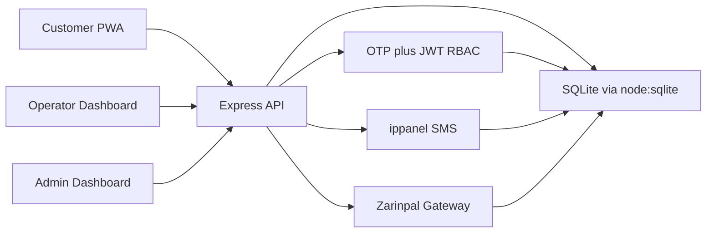

# Caffenet Production Readiness — Implemented State

Status: **Implemented**.

Goal: make the application fully production-ready and remove every part that existed
only for testing/demo.

> This document originally described a plan. It has been rewritten to record what
> was actually shipped and to fold in the features added after the plan was
> completed. For the user-facing documentation see the root `README.md`.

## Scope Confirmed With User

- Full production integration.
- Payment: real Zarinpal request + verification.
- SMS: real ippanel sender for OTP and notifications.
- Auth: server-side OTP issuance + verification, JWT/session auth, role-based
  middleware on all protected routes.

## Architecture (as built)

The server is modular: routers per domain in `src/server/routes.ts`, a service layer
for auth (`auth.ts`), SMS (`sms.ts`), payment (`payment.ts`), database-backed
settings (`settingsService.ts`), a boot-only config module (`config.ts`),
centralized middleware (`middleware.ts`) and scheduled cleanup (`cleanup.ts`). The
API is the single source of truth for money, roles and order status.

## Configuration Model

Only values required *before* the database can be opened stay in the environment
(`NODE_ENV`, `PORT`, `DATABASE_PATH`, `UPLOADS_DIR`, `MEDIA_DIR`). They are surfaced
read-only in the admin panel.

Everything else — `APP_URL`, `JWT_SECRET`, `JWT_EXPIRES_IN`, `ADMIN_PHONES`, all
`IPPANEL_*` and `ZARINPAL_*` credentials, the test/real mode switches and
`FILE_RETENTION_DAYS` — lives **only** in the `settings` table and is read straight
from the database on every access: there is no `.env` fallback and no in-process
cache. A compile-time default is used until a key is written, so a fresh deployment
still boots into a usable state.

The earlier idea of keeping provider credentials in `.env` was superseded by this
database-first model; `.env` is now boot-only.

## Key Decisions (as implemented)

- Auth token stored in an httpOnly, SameSite=Lax cookie; the role and permissions are
  read from the token, never trusted from the client.
- OTP codes stored hashed (HMAC-SHA256) with short expiry, attempt counters and rate
  limits per phone and per IP. The code is never returned by the API unless the
  panel-managed OTP/SMS test mode is deliberately enabled (which logs a warning).
- Payment amounts are always recomputed server-side from the order record;
  client-submitted amounts are never trusted.
- Wallet balance changes happen only in server transactions, with atomic guards
  against concurrent double-debit/double-credit.
- Secrets never enter client storage or `localStorage`; the admin UI only shows
  masked status and sending the mask keeps the stored value.
- Production startup serves the built `dist/` bundle and never boots the Vite dev
  middleware.
- The database uses Node's built-in `node:sqlite` in WAL mode: every write is
  durable on statement completion and the connection is closed cleanly on graceful
  shutdown (`SIGINT`/`SIGTERM`). (`saveDatabase`/`flushDatabase` are retained as
  no-ops for call-site compatibility.)

## Execution Checklist

1. [x] Config layer created; `.env.example` documents the boot-only variables.
2. [x] `server.ts` refactored into modular routers and services.
3. [x] Security middleware: helmet, rate limiting, Origin/CSRF guard, body limits,
   proxy trust, request logging.
4. [x] Server-side OTP tables and `send-otp`, `verify-otp`, `logout`, `me` endpoints.
5. [x] JWT auth and permission-based middleware plus per-route ownership checks
   (`requireAuth`, `requirePermission`, `canAccessOrder`).
6. [x] ippanel SMS service wired into OTP and notifications.
7. [x] Zarinpal payment service with request + idempotent verify endpoints and a
   `payments` table.
8. [x] Order financials recomputed server-side; transactional wallet payment
   endpoint added.
9. [x] Demo auto-login and demo data removed from `storageService.ts`; the API is
   authoritative.
10. [x] `AuthModal.tsx` rewritten to use the real API OTP with no bypass/demo blocks.
11. [x] `Navbar.tsx` role switcher removed; authenticated logout added.
12. [x] `PaymentModal.tsx` rewritten as a real gateway redirect + return flow.
13. [x] Demo seeding removed; versioned migrations and indexes added; admin
    bootstrapped via `npm run admin:set`.
14. [x] Secrets removed from client settings/localStorage; masked in API responses.
15. [x] SMS audit inbox gated behind `sms.view` / admin authentication.
16. [x] Client test hints, unused dependency, committed DB and `dev-dist` cleaned up;
    `.gitignore` updated.
17. [x] Build/run pipeline fixed for production with cross-platform scripts; PWA
    caching hardened.
18. [x] Uploads and delivery access hardened (ownership checks); file-retention
    cleanup job added.
19. [x] Atomic database persistence and graceful shutdown.
20. [x] Documentation (`README.md`, `metadata.json`) rewritten for real deployment.
21. [x] Lint/type-check and production build verified.

## Post-Completion Additions

The following were added after the initial production hardening and are documented
in the root `README.md`:

- **Payment-failure order lifecycle**: orders start in `pending_payment`, only enter
  the operator queue (`submitted`) after a verified payment, and become `failed` on
  any payment error/cancellation; abandoned orders expire after 30 minutes. See
  `plans/payment-failure-order-status-plan.md` and migration
  `005_add_order_payment_status`.
- **Fine-grained RBAC**: a shared permission model
  (`src/utils/permissions.ts`) with per-resource actions (`view`/`create`/`edit`/
  `delete`/`permissions`/`manage`), role defaults and per-user overrides; admins
  always hold every permission.
- **Landing slider management**: public `/media` assets plus admin upload, reorder
  and activate/deactivate endpoints.
- **Coupons**: expiry, min-order, max-amount and max-usage enforcement; usage is
  consumed only after a verified payment to avoid burning uses on abandoned carts.
- **Business settings** edited from the panel: urgency multipliers, courier cost,
  wallet top-up presets, wallet/coupon switches and retention window.
- **Scheduled cleanup job** (every 6 hours): file retention purge and abandoned
  `pending_payment` expiry.

## Ongoing Operational Notes

- Configure the Zarinpal callback (`paymentCallbackUrl` or the derived
  `${appUrl}/api/payments/verify`) in both the panel and the Zarinpal dashboard.
- Fill in the ippanel credentials and the OTP pattern (variable `code`).
- Set at least one admin phone (`npm run admin:set -- <phone>`); the server warns on
  startup when none is configured.
- When production runs behind a reverse proxy, ensure `X-Forwarded-*` headers are
  forwarded so rate limiting uses the real client IP (`trust proxy` is enabled).
