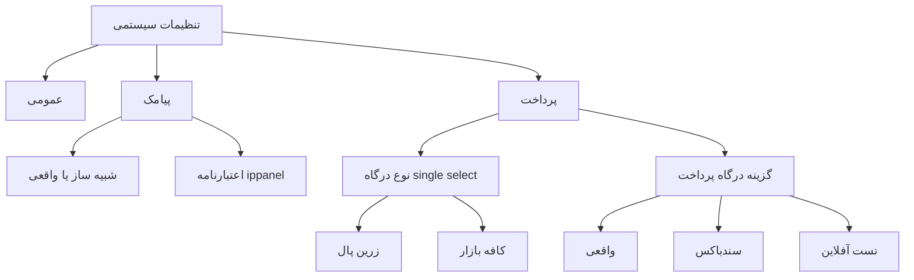

# Plan — System Settings UX overhaul (payments + SMS)

## Problem

The first pass grouped the payment keys but still exposed a per-gateway
`حالت درگاه` selector and left the raw enable/test booleans doing the work
underneath. Feedback from the owner:

- The model must be **two global choices**, not per-gateway environment selectors.
- These five raw options must never be user-facing:
  `paymentEnabled`, `paymentSandbox`, `bazaarEnabled`, `paymentTestMode`, `bazaarTestMode`.
- Auto-resolution rule: **تست آفلاین + زرین‌پال ⇒ خودکار سندباکس زرین‌پال**
  (`paymentSandbox=1`, `paymentTestMode=0`), i.e. the internal offline gateway is
  not surfaced.
- The **SMS** section gets the same treatment: a `شبیه‌ساز / واقعی` selector.
- The **کد تایید** test option folds into that same simulator switch.

## Target model

- **نوع درگاه** — single-select chips: `زرین‌پال` *یا* `کافه‌بازار` (فقط یک درگاه
  هم‌زمان فعال است؛ انتخاب درگاه دیگر، قبلی را غیرفعال می‌کند). فیلدهای اعتبارنامهٔ
  هر درگاه تنها وقتی نمایش داده می‌شوند که آن درگاه فعال **و** حالت «واقعی» باشد.
- **گزینه درگاه پرداخت** — ONE global segmented selector:
  `واقعی / سندباکس / تست آفلاین`, auto-deriving all five flags.
- **پیامک** — one `شبیه‌ساز / واقعی` segmented selector.

## Derivation matrix (hidden flags)

The panel never renders these raw toggles; the save handler derives them:

| گزینه درگاه پرداخت | `paymentSandbox` | `paymentTestMode` | `bazaarTestMode` |
|---|---|---|---|
| واقعی | 0 | 0 | 0 |
| سندباکس | 1 | 0 | 0 |
| تست آفلاین | 1 | 0 | 1 |

- `paymentEnabled` / `bazaarEnabled` come from the **نوع درگاه** chips — at most
  one is `1`; the other is always `0`.
- Zarinpal rows follow the feedback rule: تست آفلاین resolves to the Zarinpal
  sandbox, and `paymentTestMode` is **never** set to `1`.
- `سندباکس` maps to the Zarinpal sandbox; Cafe Bazaar has no sandbox so it stays
  real. `تست آفلاین` adds the Bazaar simulator on top.
- When the current choice is incompatible with the selected chips (e.g. `تست آفلاین`
  but only Zarinpal selected), the selector auto-corrects to the closest valid
  option and shows a hint.

## SMS mapping

| Control | Keys |
|---|---|
| Switch: سامانه پیامک فعال | `smsEnabled` |
| Segment: شبیه‌ساز / واقعی | `smsTestMode` = 1 / 0 |
| کلید دسترسی ippanel | `smsApiKey` |
| شماره فرستنده | `smsSender` |
| کد پترن کد تایید | `smsOtpPattern` |
| Advanced: آدرس پایه ippanel | `smsBaseUrl` |

- The standalone `حالت آزمایشی پیامک` switch and the whole `کد تایید` section are
  removed; one simulator control drives `smsTestMode`. `otpTestMode` is dropped
  entirely (redundant — the simulator already covers the OTP).
- `smsEnabled` is kept as the master on/off (it was not in the redundant list).
- The SMS credential fields are shown only when the system is enabled and the
  mode is «واقعی»; the simulator (and a disabled system) hides them (values are
  preserved because the inputs stay in the DOM).
- **Disabled SMS ⇒ nothing works:** `POST /api/auth/send-otp` returns 503 and no
  code is generated or surfaced (neither real nor simulator), and the login
  screen shows a warning using the public `smsEnabled` flag.

## Other sections

- **عمومی**: `appUrl` (hint: needed for the auto callback URL), `adminPhones`.
- **پرداخت → تنظیمات پیشرفته**: `paymentBaseUrl`, `paymentCallbackUrl`,
  `bazaarConsumeUrl`, `bazaarValidateUrl`, `bazaarTimeout`,
  `bazaarDealerPackageName`, `bazaarPermissionScope`, `bazaarRedirectUrl`.

## Files to change

1. `public/js/screens/admin-manage.js` — replace the per-gateway mode segments with
   one global `گزینه درگاه پرداخت` selector; rewrite the save derivation; replace
   the SMS switch with the simulator segment; drop the کد تایید section.
2. `public/css/app.css` — reuse the existing `.segmented`, `.adv-box`, `.status-line`
   styles (no new rules expected; adjust only if needed).
3. `docs/PROJECT_DOCUMENTATION.md` — refresh the mapping tables.

## Verification

- Every combination of chips × global mode produces the expected three booleans.
- The five raw flags never appear as controls; `paymentTestMode` is always `0` on save.
- The SMS simulator sets `smsTestMode`; `otpTestMode` has been removed as redundant.
- Secrets keep the mask protocol; advanced sections stay reachable; runtime stays read-only.
