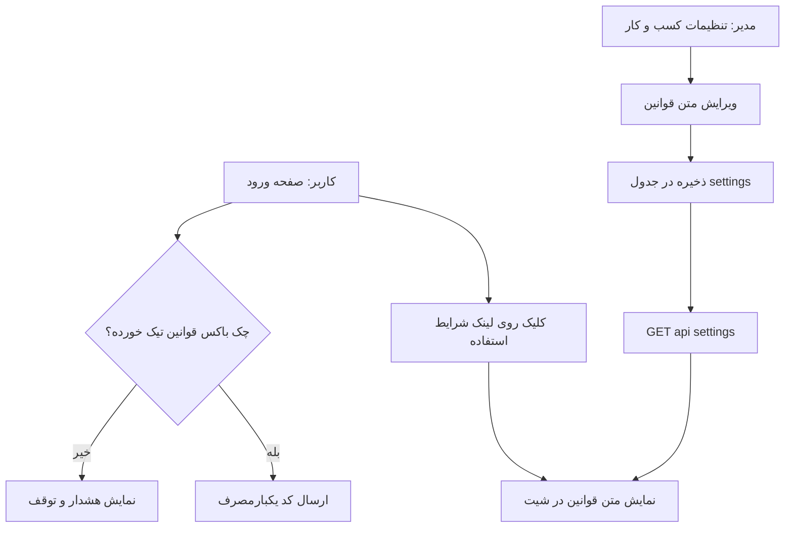

# طرح: افزودن صفحه قوانین و حریم خصوصی و دریافت رضایت کاربر

## هدف
افزودن یک صفحه «قوانین و حریم خصوصی» به برنامه، یک بخش ویرایش متن در پنل مدیریت، و یک چک‌باکس رضایت پیش از دریافت شماره موبایل (مطابق الزامات کافه‌بازار).

## تصمیم‌های تأییدشده
- محل ویرایش متن: بخش جدید «قوانین و حریم خصوصی» داخل «تنظیمات کسب‌وکار».
- ماندگاری رضایت: فلگ فنی در `localStorage` (بدون داده شخصی).

---

## ۱) مدل داده (بک‌اند)
افزودن یک کلید جدید به [`SettingsService::DEFS`](app/Services/SettingsService.php:41):

```php
['key' => 'termsText', 'category' => 'general', 'type' => 'string', 'scope' => self::SCOPE_BUSINESS,
    'label' => 'متن قوانین و حریم خصوصی', 'default' => <<<TEXT
...(متن فارسی پایین)...
TEXT],
```

نکات:
- `settings.value` از نوع `text` است ([migration](database/migrations/2026_01_01_000001_create_caffenet_schema.php:169))، پس متن چندخطی بلند مشکلی ندارد.
- چون `scope = business` است، به‌صورت خودکار توسط [`SettingsController::business()`](app/Http/Controllers/Api/SettingsController.php:16) در `GET /api/settings` برگردانده می‌شود و [`updateBusiness()`](app/Http/Controllers/Api/SettingsController.php:43) آن را ذخیره می‌کند. **نیازی به مسیر API جدید نیست.**
- [`SettingsService::raw()`](app/Services/SettingsService.php:248) در نبود ردیف دیتابیس، مقدار `default` را برمی‌گرداند؛ بنابراین متن پیش‌فرض همین‌طوری نمایش داده می‌شود و نیازی به migration جدید نیست (ذخیرهٔ مدیر با `updateOrInsert` انجام می‌شود).

## ۲) بخش مدیریت (Frontend)
در [`openBusinessSettings()`](public/js/screens/admin-manage.js:146):
- افزودن `section-title` «قوانین و حریم خصوصی» + `<textarea class="input textarea" id="s-terms" rows="10">` با مقدار `s.termsText`.
- افزودن `termsText` به payload مربوط به [`api.saveSettings()`](public/js/api.js:321).
- افزودن راهنمای کوتاه مبنی بر اینکه متن به‌صورت خام (بدون HTML) ذخیره می‌شود.

## ۳) صفحه قوانین (Frontend)
- ایجاد فایل جدید `public/js/screens/terms.js` شامل:
  - `Screens.termsContent()` → تولید HTML متن قوانین از `api.state.settings.termsText` (با `PU.escapeHtml` و تبدیل خطوط جدید به پاراگراف/`<br>`).
  - `Screens.termsPage(ctx)` → صفحه کامل با کارت متن + فوتر تماس که از تنظیمات (`coffeenetPhone`, `coffeenetAddress`) ساخته می‌شود.
  - `Screens.openTerms()` → باز کردن متن در یک `UI.sheet` (برای دسترسی از داخل مودال ورود و پروفایل).
- ثبت اسکریپت جدید در [`app.blade.php`](resources/views/app.blade.php:59) کنار سایر اسکرین‌ها.
- افزودن مسیر در [`App.render()`](public/js/app.js:208):
  `else if (scr === 'terms') html = window.Screens.termsPage(ctx);`
- مسیر `terms` برای مهمان‌ها آزاد است (در [`applyRoute()`](public/js/app.js:109) محدودیتی ندارد) و در `screenTitles()` عنوان «قوانین و حریم خصوصی» می‌گیرد.

## ۴) رضایت کاربر (Auth)
در [`Screens.openAuth()`](public/js/screens/auth.js:35) زیر فیلد شماره موبایل:
- افزودن یک ردیف چک‌باکس: `<input type="checkbox" id="auth-terms">` + متن «[شرایط استفاده از خدمات و حریم خصوصی] را می‌پذیرم» که بخش داخل کروشه یک لینک/دکمه است و [`Screens.openTerms()`](public/js/screens/terms.js:1) را فراخوانی می‌کند (بدون تغییر وضعیت چک‌باکس).
- در هندلر [`#auth-send`](public/js/screens/auth.js:68): اگر چک‌باکس تیک نخورده باشد، ارسال OTP متوقف و پیام هشدار نمایش داده می‌شود.
- پیش‌پرکردن چک‌باکس از `localStorage.getItem('caffenet_terms_accepted') === '1'`.
- با تیک‌زدن، مقدار `caffenet_terms_accepted = '1'` ذخیره می‌شود.
- این یک رضایت صریح و مستقیم است (تیک‌زدن کاربر) و هیچ اقدام غیرمستقیمی به‌عنوان رضایت تفسیر نمی‌شود.

## ۵) پروفایل
- اتصال ردیف موجود [`#profile-privacy`](public/js/screens/landing.js:281) در [`bind_profile()`](public/js/screens/landing.js:288) به `Screens.openTerms()` (اکنون بدون هندلر است).

## ۶) استایل
- `.textarea` از قبل در [`app.css`](public/css/app.css:205) تعریف شده است.
- افزودن یک کلاس کوچک (مثلاً `.legal-text`) برای خوانایی متن بلند (line-height، فاصله پاراگراف‌ها، امکان مشاهده تمام‌عرض در شیت).

## ۷) متن فارسی قوانین (مقدار پیش‌فرض)
متن زیر به‌عنوان `default` کلید `termsText` استفاده می‌شود و مدیر می‌تواند آن را ویرایش کند:

> **شرایط استفاده از خدمات و حریم خصوصی**
>
> **۱) پذیرش شرایط**
> با ثبت شماره همراه و ورود به سامانه «کافی‌نت احسان»، تأیید می‌کنید که این شرایط و سیاست حریم خصوصی را خوانده و پذیرفته‌اید. اگر با این شرایط موافق نیستید، لطفاً از سامانه استفاده نکنید.
>
> **۲) اطلاعاتی که از شما دریافت می‌کنیم**
> - شماره همراه: برای ثبت‌نام، ورود با کد یکبارمصرف و اطلاع‌رسانی وضعیت سفارش.
> - نام و نام خانوادگی: برای ثبت و پیگیری سفارش.
> - کد ملی و اطلاعات هویتی: تنها در خدماتی که به‌حکم قانون به آن نیاز است (مانند خدمات اداری، مالیاتی و دانشجویی).
> - فایل‌ها و مدارک ارسالی شما: برای انجام سفارش درخواستی.
> - اطلاعات سفارش و تراکنش‌ها: برای پردازش پرداخت، مدیریت کیف پول و پشتیبانی.
> - نشانی و اطلاعات تماس: در صورت نیاز به تحویل یا هماهنگی.
>
> **۳) علت و هدف از دریافت اطلاعات**
> از اطلاعات شما فقط برای اهداف زیر استفاده می‌شود و به موارد دیگر تعمیم داده نمی‌شود: ایجاد و مدیریت حساب کاربری، انجام سفارش و ارائه خدمات، پردازش پرداخت و کیف پول، اطلاع‌رسانی وضعیت سفارش از طریق پیامک، پشتیبانی و پاسخگویی، و رعایت الزامات قانونی.
>
> **۴) نحوه حفاظت از اطلاعات**
> - انتقال اطلاعات روی بستر امن و با رمزنگاری مدرن (HTTPS) انجام می‌شود.
> - دسترسی به اطلاعات تنها برای کاربران مجاز سامانه (مدیر و اپراتور) و بر اساس سطح دسترسی تعریف‌شده امکان‌پذیر است.
> - اطلاعات شخصی و حساس شما فروخته نمی‌شود و در اختیار اشخاص غیرمجاز قرار نمی‌گیرد.
>
> **۵) اشتراک‌گذاری با اشخاص ثالث**
> تنها در حد لازم و برای ارائهٔ همان خدمت، بخشی از اطلاعات با ارائه‌دهندگان زیر به اشتراک گذاشته می‌شود: درگاه پرداخت (برای انجام تراکنش مالی) و سامانه پیامک (برای ارسال کد ورود و اطلاعیه‌ها). این اشخاص فقط مجاز به استفاده از اطلاعات در چارچوب همان خدمت هستند.
>
> **۶) داده‌های ذخیره‌شده روی دستگاه شما**
> برنامه تنها یک نشانهٔ فنی برای یادآوری پذیرش این شرایط را در حافظهٔ محلی مرورگر نگه می‌دارد. هیچ دادهٔ شخصی یا حساسی در حافظهٔ محلی دستگاه ذخیره نمی‌شود.
>
> **۷) دسترسی‌های موردنیاز**
> - پیامک: تنها برای ارسال کد ورود یکبارمصرف.
> - دوربین/گالری: تنها زمانی که خودتان بخواهید فایلی برای سفارش بارگذاری کنید.
> - اعلان: برای اطلاع از وضعیت سفارش.
>
> **۸) حقوق شما**
> - مشاهده و اصلاح اطلاعات حساب کاربری.
> - درخواست حذف حساب و اطلاعات مرتبط.
> - لغو رضایت از دریافت پیامک‌های اطلاع‌رسانی (به‌جز پیامک‌های ضروری مانند کد ورود).
>
> **۹) نگهداری و حذف اطلاعات**
> اطلاعات شما تا زمانی که حساب کاربری فعال است نگهداری می‌شود. فایل‌های بارگذاری‌شدهٔ سفارش نیز پس از مدت تعیین‌شده در سیاست نگهداری سامانه حذف می‌شوند.
>
> **۱۰) تغییرات**
> ممکن است این متن به‌روزرسانی شود. نسخهٔ معتبر همان متنی است که در همین برنامه نمایش داده می‌شود.
>
> **۱۱) تماس با ما**
> برای هر پرسش دربارهٔ حریم خصوصی می‌توانید از اطلاعات تماس نمایش‌داده‌شده در پایین همین صفحه استفاده کنید.

اطلاعات تماس (تلفن و نشانی) به‌صورت پویا از تنظیمات کسب‌وکار در فوتر صفحه نمایش داده می‌شود (نه داخل متن قابل ویرایش).

---

## نمودار جریان


## چک‌لیست راستی‌آزمایی
- `GET /api/settings` کلید `termsText` و متن پیش‌فرض را برمی‌گرداند.
- ذخیره از پنل مدیریت و بازیابی مجدد متن، درست کار می‌کند.
- بدون تیک چک‌باکس، ارسال کد تایید انجام نمی‌شود؛ با تیک، انجام می‌شود.
- لینک زیر فیلد شماره موبایل، متن قوانین را باز می‌کند.
- مسیر `#/terms` برای مهمان هم قابل مشاهده است.
- ردیف «حریم خصوصی» در پروفایل، متن را باز می‌کند.
- متن به‌صورت امن (escape) رندر می‌شود و از XSS جلوگیری می‌گردد.
