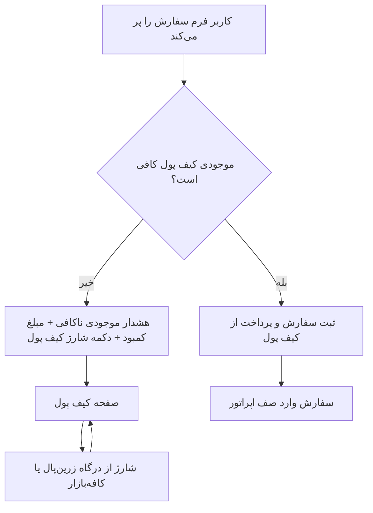

# پلن: پرداخت خدمات فقط از کیف پول، شارژ کیف پول از درگاه

## هدف

حذف پرداخت مستقیم خدمات از درگاه (زرین‌پال/کافه‌بازار) و انتقال همهٔ پرداخت‌ها به این مدل:

- **پرداخت خدمات/سفارش** فقط از **موجودی کیف پول** انجام می‌شود.
- هنگام پرداخت خدمات، موجودی کیف پول بررسی می‌شود؛ اگر کافی نبود یا صفر بود، به کاربر
  هشدار «موجودی کافی نیست» با نمایش **مبلغ کمبود** و دکمهٔ **«شارژ کیف پول»** داده می‌شود و
  **سفارش ثبت نمی‌شود**.
- **شارژ کیف پول** تنها جایی است که از **درگاه پرداخت** (کافه‌بازار درون‌برنامه‌ای یا
  زرین‌پال) استفاده می‌شود.

## تصمیم‌های تأییدشده

- هنگام موجودی ناکافی: **سفارش ثبت نشود**؛ همان لحظه هشدار + دکمهٔ شارژ؛ پس از شارژ، کاربر
  خودش دوباره سفارش را ثبت می‌کند.
- `enableWalletPayment` عملاً **همیشه فعال** در نظر گرفته می‌شود (کیف پول تنها راه پرداخت
  خدمات است) و از پنل حذف/پنهان می‌شود.

## جریان هدف

## تغییرات بک‌اند

1. [`app/Http/Controllers/Api/PaymentController.php`](../app/Http/Controllers/Api/PaymentController.php:30)
   - در `request` فقط `purpose === 'wallet'` پذیرفته شود؛ `purpose === 'order'` با خطای واضح
     (مثلاً «پرداخت سفارش فقط از کیف پول انجام می‌شود؛ ابتدا کیف پول را شارژ کنید.») رد شود.
   - شاخهٔ ساخت پرداخت سفارش (زرین‌پال) و پارامتر `$order` در `requestBazaar` حذف شود؛ Bazaar
     فقط برای شارژ کیف پول بماند.
   - importهای بی‌استفاده (`Order`, `OrderLog`) پاک‌سازی شود.
   - متد `verify` (کال‌بک زرین‌پال) فقط برای شارژ کیف پول معنا پیدا می‌کند؛ رفتار فعلی حفظ شود.

2. [`app/Http/Controllers/Api/OrderController.php`](../app/Http/Controllers/Api/OrderController.php:69) — `store`
   - پیش از ساخت سفارش، `payable = total_price − discount` محاسبه و با `wallet_balance` مقایسه
     شود؛ در صورت کمبود، **هیچ ردیفی ساخته نشود** و پاسخ ساخت‌یافته برگردد:
     `{ error, code: 'INSUFFICIENT_WALLET', required, balance, shortfall }`.
   - `payment_method` هنگام ساخت به `null` (یا `wallet`) تغییر کند، نه `online`.

3. [`app/Http/Controllers/Api/OrderController.php`](../app/Http/Controllers/Api/OrderController.php:169) — `payWithWallet`
   - گارد `enableWalletPayment` حذف شود.
   - در صورت کمبود موجودی، پاسخ ساخت‌یافتهٔ `INSUFFICIENT_WALLET` با `required/balance/shortfall`
     برگردد (سازگار با UI).
   - گارد اتمیک فعلی (lockForUpdate + unpaid guard) حفظ شود.

## تغییرات فرانت‌اند

4. [`public/js/screens/order-form.js`](../public/js/screens/order-form.js:79)
   - انتخاب روش پرداخت (online/bazaar/wallet) حذف و با کارت «پرداخت از کیف پول» (نمایش موجودی و
     مبلغ قابل پرداخت) جایگزین شود.
   - در submit: اگر `user.walletBalance < payable` → هشدار با مبلغ کمبود + دکمهٔ «شارژ کیف پول»
     (هدایت به صفحهٔ کیف پول) و **عدم ثبت سفارش**.
   - در غیر این صورت: `createOrder` سپس `payOrderWithWallet`؛ در صورت دریافت خطای ساخت‌یافتهٔ
     سرور (`INSUFFICIENT_WALLET`) همان هشدار/دکمه نمایش داده شود.

5. [`public/js/screens/order-tracker.js`](../public/js/screens/order-tracker.js:233)
   - دکمهٔ «پرداخت مجدد» فقط `payOrderWithWallet` را صدا بزند؛ شاخهٔ gateway/bazaar حذف شود.
   - در کمبود موجودی، هشدار + دکمهٔ «شارژ کیف پول» نمایش داده شود.

6. [`public/js/screens/wallet.js`](../public/js/screens/wallet.js:47)
   - شارژ از درگاه (کافه‌بازار درون‌برنامه‌ای یا زرین‌پال) حفظ شود.
   - پس از شارژ، موجودی به‌روز شود و پیام راهنما («اکنون می‌توانید سفارش خود را ثبت کنید»).

7. [`public/js/app.js`](../public/js/app.js:254) — `handlePaymentReturn`
   - پس از بازگشت از درگاه، `api.getCurrentUser()` نیز فراخوانی شود تا `walletBalance` تازه شود
     (`syncWithBackend` فعلی `/api/auth/me` را نمی‌خواند).

8. [`public/js/screens/admin-manage.js`](../public/js/screens/admin-manage.js:132)
   - چک‌باکس «پرداخت با کیف پول فعال باشد» حذف/پنهان شود (کیف پول اجباری است).

## هم‌راستایی SKU کافه‌بازار با شارژ کیف پول (ریسک کلیدی)

شارژ کیف پول هم **مبلغ متغیر** است و کافه‌بازار قیمت ثابت SKU را می‌گیرد. بنابراین:

- برای کافه‌بازار، مبالغ شارژ باید به **بسته‌های ثابت (نردبان SKU)** محدود شوند (مطابق
  `walletTopUpPresets`) و هر preset به یک SKU نگاشت شود؛ یا
- برای مبلغ دلخواه، از **زرین‌پال** استفاده شود.

## تست‌ها و مستندات

- تست‌های feature به‌روزرسانی/افزوده شوند: رد شدن `purpose=order`، عدم ساخت سفارش در کمبود
  موجودی، پرداخت موفق از کیف پول، و ساختار خطای `INSUFFICIENT_WALLET`.
- [`docs/PROJECT_DOCUMENTATION.md`](../docs/PROJECT_DOCUMENTATION.md:1): جدول API، بخش‌های پرداخت/کیف
  پول و تنظیمات پنل به‌روزرسانی شود.
- [`docs/BAZAAR_IAP_LIBRARY.md`](../docs/BAZAAR_IAP_LIBRARY.md:1) و
  [`packages/caffenet/bazaar-iap/README.md`](../packages/caffenet/bazaar-iap/README.md:1): کافه‌بازار
  فقط برای شارژ کیف پول؛ اصلاح بخش‌های ۷ و ۱۴.

## تأیید نهایی

- اجرای تست‌ها و بررسی دستی سرتاسری: موجودی ناکافی → شارژ → ثبت سفارش → پرداخت از کیف پول.
