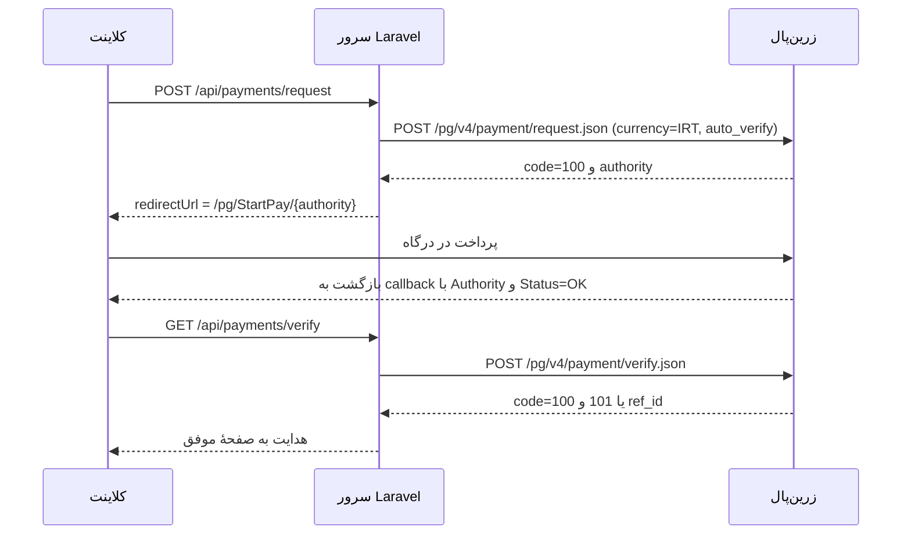

# اصلاح درگاه پرداخت زرین‌پال (Zarinpal v4) — واقعی و سندباکس

مرجع: [`zarinpal-payment-gateway-docs.md`](zarinpal-payment-gateway-docs.md:1)

## خلاصهٔ وضعیت فعلی

پیاده‌سازی در [`app/Services/PaymentService.php`](app/Services/PaymentService.php:20) و
[`app/Http/Controllers/Api/PaymentController.php`](app/Http/Controllers/Api/PaymentController.php:30) است.
حالت‌ها در [`SettingsService::paymentSettings()`](app/Services/SettingsService.php:371) ساخته می‌شوند و از پنل
[`admin-manage.js`](public/js/screens/admin-manage.js:281) به‌صورت «واقعی / سندباکس / تست آفلاین» کنترل می‌شنوند.

## نقص‌های شناسایی‌شده نسبت به مستندات

| # | مورد | محل | مشکل |
|---|------|-----|------|
| 1 | آدرس StartPay | `PaymentService.php:62` | `/pg` جا افتاده؛ باید `baseUrl./pg/StartPay/`. |
| 2 | واحد پولی | `PaymentService.php:47` | پارامتر `currency` ارسال نمی‌شود؛ مبالغ تومان هستند اما زرین‌پال ریال فرض می‌کند. |
| 3 | مرچنت سندباکس | `PaymentService.php:42` | مرچنت خالی در سندباکس رد می‌شود؛ UUID موقت هم بین request و verify پایدار نیست. |
| 4 | پارس پاسخ | `PaymentService.php:58,68` | وابستگی به `successful()` و `errors.message`؛ پوشش ندادن `errors` آرایه‌ای و کد خطا. |
| 5 | متادیتا | `PaymentService.php:52` | `auto_verify` و `order_id` ارسال نمی‌شوند. |
| 6 | callback مطلق | `SettingsService.php:382` | بازگشت نسبی در حالت واقعی/سندباکس باعث خطای ‎-14‎ می‌شود. |

## برنامهٔ اصلاح

### ۱. آدرس StartPay
- در [`PaymentService::requestPayment()`](app/Services/PaymentService.php:62) آدرس را به
  `$cfg['baseUrl'].'/pg/StartPay/'.$authority` تغییر بده (هم واقعی هم سندباکس).

### ۲. واحد پولی (currency)
- افزودن کلید سیستمی `paymentCurrency` (مقادیر `IRT`/`IRR`، پیش‌فرض `IRT`) در
  [`SettingsService::DEFS`](app/Services/SettingsService.php:153) و بازگرداندن آن در
  [`paymentSettings()`](app/Services/SettingsService.php:371).
- ارسال `'currency' => $cfg['currency']` در بدنهٔ `request.json`.
- افزودن انتخاب واحد پولی در جعبهٔ پیشرفتهٔ زرین‌پال در [`admin-manage.js`](public/js/screens/admin-manage.js:286).

### ۳. مرچنت‌آیدی پایدار (سندباکس)
- تابع کمکی `resolveMerchantId()`:
  - حالت واقعی: `paymentMerchantId` الزامی؛ در غیر این صورت خطای واضح فارسی.
  - حالت سندباکس: اگر `paymentMerchantId` خالی بود، یک UUID تولید و در کلید جدید
    `paymentSandboxMerchantId` ذخیره شود و در **هم request و هم verify** استفاده شود.

### ۴. مقاوم‌سازی فراخوانی HTTP و پارس پاسخ
- استفادهٔ صریح از `Http::asJson()->acceptJson()->withTimeout(...)`.
- تصمیم‌گیری بر اساس `data.code` (۱۰۰ برای request، ۱۰۰/۱۰۱ برای verify) مستقل از HTTP status.
- استخراج خطای مقاوم (هم `errors` آبجکت، هم آرایه) و افزودن کد خطا به پیام فارسی.
- ثبت (`Log::warning`) بدنهٔ پاسخ ناموفق برای عیب‌یابی.

### ۵. متادیتا
- افزودن کلید سیستمی `paymentAutoVerify` (پیش‌فرض فعال) و ارسال `metadata.auto_verify`.
- افزودن `metadata.order_id` (شناسهٔ پرداخت/سفارش) در [`PaymentService::requestPayment()`](app/Services/PaymentService.php:31)
  با افزودن پارامتر ورودی.

### ۶. محافظت callback مطلق
- در [`SettingsService::paymentSettings()`](app/Services/SettingsService.php:377) حالت واقعی/سندباکس را ملزم به
  callback مطلق کن؛ در نبود `appUrl`/`paymentCallbackUrl` خطای واضح به کاربر و هشدار در پنل.

### ۷. تست‌ها
- افزودن تست‌های `Http::fake` برای:
  - واقعی: URL صحیح `/pg/v4/payment/request.json` و `redirectUrl` شامل `/pg/StartPay/`.
  - سندباکس: پایهٔ `sandbox.zarinpal.com` و ارسال UUID.
  - ارسال `currency=IRT` و `metadata.auto_verify`.
  - verify با کدهای ۱۰۰ و ۱۰۱ (idempotent) و مدیریت خطا.
- حفظ رفتار فعلی `TEST-` (در [`WalletOnlyPaymentsTest.php`](tests/Feature/WalletOnlyPaymentsTest.php:76)).

### ۸. مستندات
- به‌روزرسانی بخش سرویس زرین‌پال در [`docs/PROJECT_DOCUMENTATION.md`](docs/PROJECT_DOCUMENTATION.md:552) با
  جزئیات currency، سندباکس، auto_verify و مرچنت سندباکس.

## جریان پرداخت پس از اصلاح

